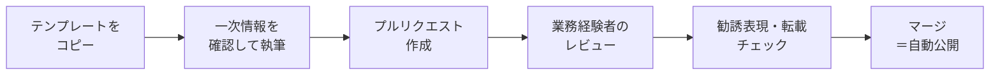

# 執筆ガイド

## 記事を書く流れ

1. `templates/article-template.md` をコピーし、`docs/` 配下の該当フォルダに置きます。
2. `mkdocs.yml` の `nav` に記事を追加します（準備中ページを置き換える場合は不要）。
3. ローカルで表示を確認します：`mkdocs serve`
4. プルリクエストを作成し、レビューを受けます。
5. `main` ブランチにマージされると GitHub Actions が自動でビルド・公開します。

## 書き方の原則

- **入門者が主役**：専門用語は初出で説明するか[用語集](../glossary.md)にリンクする。
- **結論から**：冒頭の「3行でいうと」で要点を示す。
- **「なぜ」を書く**：ルールや手順の背景・目的を説明する。
- **図を使う**：流れのある話は Mermaid でフロー図にする。
- **断定は出典とセット**：数値・期限・制度は必ず出典を付ける。

## 書いてはいけないこと

!!! danger "禁止事項"
    - 個別銘柄・個別商品の推奨、売買を促す表現（「今が買い時」など）
    - 協会規則・取引所資料・書籍の文章の転載
    - 社内固有の情報（手順書、システム名、顧客・取引の事例）
    - 根拠のない断定、出典のない数値

## レビュー観点

| 観点 | 確認内容 |
|---|---|
| 正確性 | 一次情報と一致しているか、`last_reviewed` は更新されたか |
| わかりやすさ | 他部署の人が読んで理解できるか |
| 法令・規制 | 勧誘・助言と受け取られる表現がないか |
| 権利 | 転載・無断利用の図表がないか |
