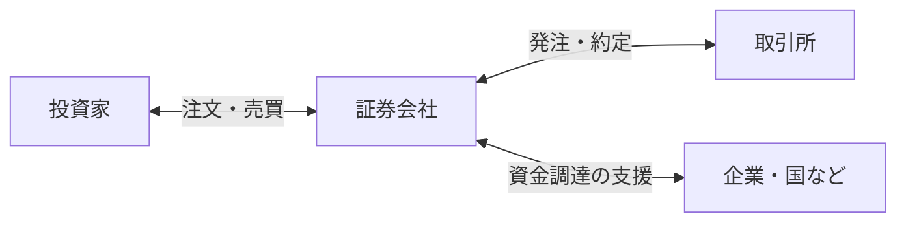
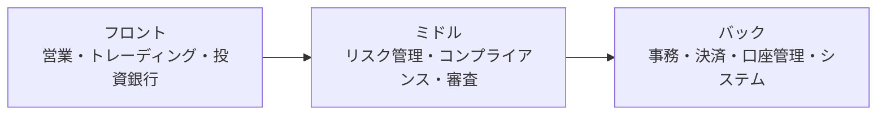

# 証券会社って何をしているの？

!!! abstract "3行でいうと"
    - 証券会社は、株式や債券などの**売買を仲立ち**し、企業の**資金調達を手伝う**会社です。
    - 基本となる業務は「**ブローカー・ディーラー・アンダーライター・セリング**」の4つです。
    - 社内では、お客さまに接する**フロント**、リスクや法令を管理する**ミドル**、事務・決済を担う**バック**が分担して支えています。

## なぜ証券会社が必要なの？

株式や債券は、お金を**集めたい企業・国**と、お金を**運用したい投資家**をつなぐ道具です。
しかし、投資家が取引所で直接売買することはできません。取引所で売買できるのは、取引資格を持つ証券会社（取引参加者）だけです。

そこで証券会社が、投資家と市場、投資家と企業の**間に立つ**役割を担っています。

## 4つの基本業務

証券会社の業務は、金融商品取引法第2条第8項に「金融商品取引業」として列挙されており、株式などの売買を扱う業務は第28条で「第一種金融商品取引業」と区分されています。代表的なのは次の4つです。

| 業務 | 呼び方 | ひとことで | 例 | 金商法の根拠 |
|---|---|---|---|---|
| 委託売買業務 | ブローカー業務 | お客さまの注文を市場に取り次ぐ | 投資家の「A社株を100株買いたい」を取引所に発注する | 第2条第8項第2号・第3号（売買の取次ぎなど） |
| 自己売買業務 | ディーラー業務（ディーリング業務） | 自社のお金で売買する | 自社の判断で債券を売買する | 第2条第8項第1号（有価証券の売買） |
| 引受業務 | アンダーライター業務 | 企業が新しく発行する株式・債券をいったん引き受ける | 新規上場（IPO）の株式を引き受け、投資家に販売する | 第2条第8項第6号（有価証券の引受け） |
| 募集・売出しの取扱い | セリング業務 | 発行される証券の販売を手伝う | 投資信託を販売する | 第2条第8項第9号（募集・売出しの取扱い） |

!!! tip "ブローカーとディーラーの違い"
    ブローカーは**お客さまのため**に売買を取り次ぎ、手数料を得ます。ディーラーは**自社のため**に売買し、売買益を狙います。同じ「売買」でも立場がまったく違います。

## 社内の役割分担：フロント・ミドル・バック

| 部門 | 主な仕事 | 他部署から見たポイント |
|---|---|---|
| **フロント** | お客さまへの提案・注文受付、市場での売買、企業の資金調達支援 | 収益を生む部門。ルールの範囲内で動く |
| **ミドル** | 取引のリスク管理、法令・規則の遵守状況のチェック、口座開設の審査 | フロントの「ブレーキ役」。独立性が求められる |
| **バック** | 約定内容の照合、清算・決済、顧客資産の管理、報告書の作成 | 取引を**確実に完了させる**部門。ミスが顧客資産に直結する |

## よくある誤解

!!! warning "誤解：証券会社は株価を決めている"
    株価は、取引所に集まった多数の売り注文と買い注文の需給で決まります。証券会社は注文を取り次ぐ立場です。→ [株価はどう決まる？](../market/price-formation.md)

!!! warning "誤解：証券会社が倒産したら預けた株は戻らない"
    証券会社には、お客さまの資産を自社の資産と分けて管理する「分別管理」が義務付けられています。→ [顧客資産の保護](../flow/asset-protection.md)

## もっと知りたい人へ

- [e-Gov法令検索「金融商品取引法」](https://laws.e-gov.go.jp/law/323AC0000000025)：第2条第8項（金融商品取引業の定義）、第28条（第一種金融商品取引業）
- [日本証券業協会「証券会社の仕事って？」](https://www.jsda.or.jp/start/pr/syoken/job.html)：ブローカー・ディーリング・引受などの仕事を図解で紹介

## 関連記事・用語

- [学習ロードマップ](../guide/roadmap.md)
- [証券取引の流れ](../flow/index.md)
- [用語集](../glossary.md)
