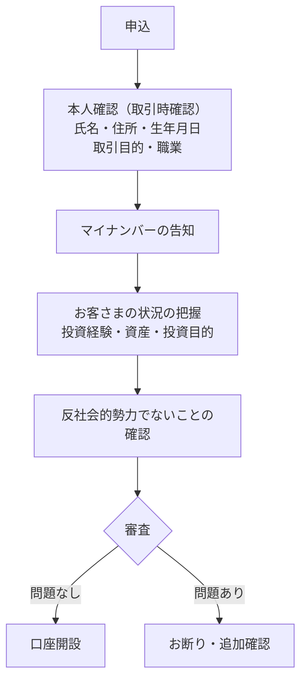

# 口座開設：本人確認と適合性の原則

!!! abstract "3行でいうと"
    - 口座開設では、**本人確認**（犯収法）、**お客さまの状況の把握**（適合性の原則）、**マイナンバーの告知**（税法）などを確認します。
    - 目的は、**マネー・ローンダリングを防ぐ**こと、そしてお客さまに**合わない商品を勧めない**ことです。
    - 「手続きが多い」と感じられやすいですが、それぞれに法令上の理由があります。

## なぜこんなに確認が必要なの？

証券口座は、大きなお金を動かせる「入口」です。入口でしっかり確認しないと、次のような問題が起きます。

- 犯罪で得たお金が、証券取引を通じて出どころの分からないお金に変えられてしまう（**マネー・ローンダリング**）
- 投資経験や資産に見合わない、リスクの高い商品を勧めてしまい、お客さまに大きな損失を与える
- 税金の計算・報告が正しく行えない

## しくみ：口座開設で確認すること

| 確認項目 | 主な根拠 | 目的 |
|---|---|---|
| 本人確認（取引時確認） | 犯罪収益移転防止法 | なりすまし・マネー・ローンダリングの防止 |
| マイナンバーの告知 | 税法（2016年1月1日以降に口座を開設する場合は開設時に提供） | 税務署へ正しく報告するため |
| 投資経験・資産・投資目的 | 金融商品取引法（適合性の原則）、日本証券業協会の規則 | お客さまに合った勧誘をするため |
| 反社会的勢力でないことの確認 | 業界の自主規制、各社の約款 | 反社会的勢力との取引の遮断 |

### 本人確認（取引時確認）

犯罪収益移転防止法第4条では、証券会社（金融商品取引業者）などの「特定事業者」に対して、口座開設などの取引の際に次の事項を確認することを求めています。

- **本人特定事項**：個人の場合は氏名・住居・生年月日
- **取引を行う目的**
- **職業**（法人の場合は事業の内容）
- 法人の場合は、事業経営を実質的に支配する人（**実質的支配者**）

運転免許証やマイナンバーカードなどの本人確認書類を使います。

### マイナンバーの告知

2016年1月1日以降に証券会社と取引を始める人は、口座開設時にマイナンバーを証券会社に提供する必要があります。証券会社は、配当や売却代金の支払いなどについて税務署に提出する書類（法定調書）にマイナンバーを記載するためです。[^jsda-mynumber]

[^jsda-mynumber]: [日本証券業協会「マイナンバーについて」](https://www.jsda.or.jp/anshin/mynumber/)

### 適合性の原則

金融商品取引法第40条第1号は、顧客の**知識・経験・財産の状況・金融商品取引契約を締結する目的**に照らして不適当な勧誘をしてはならない、と定めています（適合性の原則）。

そのため証券会社は、口座開設の時点でお客さまの投資経験や資産の状況、投資の目的などを把握し、記録しておきます。

## よくある誤解

!!! warning "誤解：本人確認は不正防止のための証券会社独自のルール"
    本人確認（取引時確認）は、犯罪収益移転防止法に基づく**法律上の義務**です。

!!! warning "誤解：資産や年収を聞かれるのは営業のため"
    投資経験や資産の状況を把握するのは、**お客さまに合わない商品を勧めない**ための仕組み（適合性の原則）です。

## もっと知りたい人へ

- [e-Gov法令検索「犯罪による収益の移転防止に関する法律」](https://laws.e-gov.go.jp/law/419AC0000000022)：第4条（取引時確認等）
- [e-Gov法令検索「金融商品取引法」](https://laws.e-gov.go.jp/law/323AC0000000025)：第40条（適合性の原則等）
- [日本証券業協会「定款・諸規則」](https://www.jsda.or.jp/about/kisoku/)：「協会員の投資勧誘、顧客管理等に関する規則」（顧客カードの整備など、顧客情報の把握に関するルール）
- [日本証券業協会「マイナンバーについて」](https://www.jsda.or.jp/anshin/mynumber/)：証券口座とマイナンバーの関係

## 関連記事・用語

- [適合性原則と説明義務](../rules/suitability.md)
- [マネロン対策（犯収法）](../rules/aml.md)
- [特定口座と一般口座](../tax/specified-account.md)
- [用語集](../glossary.md)
