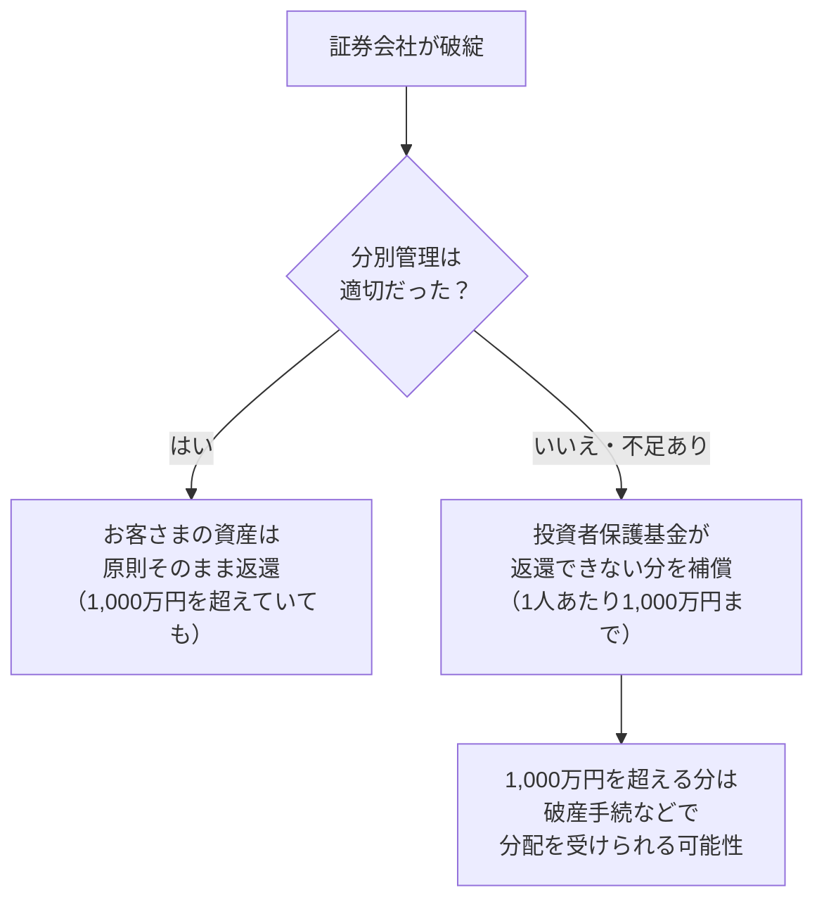

# 顧客資産の保護：分別管理と投資者保護基金

!!! abstract "3行でいうと"
    - 証券会社は、お客さまから預かったお金や株式などを、**自社の財産と分けて管理**することが法律で義務付けられています（**分別管理**）。
    - 分別管理がきちんと行われていれば、証券会社が破綻しても、お客さまの資産は**原則として全額返還**されます。
    - 万一、分別管理の不備などで返還できない場合に備えて、**投資者保護基金**がお客さま1人あたり**1,000万円まで**を補償します。

## なぜ必要なの？

お客さまが証券会社で株式や投資信託を買うと、その株式やお金は証券会社の口座に預けられた状態になります。もし証券会社がそれを自社のお金と混ぜて管理していたら、証券会社が経営破綻したときに、お客さまの資産まで会社の借金の返済に使われてしまうおそれがあります。

そこで、次の**2段構え**でお客さまの資産を守る仕組みが作られています。[^jipf-about]

1. **分別管理**：そもそも、お客さまの資産を証券会社の財産と混ぜない
2. **投資者保護基金**：それでも返還できない分が出たときのセーフティネット

[^jipf-about]: [日本投資者保護基金「基金について」](https://jipf.or.jp/about/index.html)

## しくみ

### 分別管理とは

金融商品取引法第43条の2は、証券会社（金融商品取引業者等）に対し、お客さまの資産を**自己の固有財産と分別して管理**することを義務付けています。

| 預かり資産 | 分別管理の方法（概要） | 根拠 |
|---|---|---|
| 株式・債券などの有価証券 | 内閣府令で定める方法により、証券会社自身の有価証券と分けて管理 | 金融商品取引法第43条の2第1項 |
| お金（預り金など） | お客さまに返還すべき額に相当するお金を、国内の信託銀行などに**信託**する（顧客分別金信託） | 同条第2項 |
| 管理の状況 | 定期的に公認会計士または監査法人の**監査**を受ける | 同条第3項 |

お金を信託銀行などに信託しておけば、証券会社が破綻しても、そのお金は証券会社の財産とは別のものとして守られます。

!!! quote "金融商品取引法 第43条の2第2項（抜粋）"
    金融商品取引業者等は、次に掲げる金銭又は有価証券について、当該金融商品取引業者等が金融商品取引業（登録金融機関業務を含む。以下この項において同じ。）を廃止した場合その他金融商品取引業を行わないこととなつた場合に顧客に返還すべき額として内閣府令で定めるところにより算定したものに相当する金銭を、自己の固有財産と分別して管理し、（中略）国内において、信託会社等に信託をしなければならない。

### 証券会社が破綻したらどうなるか

分別管理が厳格に行われていれば、証券会社が破綻しても、お客さまの資産には基本的に影響がなく、お客さまは自分のお金や有価証券の返還を求めることができます。預けている資産が1,000万円を超えていても、分別管理がきちんと行われていれば返還されます。[^jipf-qa]

問題になるのは、分別管理に不備があったり、決済などの手続きが終わらないうちに破綻したりして、資産の一部が返還できなくなった場合です。このとき登場するのが**投資者保護基金**です。[^jipf-qa]

[^jipf-qa]: [日本投資者保護基金「Q&A」](https://jipf.or.jp/qa/index.html)

### 投資者保護基金の補償の範囲

日本投資者保護基金は、金融商品取引法に基づいて1998年12月1日に設立された法人です。国内で株式などを扱う証券会社は、店舗型・インターネット専業を問わず、投資者保護基金への加入が法律で義務付けられています。[^jipf-about][^jipf-qa]

| 項目 | 内容 |
|---|---|
| 補償が行われる場面 | 会員の証券会社が破綻などで、分別管理の義務違反によりお客さまの資産を返還できない（または返還できない可能性が高い）と基金が認定したとき |
| 補償の上限 | お客さま**1人あたり1,000万円**（証券会社ごと） |
| 補償の方法 | **お金**で支払う（有価証券は、基金が公告した日の最終価格などで評価） |
| 差し引かれるもの | お客さまが証券会社に負っている債務（買付代金の立替えなど）。資産を担保に差し入れている場合も、その分が考慮される |

補償の上限1,000万円は、法律（金融商品取引法第79条の57第3項）が「政令で定める金額」とし、金融商品取引法施行令第18条の12が**千万円**と定めています。

複数の証券会社が破綻した場合は、**破綻した証券会社ごと**に1人あたり1,000万円が上限になります。[^jipf-qa]

**補償の対象となる主な取引**は次のとおりです。[^jipf-qa]

- 株式・公社債・投資信託の取引（海外で発行されたものを含む）
- 株式の信用取引の保証金（委託保証金・代用有価証券）
- 国内の取引所での先物・オプション取引などの証拠金

### 補償の対象にならないもの

投資者保護基金は「**預けた資産が返ってこない**」ことに対する補償です。そのため、次のようなものは補償の対象になりません。[^jipf-about][^jipf-qa]

| 対象外のもの | 理由・例 |
|---|---|
| 相場の値下がりによる損失 | 補償されるのは時価相当額で、買ったときとの差額（評価損）は補償されない |
| 発行体の破綻による損失 | 債券の発行会社が破綻して利息や償還金が払われない場合など |
| 説明義務違反などによる損害 | 分別管理とは関係のない損害のため |
| 一部の取引 | 店頭デリバティブ取引（CFDなど）、海外取引所のデリバティブ取引、FX（外国為替証拠金取引）、取引所の通貨関連取引、第二種金融商品取引業の商品（信託受益権・組合契約など）の取引 |
| 一部のお客さま | 適格機関投資家や国・地方公共団体などの「プロの投資家」、他人名義（仮名・借名）での取引、破綻した証券会社の役員など |
| 破綻した証券会社自身が発行した株式・社債 | 補償対象の取引であっても除外 |

法律上、補償を受けられるのは「**一般顧客**」で、適格機関投資家や国・地方公共団体など政令で定める者は除かれています（金融商品取引法第79条の20第1項）。

## よくある誤解

!!! warning "誤解：証券会社が破綻すると、預けた資産は1,000万円までしか戻らない"
    分別管理が適切に行われていれば、1,000万円を超える資産も**原則として全額返還**されます。1,000万円の上限は、分別管理の不備などで**返還できなかった分**を基金が補償するときの上限です。

!!! warning "誤解：投資者保護基金は、投資で損をしたときに補償してくれる"
    値下がりや発行体の破綻による損失は補償されません。基金が補償するのは、証券会社の破綻で**預けた資産が返ってこない場合**に限られます。

!!! warning "誤解：銀行で買った投資信託も投資者保護基金で補償される"
    銀行などは投資者保護基金の会員ではないため、銀行などで買った投資信託は基金の補償対象になりません。ただし、銀行なども分別管理は義務付けられています。[^jipf-qa]

## もっと知りたい人へ

- [e-Gov法令検索「金融商品取引法」](https://laws.e-gov.go.jp/law/323AC0000000025)：第43条の2（分別管理）、第79条の20以下（投資者保護基金）
- [e-Gov法令検索「金融商品取引法施行令」](https://laws.e-gov.go.jp/law/340CO0000000321)：第18条の12（支払の最高限度額）
- [日本投資者保護基金「基金について」](https://jipf.or.jp/about/index.html)：補償範囲、補償手続の流れ、過去の補償実績
- [日本投資者保護基金「Q&A」](https://jipf.or.jp/qa/index.html)：補償対象・対象外の取引や補償額の計算方法

## 関連記事・用語

- [清算と決済の仕組み：JSCCとほふり](clearing.md)
- [金融商品取引法のポイント](../rules/fiea.md)
- [信用取引](../products/margin-trading.md)
- [用語集](../glossary.md)（分別管理・投資者保護基金・適格機関投資家）
