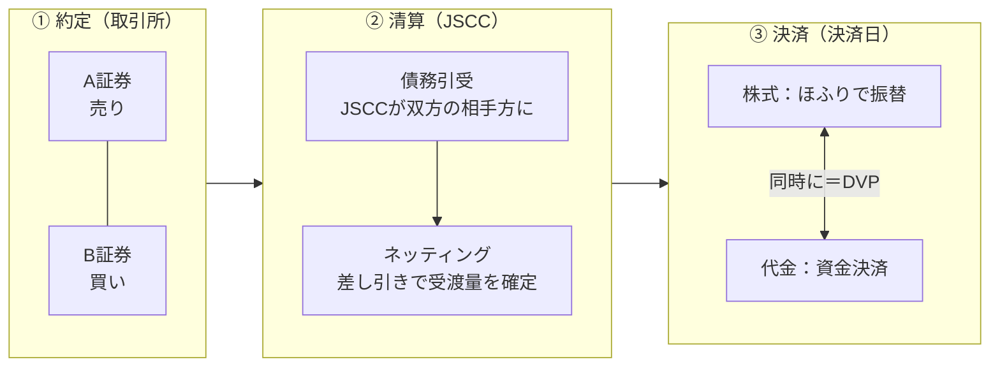
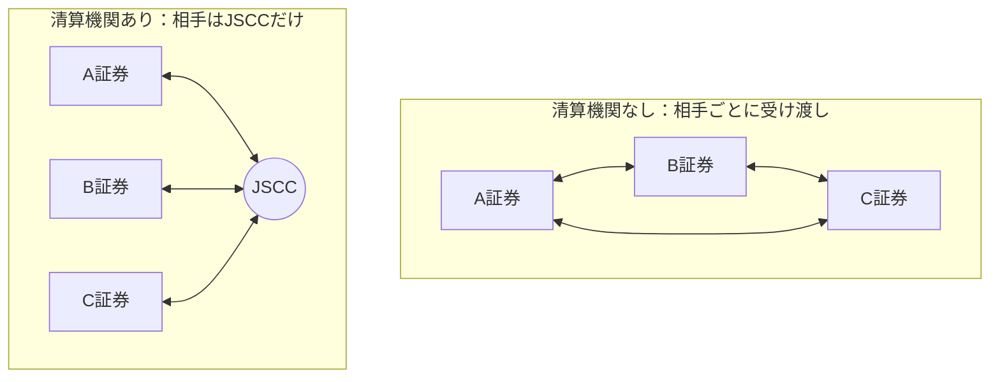
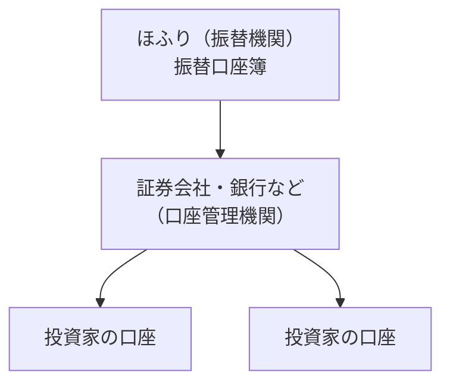

# 清算と決済の仕組み：JSCCとほふり

!!! abstract "3行でいうと"
    - 取引所で売買が成立すると、**JSCC（日本証券クリアリング機構）**が売り手・買い手の間に入り、双方の「相手方」になって決済を保証します。これを**清算**といいます。
    - JSCCは、各証券会社の売りと買いを差し引き（**ネッティング**）して、実際に受け渡す株数・金額を小さくまとめます。
    - 株式の受け渡しは、**ほふり（証券保管振替機構）**と証券会社の口座の記録を書き換える**振替**で行われ、代金の支払いと同時に行う**DVP決済**で取りはぐれを防ぎます。

## なぜ必要なの？

取引所では、たくさんの証券会社がたくさんの相手と売買をしています。もし売買の相手どうしで1件ずつ株と代金をやり取りするとしたら、次のような問題が起きます。

- **相手が倒れるリスク**：株を渡したのに、相手の証券会社が破綻して代金が払われない（取りはぐれ）かもしれません。取引のたびに相手の信用力を気にしなければならなくなります。
- **事務の負担**：取引相手の数だけ受け渡しの手続きが発生し、膨大な事務量になります。

そこで、信用力の高い専門の機関が**すべての取引の間に入り**、受け渡しを一つにまとめて保証する仕組みが作られました。これが**清算機関**です。[^jscc-about]

[^jscc-about]: [日本証券クリアリング機構「JSCCとは」](https://www.jpx.co.jp/jscc/kaisya/jscc.html)

## しくみ

| 段階 | 主な担い手 | やること |
|---|---|---|
| 約定 | 取引所 | 売り注文と買い注文を突き合わせて売買を成立させる |
| 清算 | JSCC | 債務引受とネッティングで、誰が何をいくら受け渡すかを確定する |
| 決済（受渡） | ほふり・資金決済の仕組み | 株式の口座記録を書き換え、同時に代金を支払う |

### 清算とは何か（ネッティング）

**ネッティング**とは、同じ相手との間の「渡す分」と「受け取る分」を差し引きして、**差額だけ**を受け渡すことです。[^jscc-netting]

例えば、ある証券会社が1日のうちに同じ銘柄を1,000株買い、別の取引で800株売ったとします。1件ずつ受け渡すと合計1,800株が動きますが、差し引きすれば「200株を受け取る」だけで済みます。代金も同じように差し引きされます。

清算機関を使わない場合、差し引きできるのは「同じ相手どうしの取引」に限られます。清算機関が入ると、すべての証券会社の決済の相手が**清算機関ひとつ**にまとまるため、差し引きできる範囲が広がり、受け渡す量を大きく減らせます。[^jscc-netting]

[^jscc-netting]: [日本証券クリアリング機構「ネッティング」](https://www.jpx.co.jp/jscc/seisan/genbutsu/acceptance_debt/netting.html)

### 清算機関JSCCの役割

JSCCの基本的な働きは**債務引受**です。売買が成立すると、売り手には「株を渡す義務」、買い手には「代金を払う義務」が生まれます。JSCCは、この義務を売り手・買い手の双方から**引き受け**、代わりに受け取る権利を取得します。その結果、元の取引相手どうしではなく、**JSCCと各証券会社との間**で受け渡しをする形に置き換わります。[^jscc-hikiuke]

このように、すべての取引の真ん中に立つ清算機関は「**セントラル・カウンターパーティ（CCP）**」と呼ばれます。証券会社は、元の取引相手の信用力を気にせずに取引できるようになります。

- 債務引受を業として行うには、内閣総理大臣の**免許**が必要です（金融商品取引法第156条の2）。
- JSCCは2003年1月14日に業務を開始した、日本で最初の清算機関です。現在は、取引所の株式などの現物取引のほか、先物・オプション取引、PTS（私設取引システム）の取引、国債の店頭取引なども清算しています。[^jscc-about]
- JSCCと直接受け渡しをする証券会社などを「**清算参加者**」といいます。[^jscc-hikiuke]

[^jscc-hikiuke]: [日本証券クリアリング機構「金融商品債務引受業」](https://www.jpx.co.jp/jscc/seisan/genbutsu/acceptance_debt/hikiuke.html)

### ほふりと株式等振替制度

上場株式には、いまは紙の株券がありません。**2009年1月5日**に「株券電子化」が実施され、上場会社の株券はすべて廃止されました。[^fsa-kabuken] それ以降、株主の権利は**ほふり（証券保管振替機構）と証券会社などに開設された口座**の記録で電子的に管理されています。これを**株式等振替制度**といいます。[^jasdec-outline]

口座は階層構造になっています。

株式の権利が移るかどうかは、この**口座の記録**で決まります。法律でも、振替株式の譲渡は、買った人（譲受人）の口座に株数の増加が記録されなければ効力が生じない、と定められています（社債、株式等の振替に関する法律第140条）。つまり、決済日に口座の記録が書き換わることが「株を受け取った」ことになります。

ほふりは、株式のほか、新株予約権付社債、ETF、REIT（投資口）なども取り扱っています。[^jasdec-outline]

[^fsa-kabuken]: [金融庁「株券電子化についてＱ＆A」](https://www.fsa.go.jp/ordinary/kabuken/qa.html)
[^jasdec-outline]: [証券保管振替機構「株式等振替制度 制度概要」](https://www.jasdec.com/system/less/outline/)

### DVP決済で相手方リスクを防ぐ

**DVP（Delivery Versus Payment）決済**とは、**証券の引渡しと代金の支払いを結びつけて**行う決済方法です。代金が支払われることを条件に証券を渡し、証券が渡されることを条件に代金を払います。こうすることで、仮にどこかで決済ができなくなっても、「株だけ渡して代金をもらえない」「代金だけ払って株をもらえない」という**取りはぐれ（元本リスク）**が起きません。[^jscc-dvp]

JSCCと清算参加者の間の決済は、DVP決済で行われています。対象は、取引所やPTSでの株式などの通常の売買（ほふりが取り扱う銘柄）で、国債でもDVP決済が行われています。[^jscc-dvp]

[^jscc-dvp]: [日本証券クリアリング機構「DVP決済」](https://www.jpx.co.jp/jscc/seisan/genbutsu/acceptance_debt/dvp.html)

## よくある誤解

!!! warning "誤解：清算と決済は同じ意味"
    **清算**は「誰が何をいくら受け渡すかを確定する」こと（債務引受やネッティング）、**決済**は「実際に株と代金を受け渡す」ことです。清算が終わってから、決済日に決済が行われます。

!!! warning "誤解：株を買うと、売った人から直接株が届く"
    取引所での売買では、JSCCが間に入るため、受け渡しの相手は売った人ではなく**JSCC**です。実際の株の移動も、紙の受け渡しではなく**口座の記録の書き換え（振替）**で行われます。

!!! warning "誤解：ほふりが投資家一人ひとりの口座を直接管理している"
    ほふりの口座は主に証券会社などが開設するもので、投資家の口座は**証券会社など（口座管理機関）**に開設されます。ほふりを頂点とした階層構造で記録が管理されています。

## もっと知りたい人へ

- [日本証券クリアリング機構「JSCCとは」](https://www.jpx.co.jp/jscc/kaisya/jscc.html)：清算機関の機能（債務引受・ネッティング・決済保証）と沿革
- [日本証券クリアリング機構「金融商品債務引受業」](https://www.jpx.co.jp/jscc/seisan/genbutsu/acceptance_debt/hikiuke.html)：債務引受の具体例
- [日本証券クリアリング機構「DVP決済」](https://www.jpx.co.jp/jscc/seisan/genbutsu/acceptance_debt/dvp.html)：DVP決済の対象と決済日の流れ
- [証券保管振替機構「振替株式に係る仕組み」](https://www.jasdec.com/system/less/outline/organization/)：振替・総株主通知・配当金の受け取り方法など
- [金融庁「株券電子化についてＱ＆A」](https://www.fsa.go.jp/ordinary/kabuken/qa.html)：株券電子化の目的と、手元に株券が残っていた場合の扱い（特別口座）

## 関連記事・用語

- [約定から決済まで：T+2とは](settlement-t2.md)
- [顧客資産の保護：分別管理と投資者保護基金](asset-protection.md)
- [取引所とPTS](../market/exchanges-pts.md)
- [用語集](../glossary.md)（清算・振替・DVP・CCP）
