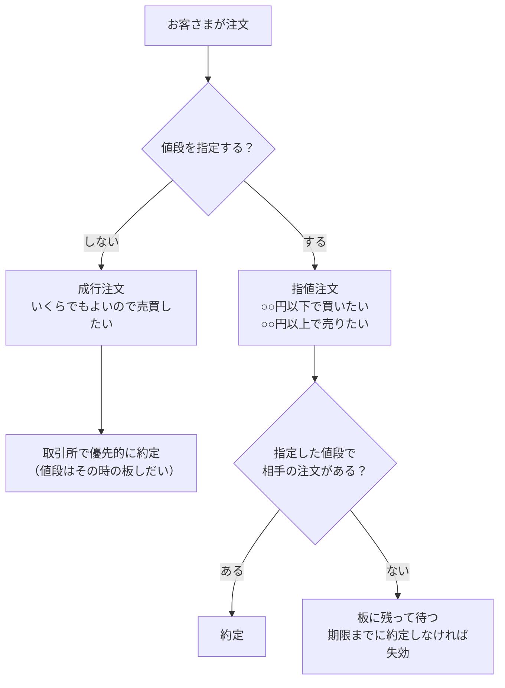

# 注文の出し方：成行・指値と売買単位

!!! abstract "3行でいうと"
    - 株の注文の基本は、値段を指定しない**成行注文**と、値段を指定する**指値注文**の2つです。
    - 成行注文は**約定しやすい**かわりに値段が読めず、指値注文は**値段を守れる**かわりに約定しないことがあります。
    - 東京証券取引所の内国株は**100株単位**で売買されます。注文には有効期限があり、期限内に約定しなければ失効します。

## なぜ必要なの？

取引所では、同じ銘柄について大勢の「買いたい人」と「売りたい人」の注文が集まり、条件が合ったものから売買が成立します（**約定**）。

このとき取引所は、注文を次の2つのルールで並べて、優先順位を決めています。[^jpx-match]

- **価格優先の原則**：買いなら高い値段の注文が、売りなら安い値段の注文が優先される
- **時間優先の原則**：同じ値段なら、先に出された注文が優先される

お客さまが「いくらで」「何株」「いつまで」注文するかによって、約定するかどうか、いくらで約定するかが変わります。注文の種類を正しく理解することは、お客さまの意図どおりに注文を取り次ぐための基本です。

[^jpx-match]: [日本取引所グループ「売買成立の方法｜内国株の売買制度」](https://www.jpx.co.jp/equities/trading/domestic/04.html)

## しくみ

### 成行注文と指値注文の違い

| | 成行注文 | 指値注文 |
|---|---|---|
| 意味 | 値段を指定せず「いくらでもよいから」買いたい／売りたい | 「○○円以下で買いたい」「○○円以上で売りたい」と値段を指定 |
| 長所 | 指値注文より優先されるので、約定しやすい | 想定外の値段で約定することがない |
| 短所 | 値動きが激しいと、思わぬ値段で約定することがある | 相場が指定の値段に届かなければ約定しない |

取引所のルールでは、成行注文は値段を指定した指値注文より優先されます。[^jpx-match]

!!! example "指値注文の例"
    いま、ある株を「1,000円なら売る」という注文が最も安く出ているとします。

    - 「990円で買いたい」という指値の買い注文は、990円以下の売り注文が出てくるまで約定しません。
    - 「1,000円で買いたい」という指値の買い注文なら、1,000円の売り注文と約定する可能性があります。

    指値は「この値段**より不利**には約定しない」という上限（買い）・下限（売り）であり、より有利な値段で約定することもあります。

成行・指値のほかにも、取引の開始時（寄付き）や終了時（引け）に執行されることを条件にした注文や、すぐに約定しなかった分を取り消す注文（IOC注文）など、**執行条件**をつけた注文があります。[^jpx-match] どの注文方法が使えるかは証券会社によって異なります。

### 売買単位（単元株）とは

株式は1株から自由に取引所で売買できるわけではなく、**売買単位**ごとに売買します。東京証券取引所での売買は、各上場会社が定款で定めた**単元株式数**を単位として行われ、内国株では**100株単位**で取引されています。[^jpx-unit]

かつては銘柄によって売買単位が異なっていました。分かりやすく利便性の高い市場にするため、全国の証券取引所は、まず100株と1,000株の2種類に集約し（2014年4月1日に完了）、その後**2018年10月1日**に内国株の売買単位は100株に統一されました。[^jpx-unit][^jpx-unit-history]

!!! info "注文に必要な金額の目安"
    株価が1,500円の銘柄なら、1単元（100株）を買うには **1,500円 × 100株 ＝ 15万円**（このほか手数料など）が必要です。株価だけを見て「1,500円で買える」と考えないよう注意しましょう。

1単元に満たない株（**単元未満株**）は、取引所の通常の売買ではやり取りできません。株式分割などで単元未満株を持つことになった場合は、発行会社に買い取ってもらう**買取請求**や、会社によっては単元に足りない分を買い増す**売渡請求**という方法があります。[^jasdec-tangen] また、証券会社によっては単元未満株を売買できる独自のサービスを提供しています。

[^jpx-unit]: [日本取引所グループ「売買単位｜内国株の売買制度」](https://www.jpx.co.jp/equities/trading/domestic/03.html)
[^jpx-unit-history]: [日本取引所グループ「売買単位の統一」](https://www.jpx.co.jp/equities/improvements/unit/01.html)
[^jasdec-tangen]: [証券保管振替機構「振替株式に係る仕組み」](https://www.jasdec.com/system/less/outline/organization/)

### 注文の有効期限

注文には**有効期限**があり、期限までに約定しなかった注文は**失効**します（成立しないまま消える）。証券会社では、一般に次のような有効期限を選べるようになっています。

| 有効期限の例 | 内容 |
|---|---|
| 当日中 | その日の取引時間が終わるまで有効 |
| 期間指定 | お客さまが指定した日まで有効 |

選べる期間の長さや、期間中に権利落ちなどがあった場合の扱いは**証券会社ごとに異なります**。お客さまに説明するときは、自社のルールを確認しましょう。

なお、東京証券取引所の取引時間は、午前（前場）が **9時〜11時30分**、午後（後場）が **12時30分〜15時30分** です。土日・祝日・年末年始（12月31日〜1月3日）は休業日で、取引は行われません。[^jpx-hours]

[^jpx-hours]: [日本取引所グループ「売買立会時（立会時間）｜内国株の売買制度」](https://www.jpx.co.jp/equities/trading/domestic/01.html)

### 1日に動ける値段の幅（制限値幅）

株価の急激な変動を防ぐため、東京証券取引所では1日の値動きの幅を、前日の終値などの「基準値段」に応じて制限しています（**制限値幅**）。上限まで上がることを**ストップ高**、下限まで下がることを**ストップ安**といいます。[^jpx-limit] 制限値幅の外の値段では約定しません。

[^jpx-limit]: [日本取引所グループ「制限値幅｜内国株の売買制度」](https://www.jpx.co.jp/equities/trading/domestic/06.html)

## よくある誤解

!!! warning "誤解：指値注文なら必ず約定する"
    指値注文は「この値段まで」という条件つきの注文です。相場がその値段に届かなかったり、同じ値段に先に出された注文が多く残っていたりすると（時間優先の原則）、**約定しないまま有効期限を迎えて失効**することがあります。

!!! warning "誤解：成行注文なら画面に出ている値段で約定する"
    成行注文は値段を指定しないため、注文が取引所に届くまでの間に相場が動けば、**表示されていた値段とは違う値段**で約定することがあります。売買が少ない銘柄や値動きが激しい場面では、特に差が大きくなりがちです。

!!! warning "誤解：株価が1,000円なら1,000円で株主になれる"
    取引所での売買は100株単位なので、1単元を買うには株価の100倍（この例では10万円）と手数料などが必要です。

## もっと知りたい人へ

- [日本取引所グループ「売買成立の方法」](https://www.jpx.co.jp/equities/trading/domestic/04.html)：注文の種類、価格優先・時間優先の原則、板寄せとザラバ
- [日本取引所グループ「売買単位の統一」](https://www.jpx.co.jp/equities/improvements/unit/01.html)：100株統一までの経緯
- [日本取引所グループ「制限値幅」](https://www.jpx.co.jp/equities/trading/domestic/06.html)：基準値段ごとの制限値幅の一覧
- [証券保管振替機構「振替株式に係る仕組み」](https://www.jasdec.com/system/less/outline/organization/)：単元未満株式の買取請求・売渡請求の手続き

## 関連記事・用語

- [株価はどう決まる？：板・気配・値幅制限](../market/price-formation.md)
- [約定から決済まで：T+2とは](settlement-t2.md)
- [株式](../products/stocks.md)
- [用語集](../glossary.md)（約定・成行・指値・単元株）
