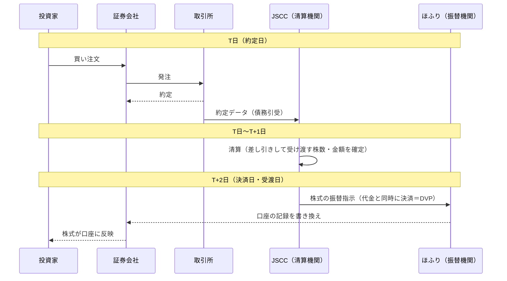
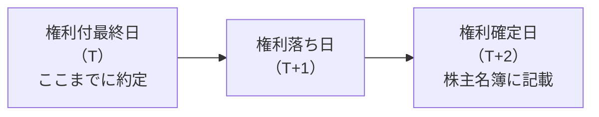

# 約定から決済まで：T+2とは

!!! abstract "3行でいうと"
    - 株の売買が成立すること（**約定**）と、株と代金を実際にやり取りすること（**決済・受渡**）は、**別の日**に行われます。
    - 日本の取引所での株式売買は、約定日（T）から**2営業日後**に決済されます。これを **T+2** と呼びます。
    - この2日間で、取引内容の確認や、誰が誰に何を渡すかのとりまとめ（**清算**）が行われます。

## なぜすぐに決済しないの？

取引所では1日に膨大な数の売買が成立します。そのすべてについて、その場で株と代金を1件ずつやり取りするのは現実的ではありません。

約定から決済までの間に、次のような作業が必要になります。

- 売買の内容（銘柄・数量・価格）に間違いがないかの**照合**
- 同じ証券会社の買いと売りを差し引きして、受け渡す量をまとめる**清算**
- 代金や株を用意する**資金・証券の準備**

この準備期間として、約定日から決済日までに一定の日数が設けられています。

## しくみ

### 曜日で見る例

| 約定日（T） | 決済日（T+2） | ポイント |
|---|---|---|
| 月曜日 | 水曜日 | 基本パターン |
| 木曜日 | 翌週月曜日 | 土日は営業日に数えない |
| 金曜日 | 翌週火曜日 | 祝日をはさむとさらに後ろにずれる |

### 歴史：T+3 から T+2 へ

日本の取引所の株式売買は、以前は **T+3**（約定日から3営業日後に決済）でした。決済までの期間が長いほど、相手方が倒れるなどのリスクにさらされる時間が長くなるため、**2019年7月16日の約定分から** T+2 へ短縮されました。[^jpx-t2]

!!! info "国債や海外の状況"
    国債の売買は、2018年5月1日の約定分から T+1（約定の翌営業日に決済）へ短縮されています。[^jsda-t1] また米国の株式は2024年5月28日に T+1 へ移行しました。[^sec-t1] 決済期間は商品や国によって異なります。

[^jpx-t2]: [日本取引所グループ「株式等の決済期間短縮化（T+2化）」](https://www.jpx.co.jp/equities/clearing-settlement/tplus2-settlement-cycle/index.html)
[^jsda-t1]: [日本証券業協会「国債取引の決済期間T＋1化について」](https://market.jsda.or.jp/shijyo/saiken/kessai/jgb_kentou/index.html)
[^sec-t1]: [U.S. SEC, Statement on Upcoming Implementation of T+1 Settlement Cycle（英語）](https://www.sec.gov/newsroom/press-releases/2024-62)

## 配当や株主優待との関係

T+2 は、**株主の権利**を得るために重要です。

株主として配当などを受け取るには、会社が定める「権利確定日」に株主名簿に載っている必要があります。名簿に載るのは決済日なので、**権利確定日の2営業日前**までに買って約定している必要があります。この日を「**権利付最終日**」と呼び、その翌営業日（権利確定日の1営業日前）からは権利のない状態（**権利落ち**）で売買されます。[^jpx-kenri]

[^jpx-kenri]: [日本取引所グループ「用語集：権利落ち」](https://www.jpx.co.jp/glossary/ka/134.html)

## よくある誤解

!!! warning "誤解：約定したら、その瞬間に株主になる"
    約定は「売買の約束が成立した」状態です。株主名簿上の株主になるのは、決済が終わったとき（T+2）です。

!!! warning "誤解：権利確定日に買えば配当がもらえる"
    権利確定日に買っても、決済はさらに2営業日後になるため間に合いません。権利付最終日までに約定している必要があります。

## もっと知りたい人へ

- [日本取引所グループ「株式等の決済期間短縮化（T+2化）」](https://www.jpx.co.jp/equities/clearing-settlement/tplus2-settlement-cycle/index.html)：T+2化の経緯と実施内容
- [日本証券クリアリング機構「JSCCとは」](https://www.jpx.co.jp/jscc/kaisya/jscc.html)：清算機関の役割（債務引受・決済保証）
- [証券保管振替機構「株式等振替制度 制度概要」](https://www.jasdec.com/system/less/outline/)：株券の電子化と振替の仕組み

## 関連記事・用語

- [清算と決済の仕組み：JSCCとほふり](clearing.md)
- [注文の出し方：成行・指値と売買単位](order-types.md)
- [用語集](../glossary.md)（約定・受渡・清算・振替）
