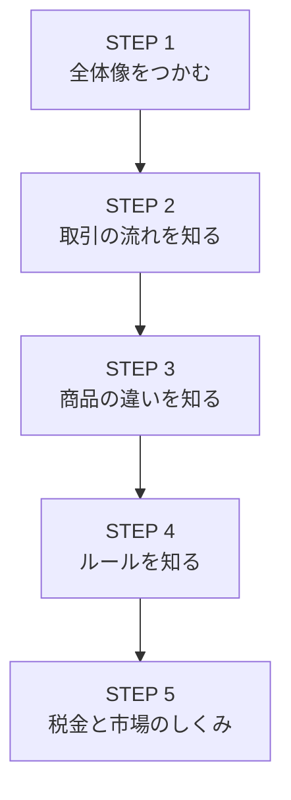

# 学習ロードマップ

はじめて証券業務を学ぶ人向けの、おすすめの読む順番です。各ステップは30分〜1時間程度が目安です。

## STEP 1：全体像をつかむ

- [ ] [証券会社って何をしているの？](../basics/what-securities-company-does.md)
- [ ] [用語集](../glossary.md)をざっと眺める

## STEP 2：取引の流れを知る

- [ ] [口座開設：本人確認と適合性の原則](../flow/account-opening.md)
- [ ] [注文の出し方：成行・指値と売買単位](../flow/order-types.md)
- [ ] [約定から決済まで：T+2とは](../flow/settlement-t2.md)
- [ ] [清算と決済の仕組み：JSCCとほふり](../flow/clearing.md)
- [ ] [顧客資産の保護：分別管理と投資者保護基金](../flow/asset-protection.md)

## STEP 3：商品の違いを知る

- [ ] [株式](../products/stocks.md) → [債券](../products/bonds.md) → [投資信託](../products/investment-trusts.md)
- [ ] 余裕があれば：[ETF・REIT](../products/etf-reit.md)、[信用取引](../products/margin-trading.md)、[デリバティブ](../products/derivatives.md)、[外国証券](../products/foreign-securities.md)

## STEP 4：ルールを知る

- [ ] [金融商品取引法のポイント](../rules/fiea.md)
- [ ] [適合性原則と説明義務](../rules/suitability.md)
- [ ] [インサイダー取引規制](../rules/insider-trading.md)
- [ ] [マネロン対策（犯収法）](../rules/aml.md)
- [ ] [顧客本位の業務運営](../rules/fiduciary.md)

## STEP 5：税金と市場のしくみ

- [ ] [特定口座と一般口座](../tax/specified-account.md)、[NISAの仕組み](../tax/nisa.md)
- [ ] [取引所とPTS](../market/exchanges-pts.md)、[株価はどう決まる？](../market/price-formation.md)

!!! tip "さらに体系的に学びたい人へ"
    日本証券業協会が実施する「証券外務員資格試験」の出題範囲は、証券業務の基礎知識を体系的に整理したものです。このサイトの構成もそれを参考にしています。
