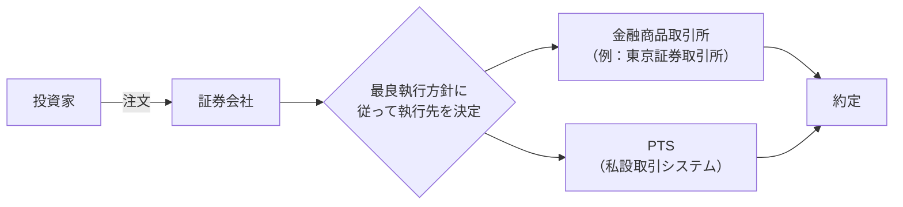

# 取引所とPTS

!!! abstract "3行でいうと"
    - 株式の売買は、主に国の**免許**を受けた**金融商品取引所**（東京証券取引所など）で行われます。東証の株式市場は**プライム・スタンダード・グロース**の3つの市場区分に分かれています。
    - 取引所以外にも、証券会社が国の**認可**を受けて運営する**PTS（私設取引システム）**という売買の場があります。
    - 売買の場が複数あるため、証券会社は「お客さまの注文をどこで、どう執行するか」を定めた**最良執行方針**を作り、公表し、それに従って執行することが法律で義務付けられています。

## なぜ必要なの？

株式を買いたい人と売りたい人がバラバラに相手を探していては、公正な値段で素早く売買することができません。そこで、**注文を1か所に集めて、ルールに従って売買を成立させる場**が必要になります。これが取引所です。

一方で、「取引所が開いていない時間にも売買したい」「少しでも有利な値段で売買したい」といったニーズに応えるため、取引所以外の売買の場（PTS）も認められています。売買の場が複数あると、**お客さまの注文をどこに出すのが一番よいのか**という問題が生まれます。そのルールが最良執行方針です。

## しくみ

### 国内の金融商品取引所

金融商品市場は、原則として**内閣総理大臣の免許**を受けた者でなければ開設できません（金融商品取引法第80条）。[^egov-fiea]

- **東京証券取引所（東証）**：日本取引所グループ（JPX）の一員で、株式などの現物市場を運営しています。東証のプライム・スタンダード・グロース市場は、日本の証券市場の中心的な市場です。[^jpx-biz]
- **大阪取引所**：同じくJPXの一員で、株価指数先物などの**デリバティブ市場**を運営しています。[^jpx-biz]
- このほか、**名古屋・札幌・福岡**にも証券取引所があります。[^jpx-strength]

### 東証の市場区分

東証の株式市場は、**2022年4月4日**から次の3つの市場区分になっています（それ以前は市場第一部・市場第二部・マザーズ・JASDAQの4区分でした）。[^jpx-ms]

| 市場区分 | どんな企業向けの市場か（要約） |
|---|---|
| プライム市場 | 多くの機関投資家の投資対象になりうる規模の時価総額（流動性）があり、より高いガバナンス水準を備え、投資者との対話を重視して中長期的な企業価値の向上に取り組む企業 |
| スタンダード市場 | 公開市場の投資対象として一定の時価総額（流動性）があり、上場企業としての基本的なガバナンス水準を備えた企業 |
| グロース市場 | 高い成長可能性があり、事業計画とその進捗を適時・適切に開示する一方、事業実績の面では相対的にリスクが高い企業 |

各市場区分には、流動性やコーポレート・ガバナンスに関する上場基準があり、上場した後もその水準を維持することが求められます。別の市場区分に移るには、移る先の新規上場基準と同等の審査を受け直す必要があります。[^jpx-ms]

!!! info "市場区分は「格付け」ではない"
    市場区分は、企業の規模や性格に応じて**投資者が銘柄を選びやすくするための区分**です。どの市場の銘柄だから安全・有利、ということを意味するものではありません。

### PTS（私設取引システム）とは

PTS（Proprietary Trading System）は、証券会社がコンピュータ・システムを使って、取引所のように多数の投資家の売買を成立させる仕組みです。金融商品取引法では、電子情報処理組織を使い、多数の者を当事者として、**競売買の方法**や**取引所の価格を用いる方法**などで有価証券の売買を行うものと定められています（第2条第8項第10号）。[^egov-fiea]

- PTSを運営するには、証券会社（金融商品取引業者）が**内閣総理大臣の認可**を受ける必要があります（第30条。ごく小規模な場合の例外あり）。[^egov-fiea]
- 取引所は「免許」、PTSは「認可」と、根拠となる手続きが異なります。
- PTSの取引時間や取り扱う銘柄は、運営する会社ごとに異なります。

## 最良執行方針

金融商品取引法第40条の2は、証券会社などに次のことを義務付けています。[^egov-fiea]

1. 顧客の注文を**最良の取引の条件で執行するための方針と方法**（最良執行方針等）を定めること
2. 最良執行方針等を**公表**すること
3. 最良執行方針等に**従って注文を執行**すること
4. 上場株式などの注文を受ける前に、顧客に最良執行方針等の**情報を提供**すること
5. 注文の執行後、顧客から求められたら、方針に従って執行したことなどを**説明**すること

!!! quote "金融商品取引法 第40条の2 第1項"
    金融商品取引業者等は、有価証券の売買及びデリバティブ取引（政令で定めるものを除く。以下この条において「有価証券等取引」という。）に関する顧客の注文について、政令で定めるところにより、最良の取引の条件で執行するための方針及び方法（以下この条において「最良執行方針等」という。）を定めなければならない。

何をもって「最良の取引の条件」とするかは、各証券会社が方針の中で定めます。後で説明するように、内閣府令は「最も有利な価格で執行すること以外の顧客の利益となる事項」を主に考慮する場合にも触れており、価格以外の要素を重視する方針もありえます。そのため、方針の中身は証券会社ごとに異なります。[^egov-fugyo]

### 2023年からの見直し

複数の市場から最も有利な価格の市場を自動的に探して注文を出す **SOR（Smart Order Routing）** の普及などを受けて、最良執行方針に関する政令・内閣府令・監督指針が改正され、**2023年1月1日**から施行されました。[^fsa-best] 現在の内閣府令では、たとえば次のような内容を方針に記載することになっています。[^egov-fugyo]

- SORを使う場合は、その旨と、**価格を比較する市場**や**市場を選ぶ順序**など
- **個人のお客さまの注文**について、最も有利な価格で執行すること**以外の利益を主に考慮する**場合は、その旨

また、執行後の説明を求められる期間は、注文の執行後**3か月間**とされています。[^egov-fugyo]

[^egov-fiea]: [e-Gov法令検索「金融商品取引法」](https://laws.e-gov.go.jp/law/323AC0000000025)（第2条第8項第10号、第30条、第40条の2、第80条）
[^egov-fugyo]: [e-Gov法令検索「金融商品取引業等に関する内閣府令」](https://laws.e-gov.go.jp/law/419M60000002052)（第124条）
[^jpx-biz]: [日本取引所グループ「事業紹介」](https://www.jpx.co.jp/corporate/about-jpx/business/index.html)
[^jpx-ms]: [日本取引所グループ「市場区分見直しの概要」](https://www.jpx.co.jp/equities/improvements/market-structure/01.html)
[^jpx-strength]: [日本取引所グループ「現物市場の機能強化に向けた取組み（取引時間の延伸等）」](https://www.jpx.co.jp/equities/trading/strengthening/index.html)（関連リンクに名古屋・札幌・福岡の各証券取引所の公表情報が掲載）
[^fsa-best]: [金融庁「『金融商品取引法施行令の一部を改正する政令（案）』等のパブリックコメント結果及び公表について」](https://www.fsa.go.jp/news/r3/shouken/20220518/20220518.html)（2022年5月18日）

## よくある誤解

!!! warning "誤解：株は必ず取引所で売買される"
    取引所のほかに、認可を受けたPTSでも上場株式の売買が行われています。どこで執行するかは、各証券会社の最良執行方針で定められています。

!!! warning "誤解：最良執行とは、常に一番安く買える（高く売れる）ことを保証するもの"
    最良執行方針は、注文を最良の条件で執行するための**方針と方法を定め、それに従って執行する**義務です。結果として常に最も有利な価格になることを保証するものではありません。また、何を「最良」とするかは各社の方針によります。

!!! warning "誤解：プライム市場の銘柄なら安全"
    市場区分は企業の規模やガバナンスの水準などに応じた区分で、株価が下がらないことを意味するものではありません。

## もっと知りたい人へ

- [e-Gov法令検索「金融商品取引法」](https://laws.e-gov.go.jp/law/323AC0000000025)：第40条の2（最良執行方針等）、第2条第8項第10号（PTSの定義）、第30条（認可）、第80条（取引所の免許）
- [e-Gov法令検索「金融商品取引業等に関する内閣府令」](https://laws.e-gov.go.jp/law/419M60000002052)：第124条（最良執行方針等の記載事項・公表方法など）
- [日本取引所グループ「市場区分見直しの概要」](https://www.jpx.co.jp/equities/improvements/market-structure/01.html)：3つの市場区分のコンセプトと見直しの背景
- [金融庁「最良執行方針等の見直しに関する公表（2022年5月18日）」](https://www.fsa.go.jp/news/r3/shouken/20220518/20220518.html)：SOR普及を受けた見直しの経緯

## 関連記事・用語

- [株価はどう決まる？：板・気配・値幅制限](price-formation.md)
- [注文の出し方：成行・指値と売買単位](../flow/order-types.md)
- [金融商品取引法のポイント](../rules/fiea.md)
- [市場のしくみ](index.md)
- [用語集](../glossary.md)（PTS・最良執行方針・市場区分）
