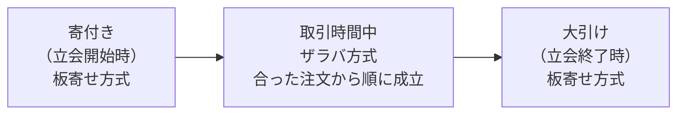

# 株価はどう決まる？：板・気配・値幅制限

!!! abstract "3行でいうと"
    - 取引所では、売り注文と買い注文を**板**に集め、**価格優先・時間優先**のルールで条件が合ったものから売買を成立させます。株価はこうして決まります。
    - 取引の始まりや終わりには、注文をまとめて1つの値段で成立させる**板寄せ方式**、取引時間中は合った注文から順に成立させる**ザラバ方式**が使われます。
    - 注文できる値段の刻み（**呼値の単位**）や、1日に動ける値段の幅（**値幅制限**）が決まっており、上限・下限に達した状態を**ストップ高・ストップ安**と呼びます。

## なぜ必要なの？

株価は、誰かが決めて発表しているわけではありません。**「いくらなら買いたい」「いくらなら売りたい」という多くの投資家の注文がぶつかり合って**決まります。

ただし、ルールがなければ、どの注文を先に成立させるかで不公平が生まれたり、一瞬で株価が極端に動いて思わぬ値段で売買が成立したりします。そこで取引所は、**注文の優先順位**、**値段の刻み**、**1日の値動きの幅**などのルールを定めています。

## しくみ

### 板とは

**板**は、ある銘柄について、値段ごとに売り注文と買い注文の数量を並べた一覧表です。下の例（説明用の数字）では、売りの一番安い値段が1,002円、買いの一番高い値段が1,000円です。この状態を「**気配**」（売り気配・買い気配）と呼び、両者の値段が合えば売買が成立します。

| 売り（株数） | 値段 | 買い（株数） |
|---:|:---:|:---|
| 500 | 1,003円 | |
| 300 | 1,002円 | |
| | 1,001円 | |
| | 1,000円 | 400 |
| | 999円 | 700 |

### 価格優先・時間優先の原則

東証の売買は、次の2つの原則に従って注文を突き合わせる**競争売買**で行われます。[^jpx-method]

- **価格優先の原則**：売り注文は**安い値段**が、買い注文は**高い値段**が優先されます。値段を指定しない**成行注文**は、値段を指定した**指値注文**より優先されます。
- **時間優先の原則**：同じ値段の注文は、**先に出された注文**が優先されます。

### ザラバ方式と板寄せ方式

| | 板寄せ方式 | ザラバ方式 |
|---|---|---|
| 使う場面 | 立会の開始時・終了時、売買が中断された後の再開時など | 上記以外の取引時間中 |
| 値段の決まり方 | それまでの注文をまとめて突き合わせ、**1つの値段**で一斉に成立させる | 価格優先・時間優先に従い、条件が合った注文から**順に**成立させる |
| 時間優先 | 適用しない（それまでの注文は**同時に出されたもの**とみなす） | 適用する |

出典：日本取引所グループ「売買成立の方法」[^jpx-method]

取引時間中に値段が一度に大きく動きそうなときは、すぐには売買を成立させず「**特別気配**」を表示して、反対の注文を呼び込む仕組みもあります。[^jpx-method]

### 立会時間（東証）

東証の立会時間は、**午前立会（前場）9時〜11時30分**、**午後立会（後場）12時30分〜15時30分**です。[^jpx-hours] 2024年11月5日から、取引時間が30分延長され、あわせて**クロージング・オークション**が導入されました。[^jpx-strength]

クロージング・オークションでは、15時25分にザラバを終え、15時30分までの5分間は注文の受付だけを行い（プレ・クロージング）、15時30分に板寄せで終値を決めます。[^jpx-method]

!!! info "予定されている変更：ランダムクローズ"
    東証は、終値の決まり方の透明性・信頼性をさらに高めるため、大引けの板寄せの時刻を一定の範囲内で毎日ランダムに決める「**ランダムクローズ方式**」を**2027年10月12日**に導入する予定です。[^jpx-strength]

### 売買単位

東証の内国株は、**100株単位**で売買されます（2018年10月1日に100株に統一）。[^jpx-unit] 注文の出し方は[注文の出し方：成行・指値と売買単位](../flow/order-types.md)も参照してください。

## 呼値の単位

注文するときの値段の刻みを**呼値（よびね）の単位**といいます。銘柄の種類と値段の水準によって異なります。現在のルールの一部を抜粋すると、次のとおりです。[^jpx-tick]

| 値段の水準 | TOPIX500構成銘柄 | その他の銘柄 |
|---|---|---|
| 1,000円以下 | 0.1円 | 1円 |
| 1,000円超 3,000円以下 | 0.5円 | 1円 |
| 3,000円超 5,000円以下 | 1円 | 5円 |
| 5,000円超 10,000円以下 | 1円 | 10円 |

たとえば「その他の銘柄」で株価が4,000円台なら、4,000円・4,005円・4,010円…と5円刻みでしか注文できません。

!!! info "2027年3月1日からの見直し（予定）"
    東証は**2027年3月1日**から、TOPIX500構成銘柄かどうかで呼値の単位を決める現在のしくみをやめ、**銘柄ごとの流動性**（STR：Spread to Tick Ratio という指標）にもとづいて呼値の単位を決める制度に変更する予定です。[^jpx-tick] 実際の刻みは、その時点の東証の公表資料で確認してください。

## 値幅制限（ストップ高・ストップ安）

東証では、1日の値動きの幅を、前日の終値などをもとにした**基準値段**に応じて制限しています。この幅を**制限値幅**といい、上限まで上がった状態を**ストップ高**、下限まで下がった状態を**ストップ安**と呼びます。[^jpx-limit]

| 基準値段 | 制限値幅（上下） |
|---|---|
| 100円未満 | 30円 |
| 100円以上 200円未満 | 50円 |
| 200円以上 500円未満 | 80円 |
| 500円以上 700円未満 | 100円 |
| 700円以上 1,000円未満 | 150円 |
| 1,000円以上 1,500円未満 | 300円 |
| 1,500円以上 2,000円未満 | 400円 |
| 2,000円以上 3,000円未満 | 500円 |

（一部抜粋。全体は東証の「制限値幅」ページを参照）[^jpx-limit]

**例**：基準値段が800円の銘柄なら、制限値幅は上下150円なので、その日は **650円〜950円** の範囲でしか売買できません。

- ストップ高・ストップ安で注文が大きく偏ったまま取引が終わる場合、大引けに**ストップ配分**という方法で、取引参加者（証券会社）ごとに売買を割り当てることがあります。お客さまの注文が約定するかどうかは、東証のルールに加えて各証券会社のルールにもよります。[^jpx-method]
- 一定の条件に当てはまった場合などは、制限値幅が臨時に**拡大**されることがあります。[^jpx-limit]

[^jpx-method]: [日本取引所グループ「売買成立の方法」](https://www.jpx.co.jp/equities/trading/domestic/04.html)
[^jpx-hours]: [日本取引所グループ「売買立会時（立会時間）」](https://www.jpx.co.jp/equities/trading/domestic/01.html)
[^jpx-strength]: [日本取引所グループ「現物市場の機能強化に向けた取組み（取引時間の延伸等）」](https://www.jpx.co.jp/equities/trading/strengthening/index.html)
[^jpx-unit]: [日本取引所グループ「売買単位」](https://www.jpx.co.jp/equities/trading/domestic/03.html)
[^jpx-tick]: [日本取引所グループ「呼値の単位」](https://www.jpx.co.jp/equities/trading/domestic/07.html)
[^jpx-limit]: [日本取引所グループ「制限値幅」](https://www.jpx.co.jp/equities/trading/domestic/06.html)

## よくある誤解

!!! warning "誤解：株価は取引所や証券会社が決めている"
    株価は、投資家の売り注文と買い注文が価格優先・時間優先のルールで突き合わされて決まります。取引所が決めるのは、そのための**ルール**です。

!!! warning "誤解：ストップ高になれば、買い注文を出せば必ず買える"
    ストップ高では買い注文が売り注文を大きく上回っていることが多く、買えないことがあります。大引けにストップ配分が行われても、割り当てを受けられるとは限りません。[^jpx-method]

!!! warning "誤解：同じ値段なら、注文の量が多い人が優先される"
    同じ値段の注文は、量ではなく**先に出された順**（時間優先）で成立します。ただし、板寄せでは、それまでの注文がすべて同時に出されたものとして扱われます。[^jpx-method]

## もっと知りたい人へ

- [日本取引所グループ「売買成立の方法」](https://www.jpx.co.jp/equities/trading/domestic/04.html)：価格優先・時間優先、板寄せとザラバ、特別気配、クロージング・オークション
- [日本取引所グループ「呼値の単位」](https://www.jpx.co.jp/equities/trading/domestic/07.html)：呼値の単位の全表と2027年3月からの見直し
- [日本取引所グループ「制限値幅」](https://www.jpx.co.jp/equities/trading/domestic/06.html)：制限値幅の全表と拡大の条件
- [日本取引所グループ「現物市場の機能強化に向けた取組み」](https://www.jpx.co.jp/equities/trading/strengthening/index.html)：取引時間延伸の経緯とランダムクローズの導入予定

## 関連記事・用語

- [取引所とPTS](exchanges-pts.md)
- [注文の出し方：成行・指値と売買単位](../flow/order-types.md)
- [約定から決済まで：T+2とは](../flow/settlement-t2.md)
- [市場のしくみ](index.md)
- [用語集](../glossary.md)（板・気配・呼値・ストップ高）
