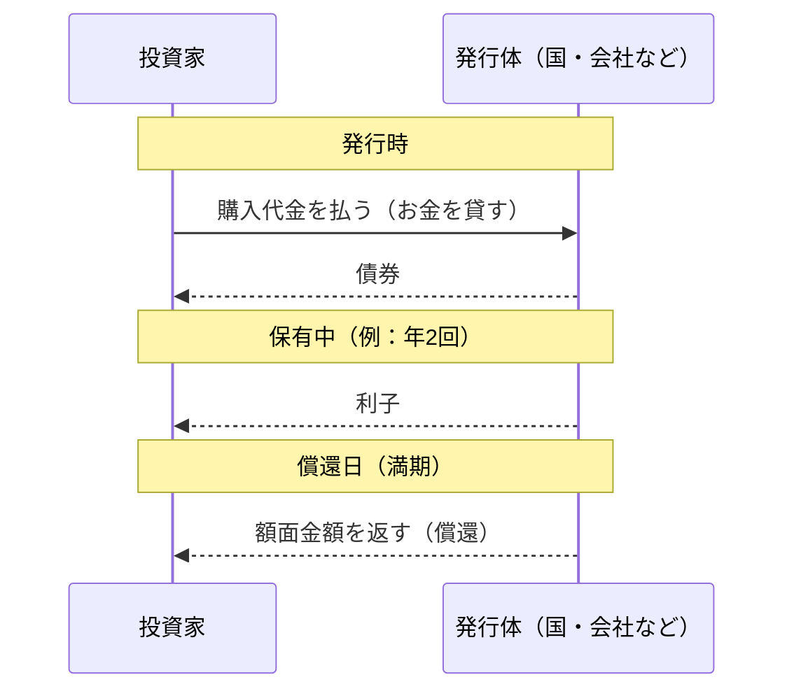
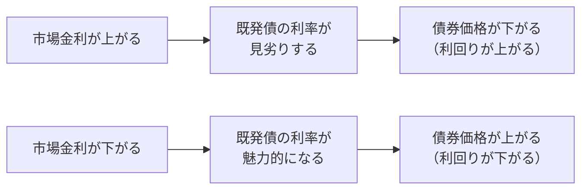

# 債券

!!! abstract "3行でいうと"
    - 債券は、国や会社などがお金を借りるときに発行する「**借用証書**」のようなものです。買った人は、決まった**利子**を受け取り、満期（**償還日**）に**額面金額**が返ってきます。
    - 債券の**価格**は市場で日々動きます。**金利が上がると債券価格は下がり、金利が下がると債券価格は上がる**という逆の関係があります。
    - 主なリスクは、途中で売るときに値下がりしている**金利変動リスク**と、発行体が利子や元本を払えなくなる**信用リスク**です。

## なぜ債券というしくみがあるの？

国や地方公共団体、会社は、道路の建設や事業の拡大などのために、大きな金額のお金を長い期間借りたいことがあります。しかし、1つの銀行から全額を借りるのは難しい場合もあります。

そこで、借りたい金額を小口に分けた「証書」を発行し、多くの投資家から少しずつお金を借ります。これが債券です。

- **発行体（借り手）**：多くの投資家から、まとまった資金を長期間調達できる
- **投資家（貸し手）**：あらかじめ決まった利子を受け取れ、満期には額面金額が返ってくる見込みがある

株式（→ [株式](stocks.md)）が「会社の持ち分」で返済の約束がないのに対し、債券は「**返済の約束があるお金の貸し借り**」である点が大きな違いです。

## しくみ

### 債券の基本用語

| 用語 | 意味 |
|---|---|
| 額面金額 | 債券に記載された金額。満期に返ってくる金額の基準 |
| 利率（クーポン） | 額面金額に対して1年間に受け取る利子の割合 |
| 償還日（満期） | 額面金額が返ってくる日 |
| 発行体 | 債券を発行してお金を借りる国・会社など |
| 利回り | 投資した金額に対して、1年あたりどれだけの収益になるかの割合 |

### 利率・利回り・価格の関係

**利率**は発行時に決まり、原則として満期まで変わりません（固定利付債の場合）。一方、発行後の債券は市場で売買され、その**価格**は日々動きます。そのため、**いくらで買ったか**によって実際の収益率（**利回り**）が変わります。

満期まで持った場合の利回りを、簡単な計算（単利）で確認してみましょう。

> 利回り（年） ＝ ｛ 1年分の利子 ＋（額面 − 購入価格）÷ 残りの年数 ｝ ÷ 購入価格

| 例：額面100円・利率1.0%・残り5年の債券 | 1年分の利子 | 満期時の差額（1年あたり） | 利回り（概算） |
|---|---|---|---|
| 100円で買う | 1.0円 | 0円 | 約1.00% |
| 98円で買う（額面より安い） | 1.0円 | ＋0.4円 | 約1.43% |
| 102円で買う（額面より高い） | 1.0円 | −0.4円 | 約0.59% |

（数字は説明用の例です。実際の利回り計算には複利など別の方法もあります）

同じ債券でも、**安く買えば利回りは高く、高く買えば利回りは低く**なります。

### 金利が上がると、なぜ債券価格は下がるの？

たとえば、利率1.0%の債券を持っているときに、市場の金利が上がって、新しく発行される債券の利率が2.0%になったとします。

すると、利率1.0%の古い債券をそのままの値段で買いたい人はいなくなります。古い債券を売るには、**価格を下げて、利回りを新しい債券と同じ程度まで引き上げる**しかありません。逆に金利が下がれば、利率の高い古い債券の人気が高まり、価格は上がります。

一般に、**満期までの期間が長い債券ほど**、金利の変化による価格の動きは大きくなります。

### 国債・地方債・社債の違い

金融商品取引法第2条第1項は、「有価証券」として国債証券（第1号）、地方債証券（第2号）、社債券（第5号）などを挙げています。[^fiea]

| 種類 | 発行体 | ポイント |
|---|---|---|
| 国債 | 国 | 国が法律に基づいて発行する債券。普通国債と財投債に大別される[^mof-jgb] |
| 地方債 | 都道府県・市町村など | 地方公共団体が発行する債券 |
| 社債 | 株式会社など | 会社が発行する債券。会社法第2条第23号で定義されている[^kaisha] |

国債には、個人向けに発行される**個人向け国債**もあります。財務省によると、半年ごとに利率が変わる「変動10年」と、満期まで利率が変わらない「固定5年」「固定3年」の3種類があり、最低1万円から1万円単位で購入できます。発行後1年が経てば中途換金でき、額面金額から直前2回分の利子（税引前）相当額×0.79685を差し引いた金額を受け取ります。[^mof-kojin]

!!! info "国債の決済はT+1"
    国債の売買は、約定日の翌営業日に決済されます（T+1）。株式（T+2）との違いは[約定から決済まで：T+2とは](../flow/settlement-t2.md)を参照してください。

### リスク：金利変動リスクと信用リスク

| リスク | 内容 | 影響を受ける場面 |
|---|---|---|
| 金利変動リスク | 市場金利が上がると、持っている債券の価格が下がる | **満期前に売る**とき。満期まで持てば、原則として額面金額が返ってくる |
| 信用リスク | 発行体の経営が悪化し、利子や元本の支払いが遅れたり、払われなくなったりする（**デフォルト**） | 保有中・満期時。発行体の信用が下がると価格も下がる |
| 流動性リスク | 取引が少なく、希望する価格で売れない | 満期前に売るとき |
| 為替リスク | 外貨建ての債券では、円に換えるときの為替レートで円での受取額が変わる | 外貨建て債券（→ [外国証券](foreign-securities.md)） |

信用リスクの目安として、格付会社が付ける**信用格付**（AAA、BBBなどの記号）があります。金融商品取引法では、信用状態に関する評価の結果を記号や数字で表した等級を「信用格付」と定義しています（第2条第34項）。一般に、格付が低い発行体ほど、利率を高くしないとお金を借りにくくなります。

[^fiea]: [e-Gov法令検索「金融商品取引法」](https://laws.e-gov.go.jp/law/323AC0000000025)（第2条第1項、第2条第34項）
[^mof-jgb]: [財務省「国債とは」](https://www.mof.go.jp/jgbs/summary/kokusai.html)
[^kaisha]: [e-Gov法令検索「会社法」](https://laws.e-gov.go.jp/law/417AC0000000086)（第2条第23号）
[^mof-kojin]: [財務省「個人向け国債 商品概要」](https://www.mof.go.jp/jgbs/individual/kojinmuke/main/outline/index.html)

## よくある誤解

!!! warning "誤解：債券は元本保証だから損をしない"
    債券は元本保証の商品ではありません。満期前に売れば、金利の動きによって買った値段を下回ることがあります。また、発行体が破綻すれば、満期まで持っていても元本が戻らないことがあります。

!!! warning "誤解：利率が高い債券ほど得"
    実際の収益率は、利率だけでなく**購入価格**で決まります（利回り）。また、利率が高い債券は、発行体の信用リスクが高いこともあります。

!!! warning "誤解：金利が上がるのは、債券を持っている人にとって良いこと"
    これから債券を買う人にとっては利回りが上がりますが、**すでに持っている債券の価格は下がります**。

## もっと知りたい人へ

- [財務省「国債とは」](https://www.mof.go.jp/jgbs/summary/kokusai.html)：国債の種類と発行根拠
- [財務省「個人向け国債 商品概要」](https://www.mof.go.jp/jgbs/individual/kojinmuke/main/outline/index.html)：変動10年・固定5年・固定3年の比較
- [e-Gov法令検索「金融商品取引法」](https://laws.e-gov.go.jp/law/323AC0000000025)：第2条（有価証券・信用格付の定義）

## 関連記事・用語

- [株式](stocks.md)
- [投資信託](investment-trusts.md)
- [外国証券](foreign-securities.md)
- [約定から決済まで：T+2とは](../flow/settlement-t2.md)
- [商品の基礎](index.md)
- [用語集](../glossary.md)（利回り・償還・格付）
