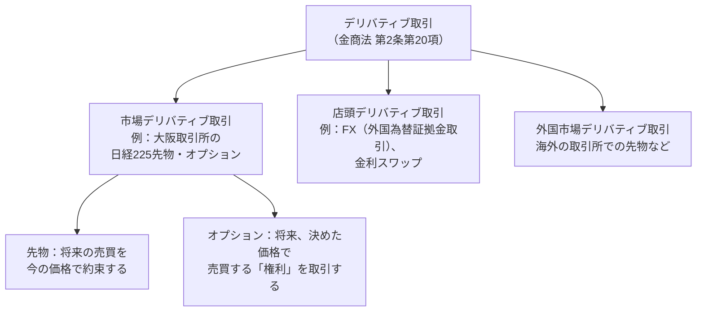

# デリバティブ入門

!!! abstract "3行でいうと"
    - デリバティブ（金融派生商品）は、株価指数などの**元になる資産（原資産）の値動きから価値が決まる取引**です。代表例が**先物**と**オプション**です。
    - 取引金額の一部にあたる**証拠金**を預けるだけで大きな金額の取引ができるため（**レバレッジ**）、利益も損失も大きくなります。
    - 値動きのリスクを減らす**ヘッジ**にも、値動きで利益を狙う**投機**にも使われます。取引によっては**証拠金を超える損失**が出ることがあります。

## なぜ必要なの？

株や債券を持っていると、相場の下落によって資産が目減りするリスクがあります。デリバティブは、もともとこうした**将来の価格変動のリスクをやり取りする**ための道具です。

- 株を大量に持つ機関投資家が、相場の下落に備えて株価指数先物を売っておく（**ヘッジ**）
- 近い将来に株を買う予定の投資家が、値上がりに備えて先に先物を買っておく
- 相場の上げ下げを予想して、少ない資金で利益を狙う（**投機**）

ヘッジしたい人だけでは取引の相手が見つかりにくいため、投機を目的とする参加者も市場にとって欠かせない存在です。両者がいることで、取引が成立しやすくなります。

## しくみ

### デリバティブの種類

金融商品取引法では、デリバティブ取引を**市場デリバティブ取引**（取引所で行うもの）、**店頭デリバティブ取引**（取引所を通さず当事者間で行うもの）、**外国市場デリバティブ取引**の3つに分けて定義しています（第2条第20項〜第22項）。[^egov-fiea]

日本では、株価指数先物・オプションなどの主な上場デリバティブは**大阪取引所**（日本取引所グループ）で取引され、清算は**日本証券クリアリング機構（JSCC）**が行います。

### 先物とは

**先物取引**は、将来の決められた日に、決められた価格で売買することを**今の時点で約束する**取引です。満期の月を**限月（げんげつ）**といい、満期までに反対売買をして差額の損益だけを受け渡すのが一般的です。

代表的な**日経225先物**の主な仕様は次のとおりです。[^jpx-225f]

| 項目 | 内容 |
|---|---|
| 原資産 | 日経平均株価（日経225） |
| 取引単位（1枚） | 日経平均株価の**1,000倍** |
| 呼値の単位（値段の刻み） | **10円**（10円動くと1枚あたり1万円の損益） |
| 限月 | 3月・6月・9月・12月 |
| 満期日（SQ日） | 各限月の**第2金曜日**（取引最終日はその前営業日） |

**SQ（特別清算指数）**は、満期日に残っている建玉（未決済の取引）を清算するための基準となる価格です。

### オプションとは

**オプション取引**は、将来の特定日に、特定の価格（**権利行使価格**）で**買う権利（コール）**または**売る権利（プット）**を売買する取引です。[^jpx-225o] 権利の値段を**プレミアム**といいます。

| 立場 | 支払う・受け取るもの | 最大の利益 | 最大の損失 |
|---|---|---|---|
| オプションの**買い手** | プレミアムを支払う | 大きくなりうる | **支払ったプレミアムまで** |
| オプションの**売り手** | プレミアムを受け取る | **受け取ったプレミアムまで** | 大きくなりうる（コールの売りは理論上無限大） |

買い手は、相場が不利に動けば権利を使わなければよいため、損失は支払ったプレミアムに限られます。一方、売り手は買い手が権利を使ったときに応じる義務があるため、損失が大きく膨らむおそれがあります。

### レバレッジのしくみ

先物取引では、取引金額の全額ではなく、**証拠金**と呼ばれる担保を預けて取引します。日経225先物は、証拠金に対して**十数倍**の金額の取引ができる仕組みです（信用取引は約3倍）。[^jpx-225f]

!!! example "数字で見るイメージ（仮の数字による単純化した例）"
    - 日経平均が40,000円のとき、日経225先物を1枚買う → 取引金額は 40,000円 × 1,000 ＝ **4,000万円**。
    - 証拠金として仮に**250万円**を預けているとする（実際の金額は日々変わります）。
    - 日経平均が1,000円（2.5%）下がると、損失は 1,000円 × 1,000 ＝ **100万円**。証拠金の**40%**が失われます。
    - 2,500円（約6%）下がれば、損失は250万円となり、**証拠金がすべてなくなる**計算です。

先物の損益は、毎日その日の価格で計算し直されます（**値洗い**）。損失で証拠金が足りなくなると、**追加の証拠金**を差し入れる必要があります。

### 証拠金はどう決まる？

証拠金の必要額は、JSCCが過去の価格変動などをもとに計算した金額（**証拠金所要額**）が基準になります。JSCCは**2023年11月6日**に、先物・オプションの証拠金の計算方法を「SPAN方式」から「**VaR方式**」へ移行しました。[^jscc-var] 実際にお客さまが預ける証拠金は、この所要額以上の範囲で各証券会社が独自に設定しています。[^jpx-225f]

!!! info "証拠金は固定ではない"
    証拠金の必要額は相場の変動の大きさなどに応じて毎日変わります。相場が荒れると証拠金の必要額が引き上げられ、建玉を維持するために追加の資金が必要になることがあります。

## ヘッジと投機

| | ヘッジ | 投機 |
|---|---|---|
| 目的 | 持っている資産の値下がり（値上がり）リスクを減らす | 値動きを予想して利益を得る |
| 例 | 株を持っている人が、株価指数先物を売っておく | 相場上昇を予想して先物を買う |
| 結果 | 現物の損失と先物の利益が打ち消し合い、損益が安定する | 予想が当たれば大きな利益、外れれば大きな損失 |

同じ「先物を売る」取引でも、手元に株を持っているかどうかで、ヘッジにも投機にもなります。

## 主なリスク

!!! danger "デリバティブ取引の主なリスク"
    - **証拠金を超える損失**：レバレッジがかかっているため、相場が不利に動くと証拠金を超える損失が発生することがあります。[^jpx-225f]
    - **追加証拠金と強制決済**：損失や証拠金所要額の引き上げで証拠金が不足すると、短期間で追加の入金が必要になり、入金できなければ不利な価格で決済されることがあります。
    - **オプションの売りのリスク**：損失が受け取ったプレミアムをはるかに超えて膨らむおそれがあります。
    - **買い手の時間的価値の減少**：オプションの買い手は、満期までに相場が思った方向に動かなければ、権利の価値が下がり、最終的にプレミアムが全額失われることがあります。
    - **期限があること**：先物・オプションには満期（SQ日）があり、長期にわたって持ち続けることはできません。
    - **流動性リスク**：取引量の少ない限月や権利行使価格では、思った価格で売買できないことがあります。

こうしたリスクがあるため、証券会社は、お客さまの知識・経験・財産の状況・目的に照らして不適当な勧誘をしてはならないとされています（金融商品取引法第40条、[適合性の原則](../rules/suitability.md)）。[^egov-fiea]

## よくある誤解

!!! warning "誤解：損失は預けた証拠金までで済む"
    先物やオプションの売りでは、損失が証拠金を超えることがあり、その分は追加で支払う必要があります。損失が限定されるのは、オプションを**買う**場合（支払ったプレミアムまで）です。

!!! warning "誤解：デリバティブは投機のためだけのもの"
    デリバティブは、もともと価格変動のリスクを減らす**ヘッジ**のための道具として発展しました。機関投資家や事業会社がリスク管理に使っています。

!!! warning "誤解：証拠金の額は一度決まったら変わらない"
    証拠金の必要額は、相場の状況に応じて毎日見直されます。同じ建玉を持っていても、必要な証拠金が増えることがあります。

## もっと知りたい人へ

- [日本取引所グループ「日経225先物」](https://www.jpx.co.jp/derivatives/products/domestic/225futures/index.html)：取引単位・限月・SQ・証拠金の考え方
- [日本取引所グループ「日経225オプション」](https://www.jpx.co.jp/derivatives/products/domestic/225options/index.html)：コールとプット、権利行使価格の説明
- [日本証券クリアリング機構「新証拠金計算方式（VaR方式）とは」](https://www.jpx.co.jp/jscc/seisan/sakimono/shokokin_seido/VaR.html)：証拠金の計算方法と試算ツール
- [e-Gov法令検索「金融商品取引法」](https://laws.e-gov.go.jp/law/323AC0000000025)：第2条第20項〜第22項（デリバティブ取引の定義）

[^egov-fiea]: [e-Gov法令検索「金融商品取引法」](https://laws.e-gov.go.jp/law/323AC0000000025)（第2条第20項：デリバティブ取引、第21項：市場デリバティブ取引、第22項：店頭デリバティブ取引、第40条：適合性の原則等）
[^jpx-225f]: [日本取引所グループ「日経225先物」](https://www.jpx.co.jp/derivatives/products/domestic/225futures/index.html)（取引単位1,000倍、呼値10円、限月、SQ日は第2金曜日で取引最終日はその前営業日、証拠金に対し十数倍の取引、証拠金は各証券会社がJSCCの証拠金所要額以上で設定）
[^jpx-225o]: [日本取引所グループ「日経225オプション」](https://www.jpx.co.jp/derivatives/products/domestic/225options/index.html)
[^jscc-var]: [日本証券クリアリング機構「新証拠金計算方式（VaR方式）とは」](https://www.jpx.co.jp/jscc/seisan/sakimono/shokokin_seido/VaR.html)

## 関連記事・用語

- [信用取引](margin-trading.md)
- [清算と決済の仕組み：JSCCとほふり](../flow/clearing.md)
- [取引所とPTS](../market/exchanges-pts.md)
- [適合性原則と説明義務](../rules/suitability.md)
- [用語集](../glossary.md)（証拠金・限月・SQ・建玉・プレミアム）
