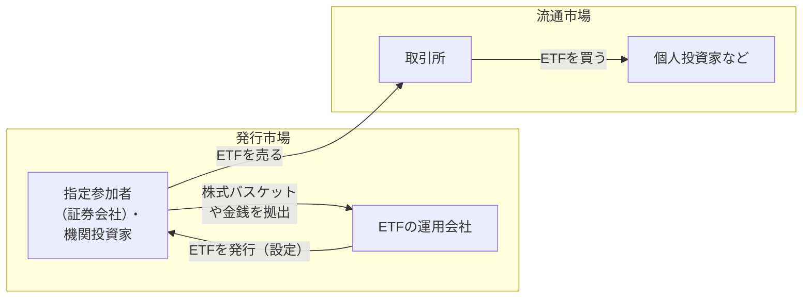
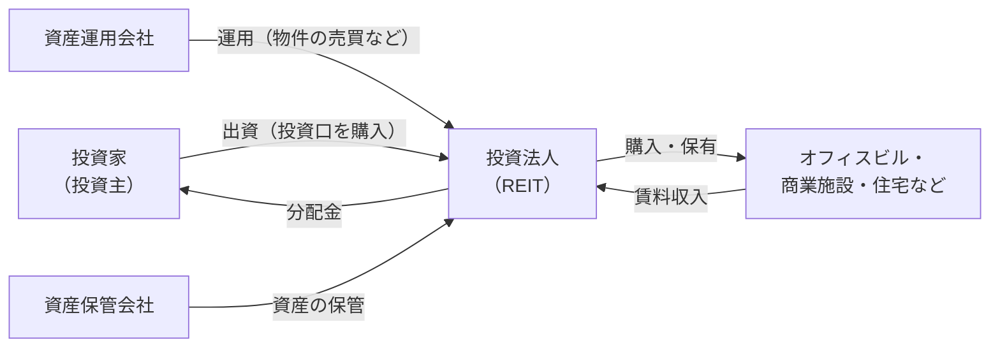

# ETF・REIT

!!! abstract "3行でいうと"
    - **ETF（上場投資信託）**は、取引所に上場している投資信託です（投資信託以外の形式のものも一部あります）。株式と同じように、取引時間中に市場の価格で売買できます。
    - **REIT（不動産投資信託）**は、投資家から集めたお金で複数の不動産を買い、その賃料などを投資家に分配する商品です。日本のREIT（J-REIT）も取引所に上場しています。
    - 通常の投資信託との大きな違いは、**どこで・いくらで・いつ売買するか**です。通常の投資信託は1日1回の基準価額で販売会社と取引しますが、ETF・REITは取引所で刻々と変わる**市場価格**で売買します。

## なぜETF・REITがあるの？

[投資信託](investment-trusts.md)は、少額で分散投資ができる便利な商品です。しかし通常の投資信託は、1日1回計算される基準価額でしか売買できず、注文する時点ではその値段が分かりません。

「投資信託の分散効果を生かしつつ、**株式のように好きなタイミングで、値段を見ながら売買したい**」というニーズに応えるのがETFです。

また、不動産は1件あたりの金額が大きく、個人が複数の物件に分散して投資するのは困難です。そこで、多くの投資家のお金を集めて**不動産に投資し、その持ち分を取引所で売買できるようにした**のがREITです。[^jpx-reit]

## しくみ

### ETFとは：上場している投資信託

ETFの多くは、TOPIX（東証株価指数）などの株価指数や金価格などの**指標に連動する**ことを目指すもの（インデックス連動型）です。連動する指標がない**アクティブ運用型**のETFもあります。[^jpx-etf]

ETFには、「**発行市場**」と「**流通市場**」という2つの市場があります。[^jpx-etf-shikumi]

- **発行市場**：指定参加者と呼ばれる証券会社などが、株式のまとまり（バスケット）や金銭を運用会社に拠出して、大口でETFを新しく作ります（**設定**）。逆に、ETFを持ち込んで株式のバスケットと交換すること（**交換**）もできます。
- **流通市場**：個人投資家などは、取引所でETFを株式と同じように小口で売買します。

この設定・交換のしくみがあることで、ETFの市場価格は、ETFが持っている資産の価値（基準価額）から大きくかけ離れにくくなっています。

### REITとは：不動産に投資するしくみ

J-REITの多くは、投信法に基づく**投資法人**という形をとっています。投資法人は、資産を主として特定資産（不動産や有価証券など）に投資して運用することを目的として設立される社団です（投信法第2条第12項）。[^toushin-hou]

- 投資法人自体は「器」で、資産の運用は**資産運用会社**に、資産の保管は**資産保管会社**に委託しなければなりません（投信法第198条第1項、第208条第1項）。[^toushin-hou]
- 投資家には**投資証券**（株券に相当するもの）が発行され、株式と同じように証券コードで取引所で売買できます。[^jpx-reit]
- 賃料収入や物件の売却益が分配金の原資になります。

!!! info "REITの分配金が多くなりやすい理由"
    租税特別措置法第67条の15は、一定の要件を満たす投資法人が支払う配当について、法人税の課税所得の計算上、損金に算入できる特例を定めています。その要件の1つが、配当の支払額が配当可能利益の額（政令で定める金額）の**90%を超えていること**です。[^sochi] このため、多くのREITは利益の大部分を投資家に分配しています。

!!! note "東証REIT指数"
    東証に上場するREIT全銘柄を対象とした時価総額加重型の指数で、2003年3月31日の時価総額を1,000として計算されています。[^jpx-reit]

### 通常の投資信託との違い

| 比較項目 | ETF・REIT（上場） | 通常の投資信託（非上場） |
|---|---|---|
| どこで買う | 取引所（証券会社を通じて） | 取り扱っている販売会社（証券会社・銀行など） |
| 取引の価格 | 取引時間中にリアルタイムで変わる**市場価格** | 1日1回計算される**基準価額** |
| 取引できる時間 | 取引所の取引時間中 | 販売会社が決めた受付時間内 |
| 注文方法 | 成行・指値（株式と同じ） | 基準価額が分からない状態で金額や口数を指定 |
| 換金方法 | 取引所で他の投資家に売る | 運用会社による解約（買取り）など |
| 信用取引 | 対象になる（銘柄・取引の種類による） | できない |

（日本取引所グループ「ETFと他の投資信託の違い」をもとに作成）[^jpx-etf-diff]

ETFの運用コスト（信託報酬）は、一般的な投資信託と比べて低い傾向があるとJPXは説明しています。[^jpx-etf] 一方、ETF・REITを売買するときには、株式と同じように証券会社の売買手数料がかかります。

[^jpx-etf]: [日本取引所グループ「ETFの特徴」](https://www.jpx.co.jp/equities/products/etfs/etf-outline/index.html)
[^jpx-etf-shikumi]: [日本取引所グループ「ETFの仕組み」](https://www.jpx.co.jp/equities/products/etfs/etf-outline/02.html)
[^jpx-etf-diff]: [日本取引所グループ「ETFと他の投資信託の違い」](https://www.jpx.co.jp/equities/products/etfs/etf-outline/01.html)
[^jpx-reit]: [日本取引所グループ「REIT 概要」](https://www.jpx.co.jp/equities/products/reits/outline/index.html)
[^toushin-hou]: [e-Gov法令検索「投資信託及び投資法人に関する法律」](https://laws.e-gov.go.jp/law/326AC0100000198)（第2条第12項、第198条第1項、第208条第1項）
[^sochi]: [e-Gov法令検索「租税特別措置法」](https://laws.e-gov.go.jp/law/332AC0000000026)（第67条の15第1項第2号ホ）

## よくある誤解

!!! warning "誤解：ETFは指数に連動するから損をしない"
    ETFは指数などに連動することを目指すだけで、指数が下がればETFの価格も下がります。元本の保証はありません。また、市場価格は需給によって基準価額と多少ずれることもあります。

!!! warning "誤解：REITは不動産だから値下がりしにくい"
    REITは取引所で売買されるため、株式と同じように価格が変動します。不動産市況や金利の動き、物件の災害などの影響で、価格が下がったり分配金が減ったりすることがあります。投資法人が倒産するリスクもあります。[^jpx-reit]

!!! warning "誤解：ETFやREITは投資信託とはまったく別の商品"
    ETFの多くは投資信託の一種で、上場しているかどうかが大きな違いです（金などの現物を信託財産とする、投資信託以外の形式のETFもあります）。REITも、投信法に基づく投資法人などのしくみを使った商品です。

## もっと知りたい人へ

- [日本取引所グループ「ETFの特徴」](https://www.jpx.co.jp/equities/products/etfs/etf-outline/index.html)：ETFの種類と特徴
- [日本取引所グループ「ETFの仕組み」](https://www.jpx.co.jp/equities/products/etfs/etf-outline/02.html)：設定・交換、発行市場と流通市場、運用方法の種類
- [日本取引所グループ「REIT 概要」](https://www.jpx.co.jp/equities/products/reits/outline/index.html)：REITのしくみと投資の際の注意事項
- [e-Gov法令検索「投資信託及び投資法人に関する法律」](https://laws.e-gov.go.jp/law/326AC0100000198)：投資法人の定義と運営のルール

## 関連記事・用語

- [投資信託](investment-trusts.md)
- [株式](stocks.md)
- [注文の出し方：成行・指値と売買単位](../flow/order-types.md)
- [信用取引](margin-trading.md)
- [取引所とPTS](../market/exchanges-pts.md)
- [商品の基礎](index.md)
- [用語集](../glossary.md)（ETF・REIT・基準価額）
