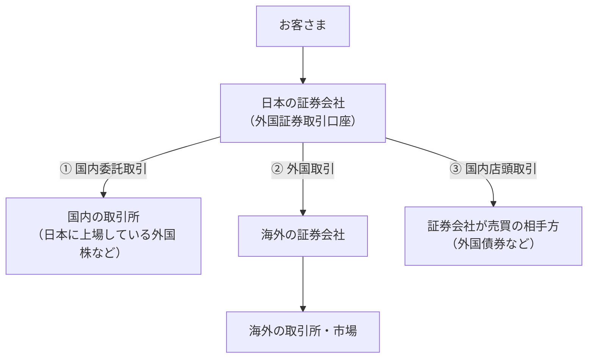
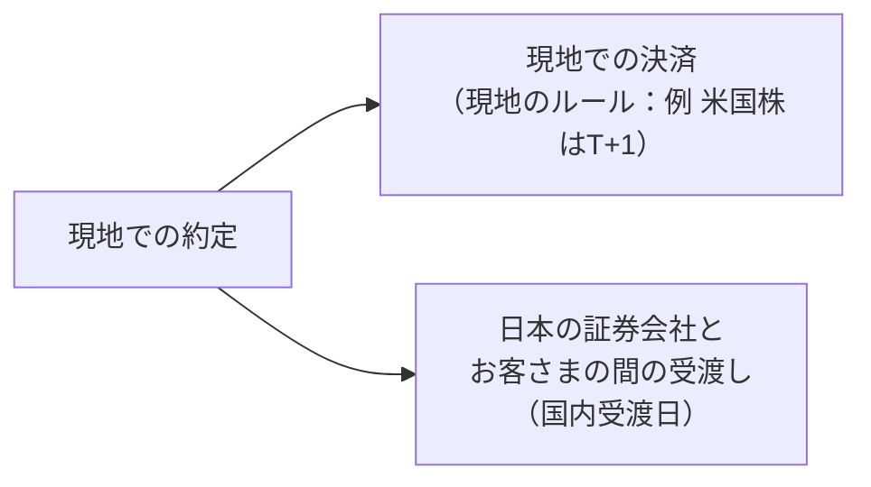

# 外国証券

!!! abstract "3行でいうと"
    - 外国証券（外国株式・外国債券など）は、日本の証券会社を通じて、**国内の取引所**、**海外の市場への取次ぎ**、**証券会社との店頭取引**のいずれかの方法で売買します。
    - 取引を始めるには、ふつうの口座とは別に**外国証券取引口座**を開設し、その約款に同意する必要があります。
    - 外貨建ての商品は、価格の変動に加えて**為替レートの変動**で円での損益が変わります。決済日も国内株式とは異なることがあります。

## なぜ必要なの？

日本の株式・債券だけでなく、海外の企業や国が発行する証券に投資したいというニーズがあります。

- 日本にはない業種や、成長が期待される海外企業に投資したい
- 日本より金利の高い国の債券で、利息を受け取りたい
- 投資先を国や通貨で分散したい

ただし、外国証券は**発行者も市場も海外**にあるため、売買や決済、保管の方法が国内の証券とは異なります。また、日本の法令に加えて現地の法令や慣行も関係します。こうした違いを取り決めておくために、外国証券専用の口座と約款が使われています。

## しくみ

### 外国株式・外国債券の取引方法

外国証券の取引は、大きく次の3つの方法に分かれます。外国証券取引口座約款でも、この3つが区別されています。[^yakan]

| 取引方法 | 内容 | 主な例 |
|---|---|---|
| ① 国内委託取引 | 国内の取引所に上場している外国証券を、国内株式と同じように取引所で売買する | 国内上場の外国株式・外国ETF |
| ② 外国取引 | お客さまの注文を、証券会社が**海外の市場に取り次いで**売買する | 米国株式を米国の取引所で売買 |
| ③ 国内店頭取引 | 取引所を通さず、**証券会社が相手方**となって売買する | 外国債券、外国株式の一部 |

外国取引では、取引時間が現地の取引時間になるため、日本の夜間に売買が成立することがあります。現地の祝日は取引ができない一方、日本の祝日でも現地の市場は開いていることがあります。

### 外国株式と外国債券

| | 外国株式 | 外国債券 |
|---|---|---|
| 何に投資するか | 海外企業の株式（株主になる） | 海外の国・政府機関・企業などが発行する債券 |
| 主な取引方法 | 国内委託取引・外国取引 | 国内店頭取引が中心 |
| 通貨 | 現地通貨建てが一般的 | 外貨建てのほか、**円建て**のものもある |
| 主なリスク | 株価変動、為替、カントリーリスク | 金利変動、発行体の信用、為替（外貨建ての場合） |

### 外国証券取引口座

日本の証券会社で外国証券を取引するには、事前に**外国証券取引口座**を開設し、「外国証券取引口座約款」にもとづいて申し込む必要があります。[^jsda-indiv] この口座の約款については、日本証券業協会の「外国証券の取引に関する規則」にもとづいて参考様式が示されており、各証券会社はそれをもとに約款を定めています。[^yakan][^jsda-rule]

約款では、外国証券の**売買の執行、代金の決済、証券の保管**などを、この口座を通じて処理することや、日本の法令・取引所や協会の規則に加えて、発行者のある国の法令や慣行にも従うことなどが定められています。[^yakan]

!!! info "保管のイメージ"
    外国取引で買った外国株式などは、通常、現地の保管機関（カストディアン）で保管され、日本の証券会社がお客さまの持ち分を管理します。証券会社がお客さまの資産を自社の資産と分けて管理する仕組みについては、[顧客資産の保護：分別管理と投資者保護基金](../flow/asset-protection.md)を参照してください。

### 為替リスク

外貨建ての外国証券は、**証券そのものの価格**と**為替レート**の2つの要因で、円で見た損益が決まります。売却や償還の時点で、買ったときより**円高**になっていれば為替差損、**円安**になっていれば為替差益が生じます。[^jsda-indiv]

!!! example "数字で見るイメージ（手数料・税金などは考慮しない単純化した例）"
    - 1株100ドルの外国株を、1ドル＝150円のときに買った → 円での購入額は **15,000円**。
    - 株価は100ドルのまま変わらず、1ドル＝135円の円高になってから売った → 円での売却額は **13,500円**。
    - 現地通貨（ドル）では損益ゼロでも、**円では1,500円（10%）の損失**になります。

外国証券の代金は、円で支払う方法（**円貨決済**）と外貨で支払う方法（**外貨決済**）があり、どちらの場合も円と外貨を交換するときに為替レートや為替手数料がかかります。具体的な条件は証券会社ごとに異なります。

### 決済日の違い

日本の取引所での株式の売買は、約定日から2営業日後に決済されます（T+2）。一方、海外の市場では決済のルールが国ごとに異なります。たとえば米国の株式は、**2024年5月28日**から約定日の翌営業日に決済する **T+1** に移行しています。[^sec-t1]

外国取引の場合、決済には次の2つの段階があります。

- **現地決済日**：現地の市場のルールにもとづき、海外の証券会社などとの間で決済される日
- **国内受渡日**：日本の証券会社とお客さまの間で、証券と代金を受け渡す日

国内受渡日は、時差や日本と現地の休日を考慮して証券会社が定めており、国内株式の「約定日から2営業日後」と同じとは限りません。外国株の売却代金がいつ使えるようになるか、配当などの権利を得るためにいつまでに買う必要があるかは、現地の市場のルールと証券会社の定めの両方を確認する必要があります。

## よくある誤解

!!! warning "誤解：外国株は、現地の株価が上がれば必ず利益になる"
    外貨建ての証券では、現地の株価が上がっても、それ以上に円高が進めば、円で見ると損失になることがあります。

!!! warning "誤解：外国証券の決済日は、国内株式と同じT+2"
    決済のルールは国・市場ごとに異なり、たとえば米国株は現地でT+1です。さらに、日本の証券会社とお客さまの間の受渡日は、時差や休日を考慮して別に定められています。

!!! warning "誤解：円建ての外国債券なら、為替の影響はまったくない"
    円建てであれば、利息や償還金を受け取るときの為替変動の影響は受けません。ただし、発行体が海外にあるため、発行体の信用やその国の情勢（カントリーリスク）の影響は受けます。

## もっと知りたい人へ

- [日本証券業協会「外国証券の取引に関する規則」（PDF）](https://www.jsda.or.jp/about/kisoku/files/gaikokukisoku.pdf)：外国証券取引口座や、外国証券の取引に関する業界ルール
- [日本取引所グループ掲載「外国証券取引口座約款」（参考様式、PDF）](https://www.jpx.co.jp/english/equities/products/cf/outline/tvdivq0000007k00-att/ga_yakan.pdf)：取引方法の区分、保管、決済などの取り決め
- [日本証券業協会「個人投資家による外国証券取引について」（PDF）](https://www.jsda.or.jp/shijyo/foreign/files/gaikokutorihiki20190716.pdf)：個人が投資できる外国証券の種類と主なリスク

[^yakan]: [日本取引所グループ掲載「外国証券取引口座約款」（日本証券業協会「外国証券の取引に関する規則」第3条第2項による参考様式、PDF）](https://www.jpx.co.jp/english/equities/products/cf/outline/tvdivq0000007k00-att/ga_yakan.pdf)（第1条：国内委託取引・外国取引・国内店頭取引の区分、第2条：外国証券取引口座による処理、第3条：遵守すべき事項）
[^jsda-rule]: [日本証券業協会「外国証券の取引に関する規則」（PDF）](https://www.jsda.or.jp/about/kisoku/files/gaikokukisoku.pdf)
[^jsda-indiv]: [日本証券業協会「個人投資家による外国証券取引について」（PDF、2019年7月16日）](https://www.jsda.or.jp/shijyo/foreign/files/gaikokutorihiki20190716.pdf)
[^sec-t1]: [U.S. SEC, Statement on Upcoming Implementation of T+1 Settlement Cycle（英語）](https://www.sec.gov/newsroom/press-releases/2024-62)

## 関連記事・用語

- [約定から決済まで：T+2とは](../flow/settlement-t2.md)
- [株式](stocks.md)
- [債券](bonds.md)
- [顧客資産の保護：分別管理と投資者保護基金](../flow/asset-protection.md)
- [譲渡益・配当の課税と損益通算](../tax/capital-gains.md)
- [用語集](../glossary.md)（為替リスク・カントリーリスク・受渡日）
