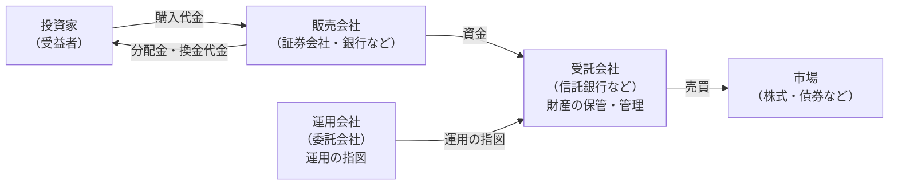
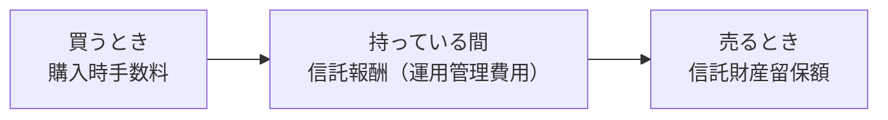
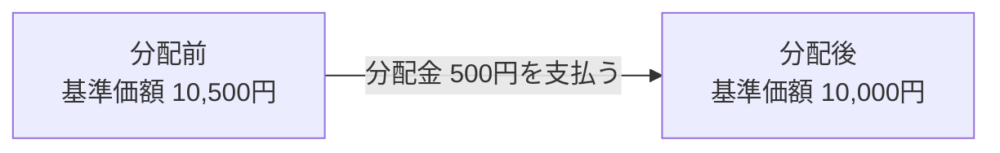

# 投資信託

!!! abstract "3行でいうと"
    - 投資信託は、多くの投資家から集めたお金をひとつにまとめ、専門家（**運用会社**）が株式や債券などに投資・運用する商品です。**販売会社・運用会社・受託会社**の3者が役割を分担しています。
    - 投資信託の値段を**基準価額**といい、原則として1日1回計算されます。
    - コストには**購入時手数料・信託報酬・信託財産留保額**があり、**分配金**は投資信託の財産から支払われるため、支払った分だけ基準価額が下がります。

## なぜ投資信託というしくみがあるの？

株式や債券に自分で投資しようとすると、次のような壁があります。

- **まとまった資金が必要**：株式は100株単位（→ [株式](stocks.md)）で、複数の会社に分けて投資するにはかなりの金額がかかります。
- **分散が難しい**：1社だけに投資すると、その会社の業績に結果が大きく左右されます。
- **知識と時間が必要**：どの会社や債券に投資するかを調べ、管理し続けるのは大変です。

投資信託は、多くの投資家のお金を**まとめて大きな資金にする**ことで、少額でも**多くの銘柄に分散投資**でき、運用を**専門家に任せられる**ようにするしくみです。

## しくみ

### 3者の役割分担

日本で一般的な投資信託（委託者指図型投資信託）は、投資信託及び投資法人に関する法律（投信法）に基づくしくみです。投信法第3条は、金融商品取引業者を**委託者**、信託会社等を**受託者**とする契約でなければならないと定めています。[^toushin-hou]

| 役割 | 主な担い手 | 主な仕事 |
|---|---|---|
| 販売会社 | 証券会社・銀行など | 投資信託の募集・販売、換金の受付、分配金・換金代金の支払い、運用報告書などの交付 |
| 運用会社（委託会社） | 投資信託委託会社（資産運用会社） | 運用方針を決め、何をどれだけ売買するかを受託会社に**指図**する。基準価額を計算する |
| 受託会社 | 信託銀行など | 投資信託の財産（**信託財産**）を保管・管理し、運用会社の指図に従って売買を行う |

!!! info "関係する会社が破綻したら？"
    投資信託の財産は、受託会社の中で、受託会社自身の財産や他の信託の財産と**分けて管理**することが法律で義務づけられています（信託法第34条）。また、受託会社が破産しても、信託財産は破産財団に属しません（信託法第25条第1項）。このため、販売会社・運用会社・受託会社のいずれかが破綻しても、投資信託の財産そのものは守られるしくみになっています。[^shintaku] ただし、**運用による値下がりから守られるわけではありません**。

### 基準価額とは

**基準価額**は、投資信託1口あたりの純資産額で、投資信託の「値段」にあたります。[^jpx-nav]

> 基準価額 ＝ 純資産総額（保有する株式・債券などの時価の合計 − 信託報酬などの費用）÷ 総口数

多くの投資信託は、運用開始時に1口1円で設定され、基準価額は**1万口あたり**の金額で表示されます。また、基準価額は購入・換金を受け付ける営業日に**1日1回**計算されます。[^fsa]

投資信託の購入・換金の注文は、多くの場合、**その日の基準価額がまだ分からない状態**で受け付けられます（ブラインド方式）。株式のように、値段を見ながら売買するのとは異なります。

!!! tip "基準価額の高い・低いと割安・割高は関係ない"
    基準価額の水準は、運用を始めた時期や、これまでの運用成績によって異なるだけです。基準価額が低いからといって「割安」とは限りません。[^fsa]

### コスト：購入時手数料・信託報酬・信託財産留保額

投資信託には、「買うとき」「持っている間」「売るとき」にそれぞれコストがかかる場合があります。

| コスト | いつ | 誰に・どう払う | ポイント |
|---|---|---|---|
| 購入時手数料 | 購入時 | 販売会社に支払う | 同じ投資信託でも販売会社によって異なることがある。手数料がかからないもの（ノーロード）もある |
| 信託報酬（運用管理費用） | 保有期間中ずっと | 信託財産から日々差し引かれ、販売会社・運用会社・受託会社が受け取る | 直接支払う感覚がないが、**長く持つほど影響が大きい** |
| 信託財産留保額 | 換金時 | 信託財産に残される（会社の収入にはならない） | 換金に伴う売買コストを、残る投資家に負担させないためのもの。かからないものもある |

具体的な料率は投資信託ごとに異なり、**目論見書（投資信託説明書）**に記載されています。

### 分配金の考え方

投資信託は、決算のときに運用で得た収益などを投資家に**分配金**として支払うことがあります。分配金の額は運用状況などによって変わり、支払われないこともあります。

**分配金は投資信託の財産（純資産）から支払われます。** そのため、分配金が支払われると、その分だけ基準価額が下がります。[^jsda]

（数字は説明用の例です。1万口あたり）

さらに分配金は、その投資家の**個別元本**（その投資家が買ったときの基準価額にあたる、1人ひとりの元本）との関係で、2種類に分けられます。[^jsda]

| 種類 | 内容 | 税金 |
|---|---|---|
| 普通分配金 | 分配後の基準価額が個別元本**以上**の場合の分配金（＝運用の利益からの分配） | 課税される |
| 元本払戻金（特別分配金） | 分配後の基準価額が個別元本を**下回る**部分の分配金（＝自分が出した元本の一部が戻ってきたもの） | 課税されない（所得税法第9条第1項第11号）[^shotoku] |

元本払戻金を受け取ると、その分だけ個別元本が減ります。

[^toushin-hou]: [e-Gov法令検索「投資信託及び投資法人に関する法律」](https://laws.e-gov.go.jp/law/326AC0100000198)（第2条第1項、第3条）
[^shintaku]: [e-Gov法令検索「信託法」](https://laws.e-gov.go.jp/law/418AC0000000108)（第25条、第34条）
[^jpx-nav]: [日本取引所グループ「株価指数等、基準価額及び市場価格」](https://www.jpx.co.jp/equities/products/etfs/etf-outline/03.html)（基準価額＝一口あたりの純資産額）
[^fsa]: [金融庁「教えて虫とり先生（第6回）投資信託って、どういうものなの？」](https://www.fsa.go.jp/policy/nisa2/attention/01/01_06.html)
[^jsda]: [日本証券業協会「『毎月分配型の投資信託』とは？」](https://www.jsda.or.jp/about/hatten/risk/bunpai/index.html)
[^shotoku]: [e-Gov法令検索「所得税法」](https://laws.e-gov.go.jp/law/340AC0000000033)（第9条第1項第11号：オープン型の証券投資信託の収益の分配のうち、信託財産の元本の払戻しに相当する部分）

## よくある誤解

!!! warning "誤解：分配金が多い投資信託ほど、よく儲かっている"
    分配金は投資信託の財産から支払われるので、その分だけ基準価額が下がります。運用で得た収益を超えて分配されることもあり、その場合は実質的に**自分の元本の一部が戻ってきている**だけ（元本払戻金）ということもあります。分配金の多さだけでは運用成績は判断できません。

!!! warning "誤解：投資信託は銀行や証券会社で買うから元本が保証されている"
    投資信託は預金ではなく、**元本の保証はありません**。運用の結果、基準価額が購入時を下回れば損失が出ます。販売会社が破綻しても財産は守られるしくみがありますが、それは値下がりから守るものではありません。

!!! warning "誤解：コストは買うときの手数料だけ"
    保有している間は、信託報酬が信託財産から毎日差し引かれています。長期間持つほど、信託報酬の差が運用成果に与える影響は大きくなります。

## もっと知りたい人へ

- [e-Gov法令検索「投資信託及び投資法人に関する法律」](https://laws.e-gov.go.jp/law/326AC0100000198)：第2条（投資信託の定義）、第3条（委託者・受託者）
- [日本証券業協会「『毎月分配型の投資信託』とは？」](https://www.jsda.or.jp/about/hatten/risk/bunpai/index.html)：分配金と基準価額、普通分配金と元本払戻金の関係
- [金融庁 NISA特設ウェブサイト「教えて虫とり先生（第6回）」](https://www.fsa.go.jp/policy/nisa2/attention/01/01_06.html)：投資信託の基本とコストを対話形式で紹介（参加者のコメントは個人の見解とされています）

## 関連記事・用語

- [ETF・REIT](etf-reit.md)
- [株式](stocks.md)
- [債券](bonds.md)
- [NISA](../tax/nisa.md)
- [顧客本位の業務運営](../rules/fiduciary.md)
- [商品の基礎](index.md)
- [用語集](../glossary.md)（基準価額・信託報酬・目論見書）
