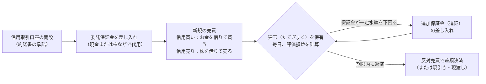

# 信用取引

!!! abstract "3行でいうと"
    - 信用取引は、**委託保証金**を担保として証券会社に預け、**お金や株を借りて**売買する取引です。保証金の約3倍までの売買や、持っていない株を売る「**信用売り**」ができます。
    - 値動きで損が出て保証金が一定の水準を下回ると、**追加保証金（追証）**を差し入れる必要があります。
    - 借りた分まで値動きの影響を受けるため、**預けた保証金を超える損失**が出ることがあります。

## なぜこんな取引があるの？

ふつうの株式の売買（**現物取引**）では、買うときは代金を全額用意し、売るときは自分が持っている株しか売れません。

信用取引では、証券会社から**買付代金を借りて買う**（**信用買い**）、または**株を借りて売る**（**信用売り**）ことができます。これにより、次のような使い方が可能になります。

- 手元の資金より大きな金額の売買をする（**レバレッジ**）
- 株価が**下がる**と考えたときにも取引できる（信用売り）
- 持っている株の値下がりに備えて、同じ銘柄を信用売りしておく（つなぎ売り）

一方、借りたお金や株は**期限内に返す**必要があり、金利などのコストもかかります。市場全体としては、売買を活発にして価格がつきやすくなる（流動性が高まる）という役割もあります。

## しくみ

信用取引で買った株や売った株は、多くの場合、反対の売買（**反対売買**）をして差額の損益だけを受け渡すことで返済（**弁済**）します。

信用取引を始めるには、ふつうの証券口座とは別に**信用取引口座**を設定し、取引所が定める様式の「信用取引口座設定約諾書」の内容を承諾する必要があります。[^fse-rule]

### 委託保証金：最初に預ける担保

信用取引で新しく売買（**新規建て**）をするときは、担保として**委託保証金**を差し入れます。最低限の水準は、金融商品取引法第161条の2にもとづく内閣府令で定められています。[^egov-ord]

| 項目 | 内容 |
|---|---|
| 保証金の率 | 約定価額（売買した金額）の **30%以上** |
| 最低額 | **30万円**（30%で計算した額が30万円に満たない場合） |
| 差し入れの期限 | 売買をした日から起算して**3日以内**（休業日は数えない） |
| 株などでの代用 | 保証金は株などの有価証券で代用でき、株券の評価額は**前日時価の80%以下**で計算 |

たとえば100万円分の株を信用買いするには、30万円以上の保証金が必要です。逆にいえば、保証金の**約3.3倍**までの売買ができることになります。[^tse-pdf]

!!! info "率は引き上げられることがある"
    上の表は法令上の最低限です。証券会社が独自にこれより厳しい条件を定めている場合や、相場が過熱した銘柄について取引所が保証金率の引き上げなどの**規制**を行う場合があります。また、レバレッジ型・ダブルインバース型のETF等では、より高い率が求められます。[^tse-pdf]

### 追加保証金（追証）：保証金が足りなくなったとき

保証金は、株価の値動きで生じた評価損や金利などを差し引いて毎日計算し直されます。[^tse-pdf]

取引所の受託契約準則（取引所が定める、売買の受託に関するルール）では、受け入れている保証金の総額が、保有している建玉の約定価額の **20%** を下回ると、20%の水準を回復するために必要な額を、損失が生じた日から起算して**3日目の日まで**の証券会社が指定する日時までに、追加で差し入れさせなければならないとされています。[^fse-rule] これが**追証（おいしょう）**です。実際の追証の発生水準や差し入れ期限は、この基準をもとに**各証券会社が定めており**、より厳しい（期限が短いなど）場合があります。必ず取引する証券会社のルールを確認してください。

!!! example "数字で見るイメージ（手数料・金利などは考慮しない単純化した例）"
    - 現金30万円を保証金にして、100万円分の株を信用買いした。
    - 株価が15%下がり、評価損が15万円になった → 保証金は 30万円 − 15万円 ＝ **15万円**。
    - 建玉100万円の20%は**20万円**なので、5万円の不足 → **追証**が発生。

実際の期限や計算方法は証券会社ごとの約款で定められ、上の例より早い期限が設定されていることもあります。追証を期限までに差し入れられない場合は、証券会社が建玉を**強制的に決済**することがあり、損失が確定します。

### 制度信用と一般信用

信用取引には2種類あり、お客さまは注文のときにどちらかを選びます。[^jpx-outline]

| | 制度信用取引 | 一般信用取引 |
|---|---|---|
| 対象銘柄 | 取引所が選定した銘柄 | 原則、全上場銘柄（実際の取扱いは証券会社が決める） |
| 返済期限 | **最長6か月** | お客さまと証券会社の間で決める |
| 品貸料（逆日歩） | 取引所が発表 | お客さまと証券会社の間で決める |
| 貸借取引 | 利用できる | 利用できない |

制度信用取引では、証券会社が決済に必要なお金や株を**証券金融会社**から借りる仕組み（**貸借取引**）が使えます。東京証券取引所は、日本証券金融株式会社を指定証券金融会社としています。[^jpx-outline]

### 信用取引のコスト

- **買方金利**：信用買いで借りたお金にかかる金利
- **貸株料**：信用売りで借りた株にかかる費用
- **品貸料（逆日歩）**：信用売りが増えて株が不足したときに、売り方が追加で負担する費用。株の需給によって発生し、事前には金額が決まりません。[^jpx-outline]

## リスク：損失が元本を超える可能性

!!! danger "信用取引の主なリスク"
    - **保証金を超える損失**：保証金の約3倍の取引をしているため、値動きが不利な方向に大きく動くと、預けた保証金をすべて失ってもなお足りない損失（**不足金**）が出ることがあります。[^tse-pdf]
    - **信用売りの損失は理論上無限大**：株価には上限がないため、信用売りした銘柄の株価が上がり続けると、損失も際限なく膨らみます。[^tse-pdf]
    - **追証と強制決済**：短期間に追証が求められ、差し入れられなければ不利なタイミングで決済されることがあります。
    - **代用有価証券の値下がり**：株で保証金を代用している場合、その株が値下がりすると保証金も減ります。相場全体が下がると、建玉の損失と代用有価証券の値下がりが**同時に**起きやすくなります。
    - **期限と規制**：制度信用は最長6か月で返済が必要です。取引所や証券会社の規制で、保証金率の引き上げなどが行われることもあります。

## よくある誤解

!!! warning "誤解：損をしても、失うのは預けた保証金まで"
    信用取引の損失は保証金の範囲にとどまりません。保証金を超えた損失は、お客さまが**追加で支払う**必要があります。

!!! warning "誤解：信用取引は「借金して投資する」だけのもの"
    信用買いだけでなく、株を借りて売る**信用売り**もあります。信用売りは株価が下がると利益、上がると損失になり、現物取引と逆の動きになります。

!!! warning "誤解：一般信用なら、いつまでも持ち続けられる"
    一般信用の返済期限は証券会社とお客さまの間で決めるもので、「無期限」とは限りません。また期限がなくても、金利などのコストは保有期間に応じてかかり続けます。

## もっと知りたい人へ

- [日本取引所グループ「信用取引制度の概要」](https://www.jpx.co.jp/equities/trading/margin/outline/index.html)：制度信用と一般信用の比較、貸借取引、コスト
- [東京証券取引所 資料「信用取引制度の概要」（PDF）](https://www.jpx.co.jp/equities/trading/margin/outline/tvdivq0000007szb-att/Outline_of_the_Margin_Trading_System_J.pdf)：図解つきの概要と留意点
- [e-Gov法令検索「金融商品取引法第百六十一条の二に規定する取引及びその保証金に関する内閣府令」](https://laws.e-gov.go.jp/law/328M50000040075)：委託保証金の率・最低額・代用価格の法令上の定め

[^egov-ord]: [e-Gov法令検索「金融商品取引法第百六十一条の二に規定する取引及びその保証金に関する内閣府令」](https://laws.e-gov.go.jp/law/328M50000040075)（第2条：率は100分の30、第3条：最低30万円、第4条：取引日から起算して3日以内に預託、第6条：株券の代用価格は前日時価の100分の80を超えない額）。根拠条文は[金融商品取引法第161条の2](https://laws.e-gov.go.jp/law/323AC0000000025)。
[^tse-pdf]: [東京証券取引所 資料「信用取引制度の概要」（PDF）](https://www.jpx.co.jp/equities/trading/margin/outline/tvdivq0000007szb-att/Outline_of_the_Margin_Trading_System_J.pdf)（委託保証金率30%の場合のレバレッジ約3.3倍、保証金の計算方法、レバレッジ型・ダブルインバース型ETF等の保証金率、留意点）
[^jpx-outline]: [日本取引所グループ「信用取引制度の概要」](https://www.jpx.co.jp/equities/trading/margin/outline/index.html)
[^fse-rule]: [福岡証券取引所「受託契約準則」（PDF）](https://www.fse.or.jp/files/rul_bun/05jyutaku.pdf)（第5条：信用取引口座設定約諾書、第37条：信用取引に係る委託保証金の維持）。受託契約準則は各取引所が定めるもので、ここでは全文が公開されている福岡証券取引所の準則を例として示しています。

## 関連記事・用語

- [株式](stocks.md)
- [注文の出し方：成行・指値と売買単位](../flow/order-types.md)
- [デリバティブ入門](derivatives.md)
- [適合性原則と説明義務](../rules/suitability.md)
- [用語集](../glossary.md)（建玉・追証・逆日歩・反対売買）
