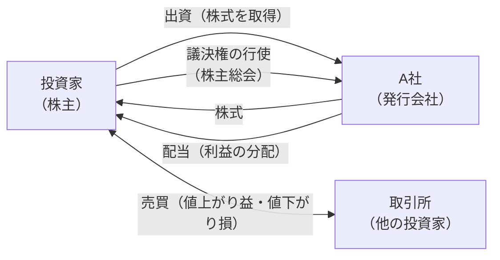

# 株式

!!! abstract "3行でいうと"
    - 株式は、会社にお金を出した人（**株主**）が持つ「会社の持ち分」です。株主には**配当を受け取る権利**や**株主総会で議決権を行使する権利**などがあります。
    - 株式で得られる利益は、主に**値上がり益（キャピタルゲイン）**と**配当（インカムゲイン）**の2つです。一方で、値下がりや発行会社の経営悪化による損失のリスクがあります。
    - 日本の取引所に上場している国内株式の売買単位（**単元**）は、原則として**100株**に統一されています。

## なぜ株式というしくみがあるの？

会社が事業を大きくするには、工場や設備、人材などのためのお金（資金）が必要です。資金の集め方には大きく2つあります。

- **借りる**：銀行から借りる、債券を発行する（→ [債券](bonds.md)）。返済と利息の支払いが必要です。
- **出してもらう**：株式を発行して、出資者（株主）からお金を出してもらう。原則として**返済する必要はありません**。

出資した人は、その見返りとして会社の「持ち分」である株式を受け取り、会社が成長すればその利益を分かち合えます。つまり株式は、**会社は返済不要の資金を得られ、出資者は会社の成長の果実を得られる**しくみです。

そして株式を取引所に**上場**すると、株主は持っている株式を市場で他の投資家に売ることができます。いつでも換金できる場があるからこそ、多くの人が安心して出資できるのです。

## しくみ

### 株主の権利

会社法第105条第1項は、株主が持つ代表的な権利として次の3つを挙げています。[^kaisha]

| 権利 | 内容 |
|---|---|
| 剰余金の配当を受ける権利 | 会社の利益などから分配される**配当**を受け取る |
| 残余財産の分配を受ける権利 | 会社が解散したとき、借金などを返した後に残った財産の分配を受ける |
| 株主総会における議決権 | 取締役の選任など、会社の重要な事柄を決める株主総会で投票する |

このほか、株主総会で質問したり、一定の条件のもとで議案を提案したりする権利もあります。

!!! info "株主の責任は「出資した額まで」"
    会社法第104条は「株主の責任は、その有する株式の引受価額を限度とする」と定めています（**有限責任**）。会社が倒産しても、株主が会社の借金を肩代わりする必要はありません。逆にいえば、最悪の場合は**出資した額（株式の価値）がゼロになる**ということです。

### 利益の源泉：値上がり益と配当

| 種類 | 呼び方 | 内容 | 注意点 |
|---|---|---|---|
| 値上がり益 | キャピタルゲイン | 買った値段より高く売れたときの差額 | 値下がりすれば損失（キャピタルロス）になる |
| 配当 | インカムゲイン | 会社が利益の一部を株主に分配するもの | 業績などにより減ったり、出なかったりする |

配当や株主優待を受け取るには、会社が定めた日（権利確定日）に株主名簿に載っている必要があります。売買の約定から株主名簿への記載までの流れは、[約定から決済まで：T+2とは](../flow/settlement-t2.md)で解説しています。

### リスク：価格変動と発行会社の信用

株式には**元本の保証がありません**。主なリスクは次のとおりです。

- **価格変動リスク**：株価は、会社の業績、景気、金利、為替、市場全体の雰囲気など、さまざまな要因で日々上下します。買った値段を下回ることもあります。
- **発行会社の信用リスク**：発行会社の業績が悪化すると、配当が減ったりなくなったりします。経営破綻すれば、株式の価値はほぼゼロになることがあります。
- **流動性リスク**：取引が少ない銘柄では、売りたいときに希望する値段で売れないことがあります。

!!! tip "株価がどう決まるか"
    取引所での株価の決まり方（板・オークション方式）は、[市場のしくみ](../market/price-formation.md)で解説します。

### 単元株と単元未満株

#### 単元株：売買の「ひとまとまり」

会社は、定款で「何株を1単元とし、1単元ごとに1個の議決権を与えるか」を定めることができます（会社法第188条、**単元株制度**）。取引所では、この単元株式数が売買の単位（**売買単位**）になります。[^jpx-news]

かつて上場会社の売買単位は1株・10株・100株・1,000株など8種類もあり、投資家にとって分かりにくい状態でした。全国の証券取引所は2007年から統一に取り組み、**2018年10月1日に、国内株式の売買単位は100株に統一されました**。[^jpx-unit]

| 例 | 計算 | 最低限必要な金額（手数料等を除く） |
|---|---|---|
| 株価 1,500円のA社 | 1,500円 × 100株 | 150,000円 |
| 株価 300円のB社 | 300円 × 100株 | 30,000円 |

（A社・B社の株価は説明用の架空の数字です）

#### 単元未満株：100株に満たない株式

1単元（100株）に満たない株式を**単元未満株**といいます。株式分割・合併などで持つことになる場合や、証券会社が提供する単元未満株の取引サービスで買う場合があります。

単元未満株には、通常の株式と比べて次のような違いがあります。

- **議決権がない**：単元未満株主は、その単元未満株式について株主総会で議決権を行使できません（会社法第189条第1項）。
- **一部の権利が制限されることがある**：会社は定款で、単元未満株主が行使できる権利を一定の範囲で制限できます（同条第2項）。
- **取引所では原則として売買できない**：売買単位に満たないため、取引所の通常の売買ではなく、証券会社の単元未満株取引サービスなどを通じて取引します。
- **会社に買い取ってもらえる**：単元未満株主は、会社に対して単元未満株式の買取りを請求できます（会社法第192条）。

[^kaisha]: [e-Gov法令検索「会社法」](https://laws.e-gov.go.jp/law/417AC0000000086)（第104条、第105条、第188条、第189条、第192条）
[^jpx-news]: [日本取引所グループ「売買単位の統一に向けた単元株式数の変更等に関するご注意（再掲）」](https://www.jpx.co.jp/news/1021/20180925-01.html)（東証は議決権の単位である単元株式数を売買単位としている旨の説明）
[^jpx-unit]: [日本取引所グループ「売買単位の統一」](https://www.jpx.co.jp/equities/improvements/unit/index.html)

## よくある誤解

!!! warning "誤解：株価が低い株ほど「お買い得」"
    株価の高い・低いは、会社が発行している株式の数などによっても変わります。株価の水準だけでは、割安か割高かは判断できません。

!!! warning "誤解：配当は必ずもらえる"
    配当は会社の利益などから支払われるもので、預金の利息のように約束されたものではありません。業績が悪化すれば減ったり、なくなったりします。

!!! warning "誤解：株式を買うと、損失が投資額を超えることがある"
    現物の株式を買う場合、株主の責任は出資した額が限度（有限責任）なので、最大の損失は投資した金額です。ただし、お金を借りて取引する[信用取引](margin-trading.md)では、投資額を超える損失が出る可能性があります。

## もっと知りたい人へ

- [e-Gov法令検索「会社法」](https://laws.e-gov.go.jp/law/417AC0000000086)：第105条（株主の権利）、第188条〜第194条（単元株式数）
- [日本取引所グループ「売買単位の統一」](https://www.jpx.co.jp/equities/improvements/unit/index.html)：100株への統一までの経緯
- [e-Gov法令検索「金融商品取引法」](https://laws.e-gov.go.jp/law/323AC0000000025)：第2条第1項（株券が「有価証券」に含まれることの定義）

## 関連記事・用語

- [約定から決済まで：T+2とは](../flow/settlement-t2.md)
- [注文の出し方：成行・指値と売買単位](../flow/order-types.md)
- [信用取引](margin-trading.md)
- [インサイダー取引規制](../rules/insider-trading.md)
- [商品の基礎](index.md)
- [用語集](../glossary.md)（単元株・配当・議決権）
