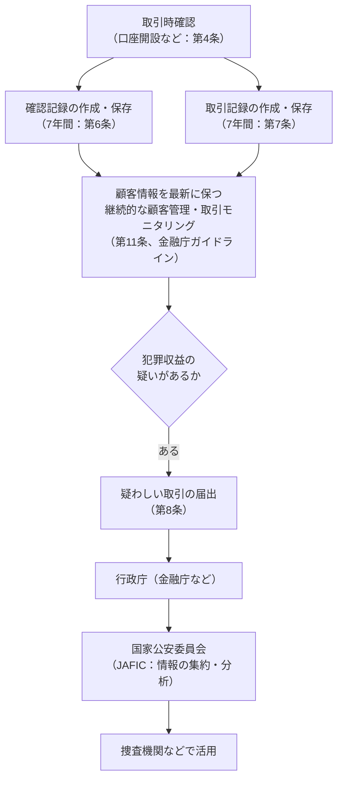
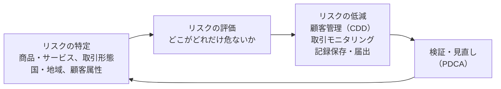

# マネロン対策（犯収法）

!!! abstract "3行でいうと"
    - **マネー・ローンダリング（マネロン）**とは、犯罪で得たお金の出どころを分からなくし、正当なお金に見せかけることです。証券口座も悪用されるおそれがあります。
    - 証券会社は**犯罪収益移転防止法（犯収法）**の「特定事業者」として、**取引時確認**、**記録の保存（7年間）**、**疑わしい取引の届出**などを義務づけられています。
    - 金融庁のガイドラインは、自社のリスクを特定・評価し、リスクに見合った対策をとる**リスクベース・アプローチ**を求めています。

## マネー・ローンダリングとは

犯罪で得たお金（犯罪収益）は、そのまま使うと足がつきます。そこで、他人名義の口座に入れたり、株などの資産に換えたりして、出どころをたどれないようにします。これがマネー・ローンダリング（資金洗浄）です。テロ活動への資金提供（**テロ資金供与**）と合わせて、国際的に対策が求められています。

犯収法第1条は、犯罪収益が組織的な犯罪を助長し、健全な経済活動に重大な悪影響を与えること、また没収や被害回復を難しくすることから、その移転を防ぐことが極めて重要だとしています。[^hansyu]

国家公安委員会の「犯罪収益移転危険度調査書」は、証券会社などを通じた投資について、犯罪収益をさまざまな権利に換えたり、その価値を増やしたりできることから、マネロンに悪用される危険性があると評価しています。実際に、次のような事例が挙げられています（要約）。[^risk]

- 架空・他人名義で開設した証券口座に詐欺の収益を入金し、株式を購入した
- 業務上横領で得たお金を商品先物取引に投資した

さらに、**匿名や架空名義・借名（他人の名義を借りること）による取引**は、危険度がより一層高まるとされています。

## しくみ：証券会社のマネロン対策の流れ

証券会社（金融商品取引業者）は、犯収法第2条第2項第21号で「**特定事業者**」とされています。[^hansyu]

## 取引時確認と確認記録の保存

### 取引時確認

口座開設などの取引の際には、本人特定事項（氏名・住居・生年月日など）、取引を行う目的、職業、法人の場合は実質的支配者などを確認します（第4条第1項）。基本的な確認項目は[口座開設：本人確認と適合性の原則](../flow/account-opening.md)で紹介しているので、ここでは一歩進んだポイントを見ます。

- **より厳格な確認（第4条第2項）**：なりすましの疑いがある取引、過去の確認で事項を偽っていた疑いがある顧客との取引、マネロン対策が不十分と認められる国・地域（特定国等）に関係する取引などでは、通常とは異なる方法での確認が必要です。一定額を超える財産の移転を伴う場合は、**資産及び収入の状況**も確認します。
- **お客さまも偽ってはいけない（第4条第6項）**：顧客は、取引時確認の事項を偽ってはなりません。本人特定事項を隠す目的で偽った場合は、**3年以下の拘禁刑もしくは500万円以下の罰金、またはその両方**の対象です（第25条）。
- **確認に応じない場合（第5条）**：お客さまが取引時確認に応じないときは、証券会社は応じるまで取引に係る義務の履行を拒むことができます。
- **情報を最新に保つ（第11条）**：証券会社は、確認した事項を**最新の内容に保つための措置**を講じるものとされ、あわせて社員教育、規程の作成、統括管理者の選任などに努める必要があります。

（以上の条番号はいずれも犯収法[^hansyu]）

### 記録の保存

| 記録 | 内容 | 保存期間 | 根拠 |
|---|---|---|---|
| 確認記録 | 取引時確認で確認した事項や、そのためにとった措置など | 契約が終了した日などから**7年間** | 第6条 |
| 取引記録 | 確認記録を検索するための事項、取引の期日・内容など | 取引が行われた日から**7年間** | 第7条 |

記録を残しておくことで、後から捜査機関などが資金の流れをたどれるようにしています。[^hansyu]

## 疑わしい取引の届出

証券会社は、取引で受け取った財産が**犯罪収益である疑い**があるかどうかなどを判断し、疑いがあると認められる場合は、**速やかに行政庁に届け出**なければなりません（第8条第1項）。[^hansyu]

- **判断の方法**：取引時確認の結果、取引の態様その他の事情、そして国家公安委員会が毎年公表する**犯罪収益移転危険度調査書**の内容を勘案して判断します（第8条第3項、第3条第3項）。
- **お客さまに知らせてはいけない**：届出をしようとしていること、または届け出たことを、その顧客や関係者に**漏らしてはなりません**（第8条第4項）。
- **届出のゆくえ**：届出の情報は行政庁を通じて国家公安委員会に集められ（第8条第5項・第6項）、刑事事件の捜査などに活用されるよう、集約・整理・分析されます（第3条第2項）。この役割を担うのが、警察庁の犯罪収益移転防止対策室（**JAFIC**）です。

金融庁は、業態別に「**疑わしい取引の参考事例**」を公表しています。[^str] また危険度調査書によると、金融商品取引業者等からの届出件数は**2025年に32,342件**で、2023〜2025年に届出の多かった理由は「不自然な態様・態度等」「架空名義・借名口座使用」「暴力団員等」の順でした。[^risk]

!!! info "2026年の犯収法改正"
    2026年6月10日に「犯罪による収益の移転防止に関する法律の一部を改正する法律」（令和8年法律第34号）が公布され、同年**7月10日**から一部が施行されました。

    - 本人特定事項を隠す目的で偽る行為の罰則が、1年以下の拘禁刑・100万円以下の罰金から、**3年以下の拘禁刑・500万円以下の罰金**に引き上げられました（第25条）。
    - 正当な理由なく、報酬を払って**他人に口座などを使った送金（財産の移転）を依頼する**ことや、それを引き受けること、広告などで誘うことが新たに処罰の対象になりました（第32条）。

    警察による口座の犯罪利用を防ぐための措置などを定めた残りの部分は、公布から1年以内に施行される予定です。施行日はe-Gov法令検索の改正履歴で確認しています。[^hansyu]

[^hansyu]: [e-Gov法令検索「犯罪による収益の移転防止に関する法律」](https://laws.e-gov.go.jp/law/419AC0000000022)（2026年8月12日施行時点の条文を確認）
[^risk]: [国家公安委員会「犯罪収益移転危険度調査書」（令和8年11月）](https://www.npa.go.jp/sosikihanzai/jafic/nenzihokoku/risk/risk081119.pdf)：「第5 商品・サービスの危険度」のうち、金融商品取引業者等が取り扱う有価証券の売買の取次ぎ等
[^str]: [金融庁「疑わしい取引の参考事例」](https://www.fsa.go.jp/str/jirei/index.html)

## 金融庁ガイドラインの考え方

金融庁の「**マネー・ローンダリング及びテロ資金供与対策に関するガイドライン**」は、証券会社を含む金融庁所管の特定事業者を対象に、「対応が求められる事項」などを示しています。最新版は**2026年3月31日**付です。[^gl]

### リスクベース・アプローチ

ガイドラインの中心にあるのが**リスクベース・アプローチ**です。金融機関等が、自らのマネロン・テロ資金供与リスクを**特定・評価**し、リスク許容度の範囲内に実効的に**低減**するため、リスクに見合った対策を講じることをいいます。

リスクの低減策として、顧客管理（**CDD**：カスタマー・デュー・ディリジェンス）、取引モニタリング・フィルタリング、記録の保存、疑わしい取引の届出、ITシステムやデータの管理などが挙げられています。

たとえば**継続的な顧客管理**では、顧客のリスクが高まったと考えられる事象が起きたときに機動的に顧客情報を確認するだけでなく、定期的な確認の**頻度も顧客のリスクに応じて変える**ことが求められています。

### 三つの防衛線

ガイドラインは、組織内の役割を「**三つの防衛線**」で整理しています。第1の防衛線は**営業部門**、第2の防衛線はコンプライアンス部門などの管理部門、第3の防衛線は内部監査部門です。お客さまと直接接する営業部門が、マネロン対策の最前線と位置づけられています。[^gl]

[^gl]: [金融庁「マネー・ローンダリング及びテロ資金供与対策に関するガイドライン」（令和8年3月31日）](https://www.fsa.go.jp/news/r7/amlcft/20260331/02.pdf)：Ⅱ（リスクベース・アプローチ）、Ⅲ－３（三つの防衛線等）

## よくある誤解

!!! warning "誤解：疑わしい取引を届け出たら、お客さまに伝えるべき"
    届出をしようとしていること・届け出たことを、顧客や関係者に漏らすことは**禁止**されています（犯収法第8条第4項）。

!!! warning "誤解：口座開設のときに確認すれば、それで終わり"
    確認した情報を**最新の内容に保つ措置**が求められています（第11条）。ガイドラインも、リスクに応じた**継続的な顧客管理**を求めています。

!!! warning "誤解：証券会社はマネロンとは無縁"
    危険度調査書は、証券会社などを通じた投資がマネロンに悪用される危険性があると評価しており、架空・他人名義の証券口座を使った事例も挙げています。

!!! note "この記事について"
    この記事は制度の概要を紹介する一般的な解説で、個別の事案についての法的助言ではありません。実際の判断は、社内規程と所管部署の指示に従ってください。

## もっと知りたい人へ

- [e-Gov法令検索「犯罪による収益の移転防止に関する法律」](https://laws.e-gov.go.jp/law/419AC0000000022)：第4条（取引時確認）、第6条・第7条（記録の保存）、第8条（疑わしい取引の届出）
- [金融庁「マネー・ローンダリング及びテロ資金供与対策に関するガイドライン」](https://www.fsa.go.jp/news/r7/amlcft/20260331/02.pdf)：リスクベース・アプローチと「対応が求められる事項」
- [警察庁 JAFIC「年次報告書・犯罪収益移転危険度調査書」](https://www.npa.go.jp/sosikihanzai/jafic/nenzihokoku/nenzihokoku.htm)：届出の統計や、業態・取引ごとの危険度の評価
- [金融庁「疑わしい取引の参考事例」](https://www.fsa.go.jp/str/jirei/index.html)：業態別に、届出を検討すべき取引の例

## 関連記事・用語

- [口座開設：本人確認と適合性の原則](../flow/account-opening.md)
- [金融商品取引法のポイント](fiea.md)
- [インサイダー取引規制](insider-trading.md)
- [用語集](../glossary.md)
