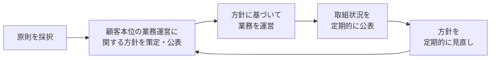

# 顧客本位の業務運営

!!! abstract "3行でいうと"
    - **顧客本位の業務運営に関する原則**は、金融事業者がお客さまの**最善の利益**を追求するための考え方を示した、金融庁の7つの原則（と補充原則）です。
    - 法律のような細かいルールではなく、各社が採択して自ら方針を作り、**実施しない原則があればその理由を説明する**「プリンシプルベース」のしくみです。
    - お客さまが商品を比べやすくする**重要情報シート**や、販売会社どうしを比べられる**共通KPI**の公表が、その取組みの代表例です。

## なぜ必要なの？

金融商品は、手数料やリスクの仕組みが分かりにくく、販売する側とお客さまの間に大きな情報の差があります。販売会社にとって手数料の高い商品が、お客さまにとっても良い商品とは限りません。

法令で決められた最低限のルール（[適合性の原則や説明義務](suitability.md)など）を守るだけでは、「お客さまのためになっているか」までは確保しきれません。そこで金融庁は、金融事業者が**形式ではなく実質で**お客さま本位の業務を行うよう促すため、**2017年3月30日**に「顧客本位の業務運営に関する原則」を策定しました。その後、2021年1月15日と**2024年9月26日**に改訂されています。[^fsa-fd] [^fd-pdf]

## しくみ：プリンシプルベース・アプローチ

この原則は、とるべき行動を細かく定める「ルールベース」ではなく、各社がそれぞれの状況に応じて趣旨を考えて実践する「**プリンシプルベース・アプローチ**」を採用しています。原則を採択した金融事業者は、次のことを求められます。[^fd-pdf]

- 原則2〜7と補充原則の内容ごとに、**実施する場合は対応方針**を、**実施しない場合はその理由や代替策**を、分かりやすく方針に盛り込む
- 方針に対応した形で、取組状況を明確に示す

金融庁は、原則を採択し方針などを報告した事業者を「**金融事業者リスト**」として公表しています。[^fsa-fd]

### 7つの原則

| 原則 | テーマ | 内容（要約） |
|---|---|---|
| 原則1 | 方針の策定・公表等 | 顧客本位の業務運営の方針を策定・公表し、取組状況を定期的に公表、方針も定期的に見直す |
| 原則2 | 顧客の最善の利益の追求 | 高度の専門性と職業倫理を保ち、誠実・公正に業務を行い、顧客の最善の利益を図る。企業文化として定着させる |
| 原則3 | 利益相反の適切な管理 | 顧客との利益相反の可能性を正確に把握し、適切に管理する。対応方針をあらかじめ策定する |
| 原則4 | 手数料等の明確化 | 顧客が負担する手数料などの詳細を、何の対価かも含めて分かるように情報提供する |
| 原則5 | 重要な情報の分かりやすい提供 | 商品のリターン・リスク・取引条件、想定する顧客属性、選定理由、利益相反の内容などを分かりやすく提供する |
| 原則6 | 顧客にふさわしいサービスの提供 | 顧客の資産状況・取引経験・知識・取引目的やニーズを把握し、ふさわしい商品・サービスを組成・販売・推奨する |
| 原則7 | 従業員に対する適切な動機づけの枠組み等 | 顧客の最善の利益を追求する行動などを促す報酬・業績評価体系、研修、ガバナンス体制を整備する |

2024年の改訂では、商品を作る側（運用会社など）が、想定する顧客層を明確にして商品を組成し、販売後も検証するといった「**プロダクトガバナンスに関する補充原則**」（補充原則1〜5）が新たに加わりました。[^fd-pdf]

!!! info "法律上の義務との関係"
    原則そのものは法律ではなく、採択するかどうかも各社の判断です。一方で、**2024年11月1日**からは「金融サービスの提供及び利用環境の整備等に関する法律」**第2条**により、証券会社などは「顧客等の**最善の利益を勘案しつつ**、顧客等に対して誠実かつ公正に」業務を行うことが**法律上の義務**になっています。[^fsa-act]

    また、**2025年12月1日**からは、内閣府令の改正により、顧客との**利益相反の可能性**に係る事項について顧客への情報提供が義務づけられています。[^coi]

## 重要情報シート

**重要情報シート**は、金融商品の重要な情報を**簡潔にまとめ**、銀行・証券・保険といった業態の違いを超えて、お客さまが商品を**比べやすく**するための資料です。金融庁が2021年5月12日に、作成・活用の手引きとフォーマット例を公表しました。[^sheet]

フォーマット例には、販売会社自身について説明する「**金融事業者編**」と、商品ごとの「**個別商品編**」があります。個別商品編の項目は次のとおりです。

| 項目 | 主な内容 |
|---|---|
| 1. 商品等の内容 | 商品の名称・種類、組成会社、目的・機能、**想定する購入層**、パッケージ化の有無など |
| 2. リスクと運用実績 | 損失が生じるリスクの内容、過去の収益率 |
| 3. 費用 | 購入時・継続的・運用成果に応じて支払う費用 |
| 4. 換金・解約の条件 | 償還期限、換金・解約時の費用や制限 |
| 5. 当社の利益とお客様の利益が反する可能性 | 販売会社が受け取る手数料、組成会社との関係、営業職員の業績評価との関係 |
| 6. 租税の概要 | NISAなどの対象かどうかを含む |
| 7. その他参考情報 | 目論見書など詳しい書面の案内 |

各項目には「**この商品が私にふさわしいという根拠は何か**」「**費用がより安い類似商品はあるか**」といった、お客さまから販売員への**質問例**も添えられているのが特徴です。重要情報シートの利用は法令上の義務ではなく、積極的に用いられることが望ましいとされています。[^sheet]

## 成果指標（KPI）の公表

顧客本位の取組みが「言葉だけ」で終わらないよう、成果を数字で示す取組みも進められています。その代表が、金融庁が2018年6月29日に定義を公表した、投資信託の販売会社における**比較可能な共通KPI**です。[^kpi]

| 共通KPI | 何が分かるか |
|---|---|
| 運用損益別顧客比率 | 投資信託などを保有するお客さまのうち、運用損益がプラスの人・マイナスの人がどれくらいの割合か |
| 預り残高上位20銘柄のコスト・リターン | 多く売れている投資信託の、コスト（手数料など）とリターンの関係 |
| 預り残高上位20銘柄のリスク・リターン | 多く売れている投資信託の、リスク（値動きの大きさ）とリターンの関係 |

基準日は毎年3月末で、販売会社はこれらを共通の定義で公表します。同じ物差しで測るので、お客さまが**販売会社どうしを比較**できるのがポイントです。[^kpi] 外貨建保険についても2022年1月に共通KPIが定められ、金融庁は各社の数値を集計・分析した結果を定期的に公表しています（直近は2026年9月18日）。[^fsa-fd]

[^fsa-fd]: [金融庁「顧客本位の業務運営について」](https://www.fsa.go.jp/policy/kokyakuhoni/kokyakuhoni.html)：原則の策定・改訂の経緯、金融事業者リスト、共通KPIの分析
[^fd-pdf]: [金融庁「顧客本位の業務運営に関する原則」（2024年9月26日改訂版）](https://www.fsa.go.jp/news/r6/20240926/02.pdf)
[^fsa-act]: [e-Gov法令検索「金融サービスの提供及び利用環境の整備等に関する法律」第2条](https://laws.e-gov.go.jp/law/412AC0000000101)
[^coi]: [金融庁「「金融商品取引業等に関する内閣府令」等の改正（案）に対するパブリックコメントの結果等について」（令和7年3月11日）](https://www.fsa.go.jp/news/r6/sonota/20250311/20250311.html)
[^sheet]: [金融庁「「重要情報シート」を作成・活用する際の手引きについて」（令和3年5月12日）](https://www.fsa.go.jp/news/r2/singi/20210512.html)
[^kpi]: [金融庁「投資信託の販売会社における比較可能な共通KPIの定義」](https://www.fsa.go.jp/news/30/sonota/20180629-3/02.pdf)

## よくある誤解

!!! warning "誤解：顧客本位の原則は法律なので、守らないと罰則がある"
    原則は金融庁が示した**プリンシプル（原則）**で、採択は各社の判断です。実施しない原則があれば、その理由を説明すればよいしくみです。ただし、顧客の最善の利益を勘案した**誠実公正義務**は、金融サービス提供法第2条で法律上の義務になっています。

!!! warning "誤解：共通KPIの数字が良い会社なら、これから買う商品も儲かる"
    共通KPIは**過去のある時点**の実績を示すもので、将来の成果を約束するものではありません。市場環境によっても大きく変わります。

!!! warning "誤解：重要情報シートがあれば、ほかの説明は不要"
    重要情報シートは比較のための入口です。詳しい内容は目論見書などで確認するものとされており、法令に基づく情報提供・説明義務がなくなるわけではありません。

!!! note "この記事について"
    この記事は制度の概要を紹介する一般的な解説です。特定の商品や販売会社を評価・推奨するものではありません。

## もっと知りたい人へ

- [金融庁「顧客本位の業務運営について」](https://www.fsa.go.jp/policy/kokyakuhoni/kokyakuhoni.html)：原則本文、金融事業者リスト、共通KPIの分析、モニタリング結果のまとめページ
- [金融庁「顧客本位の業務運営に関する原則」（2024年9月26日改訂版）](https://www.fsa.go.jp/news/r6/20240926/02.pdf)：7つの原則と補充原則、各原則の注
- [金融庁「重要情報シート」の手引き](https://www.fsa.go.jp/news/r2/singi/20210512.html)：手引きとフォーマット例（金融事業者編・個別商品編）

## 関連記事・用語

- [適合性原則と説明義務](suitability.md)
- [金融商品取引法のポイント](fiea.md)
- [投資信託](../products/investment-trusts.md)
- [NISAの仕組み](../tax/nisa.md)
- [用語集](../glossary.md)
