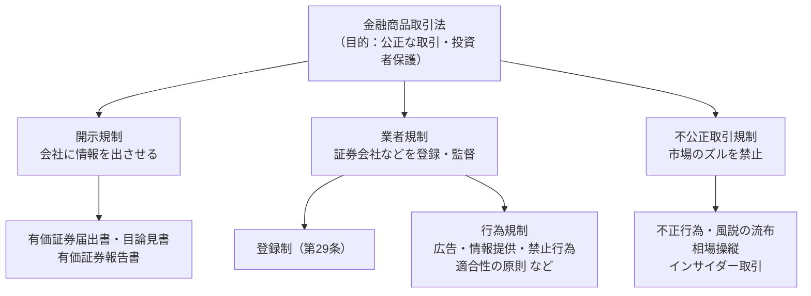

# 金融商品取引法のポイント

!!! abstract "3行でいうと"
    - **金融商品取引法（金商法）**は、株や債券などの取引を**公正**にし、**投資者を保護**するための、証券業務の土台となる法律です。
    - 中身は大きく、会社に情報を出させる**開示規制**、証券会社などを登録制にする**業者規制**、インサイダー取引や相場操縦を禁じる**不公正取引規制**の3本柱です。
    - 証券会社の営業には、広告・説明・禁止行為・適合性の原則などの**行為規制**がかかります。

## なぜ必要なの？

株や債券は、目に見える「モノ」ではなく、発行した会社の将来に対する**権利**です。投資する人は、会社の中身も、証券会社の売り方も、他の参加者の行動も、すべてを自分で確かめることはできません。

そのため、放っておくと次のような問題が起きます。

- 会社が都合の悪い情報を隠したまま、株を売り出す
- 登録も監督もされていない業者が、高リスクの商品を強引に売る
- 未公表の情報を知る人や、相場を操作する人だけが得をする

こうした状態では、誰も安心して市場にお金を出せません。金商法は第1条で、その目的を次のように定めています。

> この法律は、企業内容等の開示の制度を整備するとともに、金融商品取引業を行う者に関し必要な事項を定め、金融商品取引所の適切な運営を確保すること等により、有価証券の発行及び金融商品等の取引等を公正にし、有価証券の流通を円滑にするほか、資本市場の機能の十全な発揮による金融商品等の公正な価格形成等を図り、もつて国民経済の健全な発展及び投資者の保護に資することを目的とする。
> （金融商品取引法 第1条）[^fiea]

## しくみ：金商法の全体像

| 柱 | 誰が対象？ | 主な内容 | 主な条文 |
|---|---|---|---|
| 開示規制 | 株や債券を発行する会社など | 募集時の届出、毎年の有価証券報告書の提出 | 第4条、第24条 |
| 業者規制 | 証券会社などの金融商品取引業者 | 登録制、営業のルール（行為規制） | 第29条、第36条〜第40条 |
| 不公正取引規制 | **何人も**（すべての人） | 不正行為・相場操縦・インサイダー取引の禁止 | 第157条〜第159条、第166条ほか |

### 開示規制：投資判断の材料をそろえる

会社が一定規模以上の株や債券を広く売り出すとき（募集・売出し）は、事前に内閣総理大臣へ**有価証券届出書**を提出する必要があります（第4条）。投資家には、その内容をまとめた**目論見書**が交付されます（第13条・第15条）。

上場会社などは、毎事業年度、**事業年度経過後3か月以内**に**有価証券報告書**を提出します（第24条第1項）。提出された書類は公衆の縦覧に供され、誰でも見られます（第25条）。[^fiea]

### 業者規制：誰でも証券業を営めるわけではない

金融商品取引業は、**内閣総理大臣の登録**を受けた者でなければ行えません（第29条）。株式の売買の取次ぎなどを行う証券会社は、このうち「**第一種金融商品取引業**」（第28条第1項）の登録を受けています。無登録で金融商品取引業を行うと、刑事罰の対象になります（第197条第1項第4号の3）。[^fiea]

### 不公正取引規制：市場のズルを禁止する

不公正取引規制は、証券会社だけでなく**すべての人（何人も）**が対象です。

- **不正行為の禁止**（第157条）：不正の手段・計画・技巧、虚偽の表示を使った取引など
- **風説の流布・偽計の禁止**（第158条）：相場を動かす目的でうそのうわさを広めることなど
- **相場操縦の禁止**（第159条）：仮装売買・なれ合い売買や、取引を誘う目的で相場を動かす一連の売買など
- **インサイダー取引の禁止**（第166条・第167条）：詳しくは[インサイダー取引規制](insider-trading.md)

第157条〜第159条の違反（商品関連市場デリバティブ取引のみに係るものを除く）は、**10年以下の拘禁刑もしくは1,000万円以下の罰金、またはその両方**（第197条第1項第5号）。会社の業務として行われた場合、会社にも**7億円以下の罰金**が科されます（第207条第1項第1号）。[^fiea]

## 行為規制：証券会社の営業のルール

証券会社とその役職員が顧客と取引するときには、次のようなルールが課されています。

| ルール | 内容（要約） | 根拠 |
|---|---|---|
| 誠実公正義務 | 顧客の**最善の利益**を勘案しつつ、誠実かつ公正に業務を行う | 金融サービス提供法 第2条 |
| 広告等の規制 | 商号・登録番号・重要事項を表示する。利益の見込みなどについて、著しく事実と違う表示や誤認させる表示をしない | 第37条 |
| 契約締結前の情報提供・説明 | 契約前に、手数料やリスクなどの情報を提供し、顧客の知識・経験などに照らして理解されるように説明する | 第37条の3 |
| 契約締結時等の情報提供 | 契約が成立したときなどに、その内容を遅滞なく顧客に提供する | 第37条の4 |
| 禁止行為 | 虚偽の告知、**断定的判断の提供**（「必ず上がります」など）、一定の商品での不招請勧誘・再勧誘など | 第38条 |
| 損失補塡等の禁止 | 損失を穴埋めする約束や実行の禁止（顧客側から要求することも禁止） | 第39条 |
| 適合性の原則 | 顧客の知識・経験・財産の状況・契約目的に照らして不適当な勧誘をしない | 第40条 |

（「根拠」欄の条番号は、とくに断りのないものは金商法[^fiea]。金融サービス提供法は[^fsa-act]を参照）

適合性の原則と説明義務については、[適合性原則と説明義務](suitability.md)で詳しく解説しています。

!!! info "最近の主な改正"
    - **2024年11月1日**から、顧客に対する誠実公正義務は、金商法（旧第36条第1項）から「金融サービスの提供及び利用環境の整備等に関する法律」（金融サービス提供法）**第2条**に移り、「顧客等の**最善の利益**を勘案しつつ」誠実・公正に業務を行う義務として、銀行・保険なども含めた横断的なルールになりました。[^fsa-act]
    - **2025年4月1日**から、第37条の3は「契約締結前の**書面の交付**」から「契約締結前の**情報の提供**等」に改められ、顧客の知識・経験などに応じた**説明義務**も同条第2項に明記されました。

    この2つは、2023年11月に成立した「金融商品取引法等の一部を改正する法律」（令和5年法律第79号）による改正です。[^diet] このほか、2026年7月にも金商法の改正法（令和8年法律第64号）が公布され、2027年にかけて段階的に施行される予定です。施行日はいずれもe-Gov法令検索の改正履歴で確認しています。

[^fiea]: [e-Gov法令検索「金融商品取引法」](https://laws.e-gov.go.jp/law/323AC0000000025)（2026年8月12日施行時点の条文を確認）
[^fsa-act]: [e-Gov法令検索「金融サービスの提供及び利用環境の整備等に関する法律」第2条](https://laws.e-gov.go.jp/law/412AC0000000101)
[^diet]: [金融庁「第212回国会における金融庁関連法律案」](https://www.fsa.go.jp/common/diet/212/index.html)

## よくある誤解

!!! warning "誤解：金商法は証券会社だけが守るルール"
    行為規制は証券会社など業者向けのルールですが、インサイダー取引や相場操縦などの不公正取引規制は「**何人も**」が対象です。他部署の社員や個人投資家も例外ではありません。

!!! warning "誤解：書面の交付義務がなくなったので、説明は簡単でよい"
    2025年4月の改正で「書面の交付」は「情報の提供」に改められましたが、手数料やリスクなどを**顧客に理解されるように説明する義務**は第37条の3第2項に明記されました。電子化されても説明の重さは変わりません。

!!! warning "誤解：損をしたお客さまに会社が穴埋めするのは親切"
    損失補塡は第39条で**禁止**されています。一部の顧客だけを優遇することになり、市場の公正さを損なうためです。顧客の側から要求することも禁止されています。

!!! note "この記事について"
    この記事は制度の概要を紹介する一般的な解説で、個別の事案についての法的助言ではありません。実務での判断は、最新の法令・社内規程と所管部署の確認に基づいて行ってください。

## もっと知りたい人へ

- [e-Gov法令検索「金融商品取引法」](https://laws.e-gov.go.jp/law/323AC0000000025)：条文そのもの。第1条（目的）、第37条〜第40条（行為規制）、第157条〜第159条（不公正取引）
- [金融庁「金融商品取引業者等向けの総合的な監督指針」](https://www.fsa.go.jp/common/law/guide/kinyushohin.pdf)：金融庁が証券会社などを監督するときの着眼点。勧誘・説明態勢や広告規制の考え方
- [e-Gov法令検索「金融サービスの提供及び利用環境の整備等に関する法律」](https://laws.e-gov.go.jp/law/412AC0000000101)：誠実公正義務（第2条）や重要事項の説明義務（第4条）

## 関連記事・用語

- [適合性原則と説明義務](suitability.md)
- [インサイダー取引規制](insider-trading.md)
- [顧客本位の業務運営](fiduciary.md)
- [証券会社って何をしているの？](../basics/what-securities-company-does.md)
- [用語集](../glossary.md)
