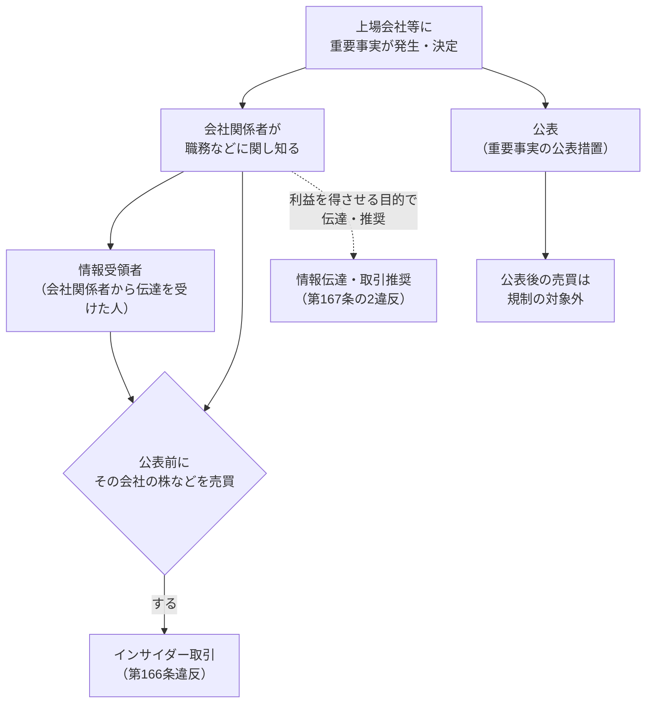

# インサイダー取引規制

!!! abstract "3行でいうと"
    - **インサイダー取引**とは、上場会社の**未公表の重要な情報**（重要事実）を知った**会社関係者など**が、その情報が**公表される前**にその会社の株などを売買することで、金融商品取引法で禁止されています。
    - 自分で売買しなくても、利益を得させる目的で**情報を伝えたり、売買を勧めたり**することも禁止されています（情報伝達・取引推奨規制）。
    - 違反すると**刑事罰**や**課徴金**の対象になります。証券会社の役職員には、未公表情報（**法人関係情報**）の取扱いについて、さらに厳しいルールがあります。

## なぜ必要なの？

たとえば、ある会社が他社を買収する予定だと、公表前に知っていたとします。公表されれば株価が大きく動く可能性が高いので、先回りして株を買えば、ほかの投資家よりも有利に利益を得られてしまいます。

こうした取引が許されると、「一部の人だけが得をする市場」になり、一般の投資家は安心して取引できなくなります。インサイダー取引規制は、**市場の公正さと、市場に対する信頼**を守るためのルールです。

## しくみ

### 会社関係者と情報受領者

金商法第166条第1項は、次のような人を「**会社関係者**」とし、それぞれの立場で重要事実を知った場合に、公表前の売買を禁止しています。[^fiea]

| 会社関係者（第166条第1項） | どのように知った場合か |
|---|---|
| 上場会社等（親会社・子会社を含む）の役員・従業員など | 職務に関し知ったとき |
| 帳簿閲覧権などを持つ株主など | 権利の行使に関し知ったとき |
| 法令に基づく権限を持つ人（許認可を行う公務員など） | 権限の行使に関し知ったとき |
| 契約を結んでいる人・交渉中の人（取引先、証券会社、弁護士など） | 契約の締結・交渉・履行に関し知ったとき |
| 上の株主や契約先が法人である場合の、その法人のほかの役員・従業員 | 職務に関し知ったとき |

- 会社関係者でなくなった後も、**1年以内**は同じく規制されます（第166条第1項後段）。
- 会社関係者から重要事実の**伝達を受けた人**（**第一次情報受領者**）も規制の対象です（第166条第3項）。

公開買付け（TOB）などについても、公開買付者側の関係者や情報受領者を対象とする同様の規制があります（第167条）。[^fiea]

### 重要事実とは

「重要事実」（第166条第2項）は、大きく次の4種類に分けられます。上場会社だけでなく、その**子会社**の事実も含まれます。[^fiea]

| 種類 | 例 |
|---|---|
| 決定事実 | 新株の発行、自己株式の取得、株式分割、合併、事業の譲渡、業務上の提携などを**決定**したこと |
| 発生事実 | 災害による損害、主要株主の異動、上場廃止の原因となる事実などが**発生**したこと |
| 決算情報 | 売上高・経常利益・純利益・配当の予想値が、直近の公表値から一定以上ずれたこと |
| バスケット条項 | 上記以外で、会社の運営・業務・財産に関する重要な事実であって、投資者の投資判断に**著しい影響**を及ぼすもの |

決定事実・発生事実の一部には、影響が軽微なものを除く「軽微基準」が内閣府令で定められています。一方、**バスケット条項**は個別に列挙されていない事実も広く対象にする規定です。

### 「公表」とは

規制が解けるのは、重要事実が「公表」された後です。公表には、次のような方法があります（第166条第4項、金融商品取引法施行令第30条）。[^fiea] [^rei]

- 会社の代表者などが、**2以上の報道機関**に公開してから**12時間**が経過したこと
- 上場している金融商品取引所に通知し、その内容が取引所を通じて**公衆の縦覧**に供されたこと（いわゆる適時開示）
- 重要事実が記載された有価証券報告書などが公衆の縦覧に供されたこと

## 情報伝達・取引推奨規制

会社関係者が、重要事実を知ったうえで、他人に**公表前に売買させて利益を得させる（または損失を避けさせる）目的**で、

- 重要事実を**伝達**すること
- その会社の株などの売買を**勧める**こと

は禁止されています（第167条の2第1項）。公開買付けについても同様の規定があります（同条第2項）。[^fiea]

刑事罰の対象となるのは、この違反によって情報を受けた人や勧められた人が、**実際に公表前に売買した場合**です（第197条の2第1項第14号）。ただし、たとえ売買されなくても、目的をもって伝達・推奨すること自体が法律で禁止された行為であることに変わりはありません。

## 違反するとどうなる？

| 区分 | 内容 | 根拠 |
|---|---|---|
| 刑事罰（個人） | **5年以下の拘禁刑もしくは500万円以下の罰金、またはその両方** | 第197条の2第1項第13号・第14号 |
| 刑事罰（法人） | 法人の業務として行われた場合、法人に**5億円以下の罰金** | 第207条第1項第2号 |
| 没収・追徴 | インサイダー取引で得た財産は原則として没収（できなければ追徴） | 第198条の2 |
| 課徴金 | 行政上の措置として、金銭の納付が命じられる | 第175条、第175条の2 |

（根拠の条番号はいずれも金商法[^fiea]）

## 証券会社で働く人として

証券会社は、引受けや投資銀行業務などを通じて、上場会社の未公表情報に接する機会があります。内閣府令は、上場会社等の運営・業務・財産に関する公表されていない重要な情報で、顧客の投資判断に影響を及ぼすものなどを「**法人関係情報**」と定義し（金融商品取引業等に関する内閣府令 第1条第4項第14号）、次のような行為を禁止しています。[^fu]

- 法人関係情報を**提供して勧誘する**こと（第117条第1項第14号）
- 公表前に売買させて顧客に利益を得させる目的で、売買を**勧めて勧誘する**こと（同項第14号の2）
- 法人関係情報に基づいて、**自己の計算で**売買すること（同項第16号）
- 顧客の注文がインサイダー取引規制に違反する（おそれがある）と知りながら、その注文を**受託する**こと（同項第13号）

また、法人関係情報の管理や顧客の取引の管理について、不公正な取引を防止するための**必要かつ適切な措置**を講じることが求められています（第123条第1項第5号）。部署間で情報を遮断する仕組み（情報隔壁）や、顧客の売買をチェックする売買審査は、このための取組みです。

## 公開事例から学ぶ注意点

証券取引等監視委員会（証券監視委）は、インサイダー取引などの課徴金勧告事案を分析した「**課徴金事例集～不公正取引編～**」を毎年公表しています。2026年6月23日公表の版（主に2025年4月〜2026年3月の勧告事案が対象）から、入門者が知っておきたいポイントを一般化してまとめます。[^sesc-2026]

- **身近な会話が入口になる**：プライベートな場での情報伝達の多くは、友人・同僚・取引先との**会食**の場で起きています。親族への近況報告として話したケースもあります。「インサイダーになるから売買しないように」と一言添えても、伝えた内容によっては規制の対象になり得るとされています。
- **直接の担当者でなくても知ってしまう**：アクセス制限の設定漏れがあった共有フォルダや、廃棄を頼まれた資料、預かった封筒の書類などから、本来知る立場にない社員が情報を知った事例が紹介されています。
- **公開買付け（TOB）事案が最も多い**：これまでの勧告件数では、公開買付けに関する事案が最多です。公表前に多くの関係者と情報を共有する必要があり、公表までに時間がかかることが多いため、と分析されています。
- **「何番目に聞いたか」だけでは決まらない**：職務上の情報共有を経て、発行会社から数えて4番目に情報を知った人が、第一次情報受領者として違反とされた例が紹介されています。
- **列挙されていない事実も重要事実になり得る**：工事不良による建物の建て替え、検査数値の改ざん、不適切な会計処理の判明などが、バスケット条項に該当するとされた例があります。
- **少額取引や他人名義の口座でも発覚する**：証券監視委は取引所や証券会社と連携して売買データを分析しており、取引の規模にかかわらず調査対象になるとしています。家族や友人であっても証券口座の貸し借りは厳禁とされています。

2025年度（令和7年度）に証券監視委が行った不公正取引に関する課徴金勧告は**18件**で、上場会社の社員が職務上知った情報で売買した事案や、契約締結者の役職員などから伝達を受けた人の事案が含まれています。[^sesc-2026]

[^fiea]: [e-Gov法令検索「金融商品取引法」](https://laws.e-gov.go.jp/law/323AC0000000025)（第166条、第167条、第167条の2、第175条、第175条の2、第197条の2、第198条の2、第207条）
[^rei]: [e-Gov法令検索「金融商品取引法施行令」第30条](https://laws.e-gov.go.jp/law/340CO0000000321)
[^fu]: [e-Gov法令検索「金融商品取引業等に関する内閣府令」](https://laws.e-gov.go.jp/law/419M60000002052)（第1条第4項第14号、第117条第1項第13号〜第16号、第123条第1項第5号）
[^sesc-2026]: [証券取引等監視委員会「金融商品取引法における課徴金事例集～不公正取引編～」の公表について（令和8年6月23日）](https://www.fsa.go.jp/sesc/jirei/torichou/20260623.html)

## よくある誤解

!!! warning "誤解：利益が出なければインサイダー取引にならない"
    第166条が禁止しているのは、重要事実の公表前に**売買等をすること**そのものです。結果として利益が出たかどうかは関係ありません。

!!! warning "誤解：会社を辞めれば関係ない"
    会社関係者でなくなった後も、**1年以内**は規制の対象です（第166条第1項後段）。

!!! warning "誤解：家族や知人の名義で取引すれば分からない"
    他人名義の口座を使った取引も、証券監視委の調査で真の取引者が特定されています。名義を借りること・貸すことは、それ自体が大きな問題になります。

!!! warning "誤解：自分が売買しなければ、話すだけなら問題ない"
    利益を得させる目的で重要事実を伝えたり売買を勧めたりすることは、**情報伝達・取引推奨規制**（第167条の2）で禁止されています。

!!! note "この記事について"
    この記事は制度の概要を紹介する一般的な解説で、個別の取引が規制に当たるかどうかの法的助言ではありません。迷ったときは売買せず、所属先のコンプライアンス部門に相談してください。

## もっと知りたい人へ

- [証券取引等監視委員会「課徴金事例集・開示検査事例集」](https://www.fsa.go.jp/sesc/jirei/index.html)：過去の課徴金事例集の一覧。具体的な事例とコラムで注意点を解説
- [e-Gov法令検索「金融商品取引法」](https://laws.e-gov.go.jp/law/323AC0000000025)：第166条（会社関係者の禁止行為）、第167条（公開買付者等関係者）、第167条の2（情報伝達・取引推奨）
- [e-Gov法令検索「金融商品取引業等に関する内閣府令」](https://laws.e-gov.go.jp/law/419M60000002052)：第117条（証券会社などの禁止行為。法人関係情報に関する規定を含む）

## 関連記事・用語

- [金融商品取引法のポイント](fiea.md)
- [株式](../products/stocks.md)
- [株価はどう決まる？：板・気配・値幅制限](../market/price-formation.md)
- [用語集](../glossary.md)
