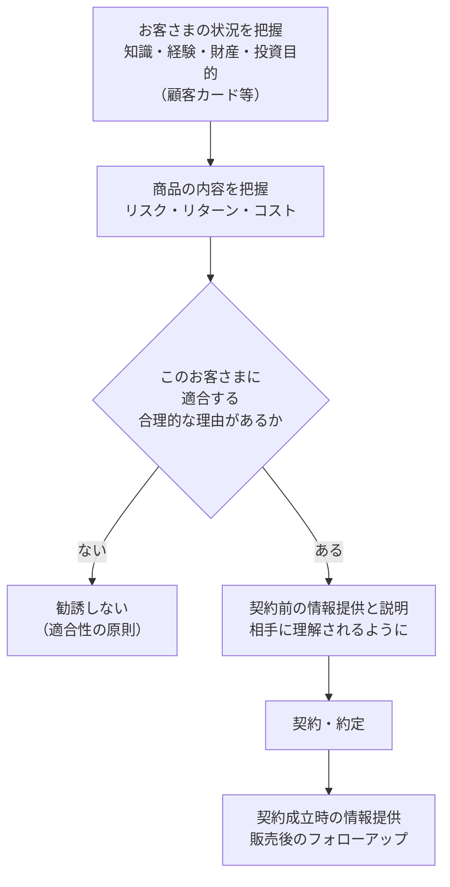

# 適合性原則と説明義務

!!! abstract "3行でいうと"
    - **適合性の原則**：お客さまの知識・経験・財産の状況・投資目的に照らして、**合わない商品を勧めてはいけない**というルールです（金融商品取引法第40条）。
    - **説明義務**：契約の前に手数料やリスクなどの情報を提供し、そのお客さまに**理解されるように説明**しなければなりません（金商法第37条の3、金融サービス提供法第4条）。
    - **高齢のお客さま**には、日本証券業協会の規則・ガイドラインに基づき、より慎重な勧誘の手続きがとられます。

## なぜ必要なの？

証券会社とお客さまの間には、商品の知識や情報の量に大きな差（**情報の非対称性**）があります。

- 仕組みが複雑な商品やリスクの高い商品を、その意味が分からないまま買ってしまう
- 生活資金を、元本割れの可能性が大きい商品に回してしまう
- 説明を受けたつもりでも、肝心のリスクや手数料を理解していない

このようなことが起きないように、「**誰に何を勧めてよいか**」（適合性の原則）と「**どう説明するか**」（説明義務）の両面からルールが設けられています。

口座開設のときにお客さまの投資経験や資産の状況を確認するのも、このためです（確認の流れは[口座開設：本人確認と適合性の原則](../flow/account-opening.md)を参照）。この記事では、その情報を使って**勧誘・販売する場面**のルールを見ていきます。

## しくみ：勧誘から契約までの流れ

## 適合性の原則（狭義・広義）

金融商品取引法第40条第1号は、次のような状況にならないよう業務を行うことを求めています。

> 金融商品取引行為について、顧客の知識、経験、財産の状況及び金融商品取引契約を締結する目的に照らして不適当と認められる勧誘を行つて投資者の保護に欠けることとなつており、又は欠けることとなるおそれがあること。
> （金融商品取引法 第40条第1号）[^fiea]

適合性の原則には、**狭義**と**広義**の2つの意味があるとされています。[^fsa-2006]

| 区分 | 考え方 | イメージ |
|---|---|---|
| 狭義の適合性原則 | ある特定のお客さまには、どれほど説明を尽くしても、一定の商品を販売・勧誘してはならない | 「この方には、この商品はそもそも勧めない」 |
| 広義の適合性原則 | お客さまの知識・経験・財産・投資目的などに**適合した形**で勧誘・販売を行わなければならない | 「勧めるなら、この方に合ったやり方・説明で」 |

金融庁の監督指針は、適合性原則を守るための態勢として、たとえば次のような点を挙げています（要約）。[^fsa-gl]

- 取り扱う商品のリスク・リターン・コストなどを分析し、勧誘する役職員が正確に理解していること
- 顧客カード等でお客さまの投資目的などを把握し、変化があれば確認のうえ登録内容を更新すること
- 商品の内容がお客さまの属性に適合する**合理的な理由**があるかを検討・評価すること

## 説明義務：契約前の情報提供

### 金融商品取引法の情報提供・説明義務

証券会社などは、契約を結ぶ前に、次のような事項の情報をお客さまに提供しなければなりません（第37条の3第1項）。[^fiea]

- 業者の商号・住所、登録番号
- 契約の概要
- 手数料・報酬など、お客さまが支払う対価
- 金利・為替・相場などの変動で**損失が生じるおそれ**があるときはその旨
- その損失が預けた証拠金などの額を**上回るおそれ**があるときはその旨

さらに同条第2項は、これらの事項（一部を除く）について、お客さまの**知識・経験・財産の状況・契約の目的**に照らして、**そのお客さまに理解されるために必要な方法と程度**で説明することを求めています。

!!! info "「契約締結前交付書面」から「情報の提供」へ"
    以前の第37条の3は「契約締結前の**書面の交付**」という見出しで、この書面は「**契約締結前交付書面**」と呼ばれてきました。2025年4月1日の改正（令和5年法律第79号）で「契約締結前の**情報の提供**等」に改められ、紙の書面に限らない形での情報提供が前提になるとともに、説明義務が条文に明記されました。実務や監督指針では、今も「契約締結前交付書面」という言葉が使われることがあります。[^fiea] [^fsa-gl]

あわせて、不確実なことについて「**必ず値上がりします**」のような**断定的判断を提供して勧誘すること**は禁止されています（第38条第2号）。[^fiea]

### 金融サービス提供法の説明義務

「金融サービスの提供及び利用環境の整備等に関する法律」（金融サービス提供法）第4条も、金融商品を販売するまでの間に、**元本欠損が生ずるおそれ**とその原因となる指標（相場・金利・為替など）や取引の仕組みの重要な部分などの「**重要事項**」を説明するよう定めています。その説明も、お客さまの知識・経験・財産の状況・契約目的に照らして、理解されるために必要な方法・程度で行う必要があります（同条第2項）。

重要事項を説明しなかったときや、断定的判断を提供したときは、販売業者はお客さまに生じた**損害を賠償する責任**を負い（第6条）、元本欠損額がその損害額と**推定**されます（第7条）。[^fsa-act]

## 高齢顧客への勧誘に関するルール

金融庁の監督指針は、高齢のお客さまについて、過去の投資経験が十分でも、身体的な衰えに加えて短期間で投資判断能力が変化する場合もあるとして、適合性の原則に基づく**慎重な勧誘・販売態勢**と、問題のある勧誘を早期に見つける**モニタリング態勢**、販売後の**丁寧なフォローアップ**を求めています。[^fsa-gl]

その具体的な目安となるのが、日本証券業協会の「協会員の投資勧誘、顧客管理等に関する規則」**第5条の3**と、その考え方を示した「**高齢顧客への勧誘による販売に係るガイドライン**」です。各証券会社はこれを踏まえて社内規則を定めます。ガイドラインの主な考え方は次のとおりです。[^jsda-kourei]

- **75歳以上**を高齢顧客の目安とし、そのうち**80歳以上**を、より慎重な勧誘による販売が必要なお客さまの目安とする
- 価格変動が小さく仕組みが単純な商品などと、それ以外の「**勧誘留意商品**」を区別し、勧誘留意商品の勧誘には**役席者（管理職）の事前承認**などの手続きを設ける
- お客さまからの自発的な注文（勧誘を伴わないもの）は対象外

!!! note "協会ガイドラインの確認について"
    日本証券業協会のサイトは本記事の執筆時に閲覧できなかったため、上記のガイドラインの内容は公開資料の検索結果と、ガイドラインに言及する金融庁監督指針に基づいて要約しています。具体的な手続きは、ガイドライン原文と各社の社内規則で確認してください。

[^fiea]: [e-Gov法令検索「金融商品取引法」](https://laws.e-gov.go.jp/law/323AC0000000025)（第37条の3、第38条、第40条）
[^fsa-2006]: [金融庁「中間論点整理 ～適合性原則を踏まえた保険商品の販売・勧誘のあり方～」（平成18年3月1日）](https://www.fsa.go.jp/news/newsj/17/hoken/f-20060301-1.pdf)：金融審議会第一部会「中間整理（第一次）」を引用して狭義・広義を整理
[^fsa-gl]: [金融庁「金融商品取引業者等向けの総合的な監督指針」（令和8年10月版）](https://www.fsa.go.jp/common/law/guide/kinyushohin.pdf)：Ⅲ－２－３－２－１（適合性原則）、Ⅲ－２－３－２－４（顧客に対する説明態勢）、Ⅳ－３－１－２（３）（高齢顧客への勧誘に係る留意事項）
[^fsa-act]: [e-Gov法令検索「金融サービスの提供及び利用環境の整備等に関する法律」](https://laws.e-gov.go.jp/law/412AC0000000101)（第4条、第6条、第7条）
[^jsda-kourei]: [日本証券業協会「協会員の投資勧誘、顧客管理等に関する規則第５条の３の考え方（高齢顧客への勧誘による販売に係るガイドライン）」](https://www.jsda.or.jp/shijyo/seido/jishukisei/web-handbook/101_kanri/files/koureikokyaku_20210801.pdf)

## よくある誤解

!!! warning "誤解：資料を渡せば説明したことになる"
    情報を提供するだけでなく、そのお客さまの知識・経験などに照らして**理解されるために必要な方法と程度**で説明することが求められます（金商法第37条の3第2項、金融サービス提供法第4条第2項）。

!!! warning "誤解：お客さまが「買いたい」と言えば、適合性は関係ない"
    適合性の原則は「不適当と認められる**勧誘**」を問題にするルールですが、証券会社には顧客の属性を把握し、商品が適合する合理的な理由があるかを検討する態勢が求められています。勧誘する側が説明を尽くしても、そもそも勧めてはいけない場合（狭義の適合性原則）もあります。

!!! warning "誤解：75歳になったら投資商品を買えなくなる"
    75歳・80歳という年齢は協会ガイドラインの**目安**で、取引を一律に禁止するものではありません。慎重な勧誘の手続きを踏むためのもので、具体的な運用は各社の社内規則によります。

!!! note "この記事について"
    この記事は制度の概要を紹介する一般的な解説で、個別の事案についての法的助言ではありません。

## もっと知りたい人へ

- [e-Gov法令検索「金融商品取引法」](https://laws.e-gov.go.jp/law/323AC0000000025)：第37条の3（契約締結前の情報の提供等）、第40条（適合性の原則等）
- [e-Gov法令検索「金融サービスの提供及び利用環境の整備等に関する法律」](https://laws.e-gov.go.jp/law/412AC0000000101)：第4条（重要事項の説明義務）、第6条・第7条（損害賠償と損害額の推定）
- [金融庁「金融商品取引業者等向けの総合的な監督指針」](https://www.fsa.go.jp/common/law/guide/kinyushohin.pdf)：適合性原則・説明態勢・高齢顧客への勧誘について、監督上の着眼点
- [日本証券業協会「高齢顧客への勧誘による販売に係るガイドライン」](https://www.jsda.or.jp/shijyo/seido/jishukisei/web-handbook/101_kanri/files/koureikokyaku_20210801.pdf)：高齢顧客の目安や勧誘留意商品の考え方

## 関連記事・用語

- [口座開設：本人確認と適合性の原則](../flow/account-opening.md)
- [金融商品取引法のポイント](fiea.md)
- [顧客本位の業務運営](fiduciary.md)
- [投資信託](../products/investment-trusts.md)
- [デリバティブ入門](../products/derivatives.md)
- [用語集](../glossary.md)
