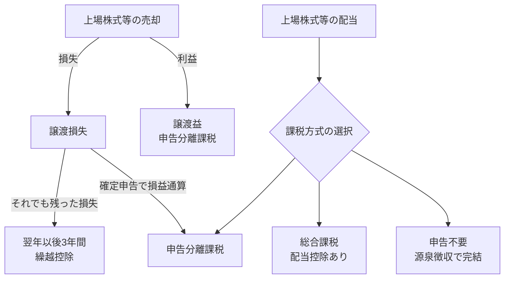

# 譲渡益・配当の課税と損益通算

!!! abstract "3行でいうと"
    - 上場株式等を売った利益（**譲渡益**）は、ほかの所得と分けて課税され（**申告分離課税**）、税率は**所得税15%＋住民税5%**に、所得税の**2.1%分の復興特別所得税**が上乗せされます（2026年分）。
    - 上場株式等の**配当**は、源泉徴収で済ませる「**申告不要**」のほか、「**総合課税**」「**申告分離課税**」から選べます（大口株主等を除く）。
    - 売却で出た損失は、確定申告をすれば配当などと**相殺（損益通算）**でき、残った損失は**翌年以後3年間繰り越す**ことができます。

!!! note "この記事について"
    この記事は制度の一般的な説明であり、個別の税務相談に代わるものではありません。例の金額は説明用の単純な数字です。実際の判断は国税庁の案内を確認するか、税務署・税理士にご相談ください。

## なぜ必要なの？

証券会社の窓口やコールセンターには、「利益が出たら税金はいくら？」「損をした年はどうなるの？」という質問がよく寄せられます。税金の計算そのものはお客さまご自身（または特定口座の仕組み）が行うものですが、**基本的な考え方を知っていると、書類の意味や手続きの流れが理解しやすく**なります。

株式の税金で大事なのは次の3点です。

1. 売却益（譲渡益）にかかる税金
2. 配当にかかる税金と、その選び方
3. 損失が出たときの扱い（損益通算・繰越控除）

## しくみ

### 上場株式等の譲渡益課税

上場株式等の譲渡益は、給与などとは分けて税額を計算する**申告分離課税**です。税率は次のとおりです。[^nta-1463]

| 税目 | 税率（2026年分） |
|---|---|
| 所得税 | 15% |
| 復興特別所得税 | 所得税額 × 2.1%（＝ 譲渡益の 0.315%） |
| 住民税 | 5% |
| 合計 | 20.315% |

復興特別所得税は、平成25年（2013年）から令和29年（2047年）までの各年分について、所得税と併せて申告・納付します。[^nta-1463]

!!! info "2027年（令和9年）1月からの変更"
    2027年1月1日以後に生じる所得については、**復興特別所得税の税率が 1.1% に引き下げられ**、新たに**防衛特別所得税（所得税額の 1% 相当）**が併せて源泉徴収されます。[^nta-1330][^nta-1476] 所得税15%に対する上乗せ分は「1.1%＋1%」となり、合計すると従来の2.1%と同じ水準になる計算ですが、**内訳と名称が変わります**。書類や画面の表示が変わる可能性があるため、最新の案内を確認してください。

**例（説明用の数字）**：100万円で買った株を120万円で売った（手数料は考えない）

- 譲渡益：120万円 − 100万円 ＝ 20万円
- 税額：20万円 × 20.315% ＝ 40,630円

なお、上場株式等と**一般株式等（非上場株式など）は別々のグループ**として計算し、原則として両者の損益は相殺できません。[^nta-1465]

### 配当の課税方式

上場株式等の配当は、受け取るときに税金が差し引かれます（源泉徴収）。大口株主等以外の場合、2026年分は**所得税・復興特別所得税 15.315%** と**住民税 5%** です。[^nta-1330]

そのうえで、次の3つから課税方式を選べます。[^nta-1330]

| 方式 | 内容 | ポイント |
|---|---|---|
| 申告不要 | 源泉徴収だけで済ませる | 金額にかかわらず選べる。ただし源泉徴収された税額を所得税額から差し引くことはできない |
| 総合課税 | 給与などと合算して申告 | 一定のものを除き**配当控除**が受けられる |
| 申告分離課税 | 他の所得と分けて申告 | **上場株式等の譲渡損失と損益通算**できる |

!!! note "大口株主等の場合"
    発行済株式等の総数の **3%以上**を持つ個人などの「大口株主等」が受け取る上場株式等の配当は、**総合課税**の対象で、申告不要や申告分離課税は選べません。源泉徴収の税率も異なります（所得税・復興特別所得税 20.42%）。[^nta-1330]

## 損益通算と繰越控除

### 損益通算：同じ年の利益と損失を相殺する

上場株式等を証券会社などを通じて売って出た損失は、確定申告をすれば、**同じ年の上場株式等の配当等（申告分離課税を選んだもの）**や、他の上場株式等の譲渡益と相殺できます。[^nta-1465][^nta-1474]

**例（説明用の数字）**：ある年に

- A株の売却で **30万円の損失**
- B株の売却で **10万円の利益**
- 上場株式の配当が **5万円**（申告分離課税を選択）

→ 合計すると 10万 ＋ 5万 − 30万 ＝ **15万円の損失**。この年の譲渡益と配当にかかる税金はゼロとなり、すでに源泉徴収されていた分は確定申告の中で精算されます。残った15万円の損失は、次に説明する繰越控除の対象になります。

!!! warning "相殺できないもの"
    上場株式等の譲渡損失は、**給与所得など他の種類の所得とは相殺できません**。また、他の所得の赤字を株式の譲渡益から差し引くこともできません。[^nta-1465] NISA口座の損失や、相対取引（取引所や証券会社を通さない売買）の損失も、通算・繰越の対象外です。[^nta-1474]

### 繰越控除：残った損失を翌年以降に持ち越す

損益通算をしても引ききれない損失は、**翌年以後3年間**にわたって、上場株式等の譲渡益や配当等（申告分離課税）から差し引けます。[^nta-1474]

上の例の15万円の損失を翌年に繰り越し、翌年に20万円の譲渡益が出た場合、課税対象は 20万 − 15万 ＝ **5万円** になります。

繰越控除を受けるには、**損失が出た年に確定申告**をし、その後も**連続して確定申告**をする必要があります。売却がなかった年も、損失を繰り越すための申告が必要です。[^nta-1474]

[^nta-1463]: [国税庁 タックスアンサー No.1463「株式等を譲渡したときの課税（申告分離課税）」](https://www.nta.go.jp/taxes/shiraberu/taxanswer/shotoku/1463.htm)（令和8年4月1日現在法令等）
[^nta-1330]: [国税庁 タックスアンサー No.1330「配当金を受け取ったとき（配当所得）」](https://www.nta.go.jp/taxes/shiraberu/taxanswer/shotoku/1330.htm)（令和8年4月1日現在法令等）
[^nta-1465]: [国税庁 タックスアンサー No.1465「株式等の譲渡損失（赤字）の取扱い」](https://www.nta.go.jp/taxes/shiraberu/taxanswer/shotoku/1465.htm)
[^nta-1474]: [国税庁 タックスアンサー No.1474「上場株式等に係る譲渡損失の損益通算及び繰越控除」](https://www.nta.go.jp/taxes/shiraberu/taxanswer/shotoku/1474.htm)（令和8年4月1日現在法令等）
[^nta-1476]: [国税庁 タックスアンサー No.1476「特定口座制度」](https://www.nta.go.jp/taxes/shiraberu/taxanswer/shotoku/1476.htm)（令和8年4月1日現在法令等）

## よくある誤解

!!! warning "誤解：株で損をしたら、給与の税金も減る"
    上場株式等の譲渡損失は、給与所得など他の種類の所得とは相殺できません。相殺できるのは、上場株式等の譲渡益や、申告分離課税を選んだ上場株式等の配当等です。[^nta-1465]

!!! warning "誤解：配当と売却損は、どの課税方式でも相殺できる"
    譲渡損失と相殺できるのは、**申告分離課税を選んだ**配当です。総合課税や申告不要を選んだ配当とは相殺できません。[^nta-1474]

!!! warning "誤解：損失は自動的に3年間繰り越される"
    繰越には毎年の確定申告が必要です。途中で申告をやめると、繰り越せなくなります。[^nta-1474]

## もっと知りたい人へ

- [国税庁 タックスアンサー No.1463](https://www.nta.go.jp/taxes/shiraberu/taxanswer/shotoku/1463.htm)：株式等の譲渡の申告分離課税と税率
- [国税庁 タックスアンサー No.1330](https://www.nta.go.jp/taxes/shiraberu/taxanswer/shotoku/1330.htm)：配当所得の課税方式と源泉徴収税率
- [国税庁 タックスアンサー No.1465](https://www.nta.go.jp/taxes/shiraberu/taxanswer/shotoku/1465.htm)：株式等の譲渡損失の取扱いの全体像
- [国税庁 タックスアンサー No.1474](https://www.nta.go.jp/taxes/shiraberu/taxanswer/shotoku/1474.htm)：損益通算と繰越控除の要件

## 関連記事・用語

- [特定口座と一般口座](specified-account.md)
- [NISAの仕組み](nisa.md)
- [株式](../products/stocks.md)
- [約定から決済まで：T+2とは](../flow/settlement-t2.md)（配当の権利確定）
- [税金](index.md)
- [用語集](../glossary.md)（申告分離課税・損益通算・繰越控除）
