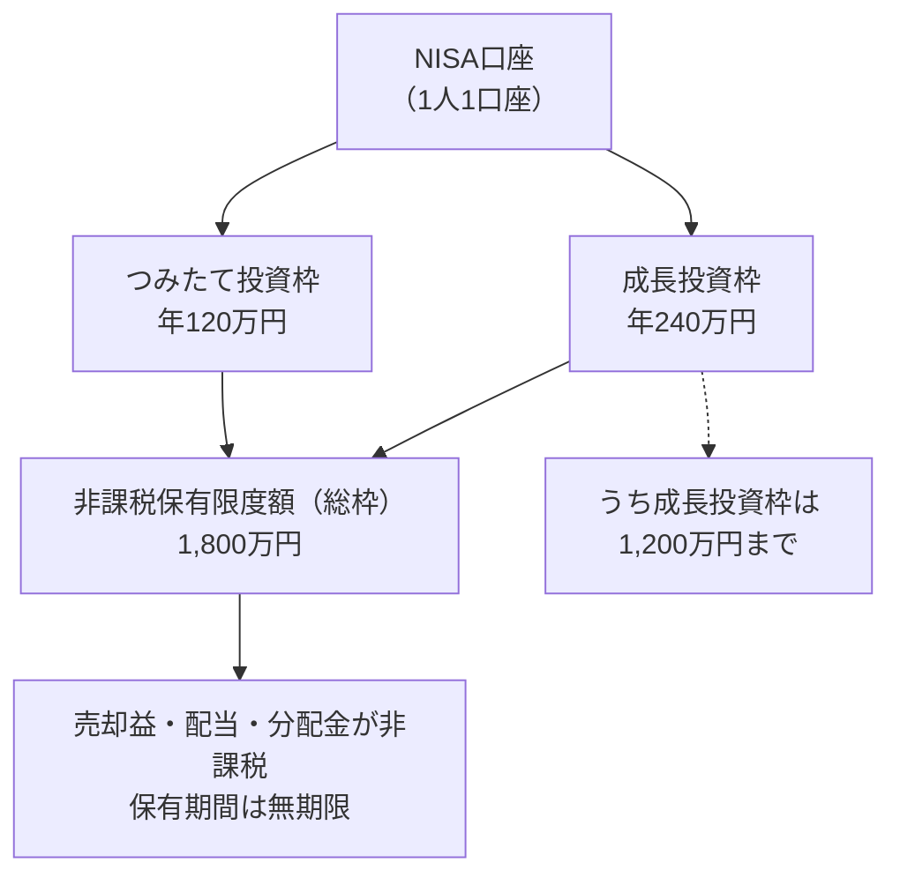

# NISAの仕組み

!!! abstract "3行でいうと"
    - **NISA（少額投資非課税制度）**は、専用の口座（NISA口座）で買った株式や投資信託の**売却益・配当・分配金に税金がかからない**制度です。
    - 2024年からのNISAは、**つみたて投資枠（年120万円）**と**成長投資枠（年240万円）**を併用でき、生涯の**非課税保有限度額は1,800万円**（うち成長投資枠は1,200万円）です。
    - 2027年1月からは、つみたて投資枠の年齢要件がなくなり、**0〜17歳の未成年者も**一定の条件のもとで利用できるようになります。

!!! note "この記事について"
    この記事は制度の一般的な説明であり、特定の商品の購入や制度の利用を勧めるものではありません。また、個別の税務相談に代わるものでもありません。例の金額は説明用の単純な数字です。

## なぜ必要なの？

通常、株式や投資信託を売って得た利益や、受け取った配当には**約20%**の税金がかかります（詳しくは[譲渡益・配当の課税と損益通算](capital-gains.md)）。[^fsa-nisa]

NISAは、少額から投資をする個人のために、一定の金額までの投資から得られる利益を非課税にする制度として、2014年1月に始まりました。イギリスの ISA（個人貯蓄口座）をモデルにしています。[^fsa-nisa] 2024年1月からは制度が大きく見直され、**非課税で保有できる期間が無期限**になり、**制度自体も恒久化**されました。[^fsa-nisa]

## しくみ

### 2つの投資枠

| | つみたて投資枠 | 成長投資枠 |
|---|---|---|
| 年間投資枠 | 120万円 | 240万円 |
| 非課税保有限度額 | 合計 1,800万円 | うち 1,200万円まで |
| 非課税保有期間 | 無期限 | 無期限 |
| 主な対象商品 | 長期の積立・分散投資に適した一定の投資信託 | 上場株式・投資信託など（一部除外あり） |
| 併用 | 可能 | 可能 |

出典：金融庁 NISA特設ウェブサイト[^fsa-nisa]、国税庁 No.1535[^nta-1535]

- 2つの枠は**併用でき**、年間で合計**360万円**まで投資できます。[^fsa-nisa]
- 成長投資枠では、**整理・監理銘柄**や、**信託期間20年未満・毎月分配型の投資信託、デリバティブ取引を用いた一定の投資信託**などは対象外です。[^fsa-nisa]
- つみたて投資枠の対象商品は、金融庁のウェブサイトで一覧が公表されています。[^fsa-nisa]

### 非課税保有限度額と枠の再利用

非課税保有限度額（総枠）は、**買ったときの金額（簿価）**で管理されます。NISA口座で保有する商品を売ると、**翌年以降**、売った商品の簿価の分だけ総枠が復活し、再び使えるようになります。[^fsa-nisa]

**例（説明用の数字）**：NISA口座で100万円で買った投資信託を、値上がりして130万円で売った場合

- 売却益30万円には税金がかかりません。
- 翌年以降に復活する総枠は、売却額の130万円ではなく**簿価の100万円**です。
- ただし年間投資枠（つみたて120万円・成長240万円）の上限は別に適用されます。

### 誰が使えるの？

- **現在**：日本国内に住む、**利用する年の1月1日時点で18歳以上**の人が対象です。口座は**1人1口座**で、金融機関の変更は年単位で可能です。[^fsa-nisa]
- **2027年1月から**：つみたて投資枠の年齢要件が撤廃され、**0〜17歳の未成年者もNISA口座を開設できる**ようになります。[^fsa-nisa]

!!! info "2027年1月からの未成年者のNISA"
    金融庁の案内では、未成年者の利用には次の条件があります。[^fsa-nisa]

    - 利用できるのは**つみたて投資枠のみ**（成長投資枠は利用できない）
    - **年間投資枠 60万円、非課税保有限度額 600万円**
    - **金融機関の変更はできない**
    - 0〜17歳の間は原則として**払い出しができない**（災害などやむを得ない場合や、12歳以降に一定の要件を満たす場合を除く）

    これは令和8年度税制改正で決まった見直しです。[^mof-r8]詳細な手続きは今後の金融庁・各金融機関の案内を確認してください。

### 2023年までのNISAとの関係

2023年までの一般NISA・つみたてNISAで投資した商品は、2024年からのNISAの1,800万円の**外枠**で管理され、それまでの制度の非課税措置が引き続き適用されます。[^fsa-nisa]

## 注意点

NISAの「非課税」には、次のような注意点があります。

- **損失は「なかったもの」とみなされる**：NISA口座で売却損が出ても、税務上は損失がないものとして扱われます。そのため、特定口座・一般口座の利益や配当と**損益通算することも、繰越控除することもできません**。[^nta-1535][^nta-1474]
- **上場株式の配当は受け取り方に注意**：NISA口座で持つ上場株式の配当が非課税になるのは、配当を証券会社経由で受け取る「**株式数比例配分方式**」を選んでいる場合です。それ以外の方法で受け取ると課税されます。[^nta-1535]
- **元本が保証されるわけではない**：非課税になるのは「利益」に対する税金です。投資した商品の値下がりによる損失がなくなるわけではありません。
- **売却しても損益がなくなるわけではない**：枠の再利用は「枠」が復活するだけで、売却時の損益そのものは発生します。[^fsa-nisa]

[^fsa-nisa]: [金融庁 NISA特設ウェブサイト「NISAを知る」](https://www.fsa.go.jp/policy/nisa2/know/index.html)
[^nta-1535]: [国税庁 タックスアンサー No.1535「NISA制度」](https://www.nta.go.jp/taxes/shiraberu/taxanswer/shotoku/1535.htm)（令和8年4月1日現在法令等）
[^nta-1474]: [国税庁 タックスアンサー No.1474「上場株式等に係る譲渡損失の損益通算及び繰越控除」](https://www.nta.go.jp/taxes/shiraberu/taxanswer/shotoku/1474.htm)（令和8年4月1日現在法令等）
[^mof-r8]: [財務省「令和８年度税制改正の大綱の概要」](https://www.mof.go.jp/tax_policy/tax_reform/outline/fy2026/08taikou_gaiyou.htm)（個人所得課税「NISAの拡充」）

## よくある誤解

!!! warning "誤解：NISAで損をしたら、ほかの口座の利益と相殺できる"
    NISA口座の損失は税務上「なかったもの」とされるため、他の口座の利益と相殺（損益通算）できず、翌年以降への繰越もできません。[^nta-1535]

!!! warning "誤解：NISA口座で持っている株の配当は、どう受け取っても非課税"
    上場株式の配当が非課税になるのは、株式数比例配分方式で受け取る場合に限られます。[^nta-1535]

!!! warning "誤解：売ったら、その年のうちに売った分の枠がすぐ戻る"
    総枠が復活するのは**翌年以降**で、復活するのは売却額ではなく**簿価（買ったときの金額）**の分です。[^fsa-nisa]

!!! warning "誤解：NISA口座は複数の金融機関で作れる"
    NISA口座は1人1口座です。金融機関の変更は年単位で可能です（2027年1月からの未成年者の口座は変更不可）。[^fsa-nisa]

## もっと知りたい人へ

- [金融庁 NISA特設ウェブサイト「NISAを知る」](https://www.fsa.go.jp/policy/nisa2/know/index.html)：制度の概要、投資枠、2027年1月からの年齢要件撤廃
- [国税庁 タックスアンサー No.1535「NISA制度」](https://www.nta.go.jp/taxes/shiraberu/taxanswer/shotoku/1535.htm)：税法上の扱い（配当の受取方法、損失の扱い）
- [国税庁 タックスアンサー No.1474](https://www.nta.go.jp/taxes/shiraberu/taxanswer/shotoku/1474.htm)：NISA口座の損失が通算・繰越の対象外であること

## 関連記事・用語

- [特定口座と一般口座](specified-account.md)
- [譲渡益・配当の課税と損益通算](capital-gains.md)
- [投資信託](../products/investment-trusts.md)
- [税金](index.md)
- [用語集](../glossary.md)（NISA・非課税保有限度額・株式数比例配分方式）
