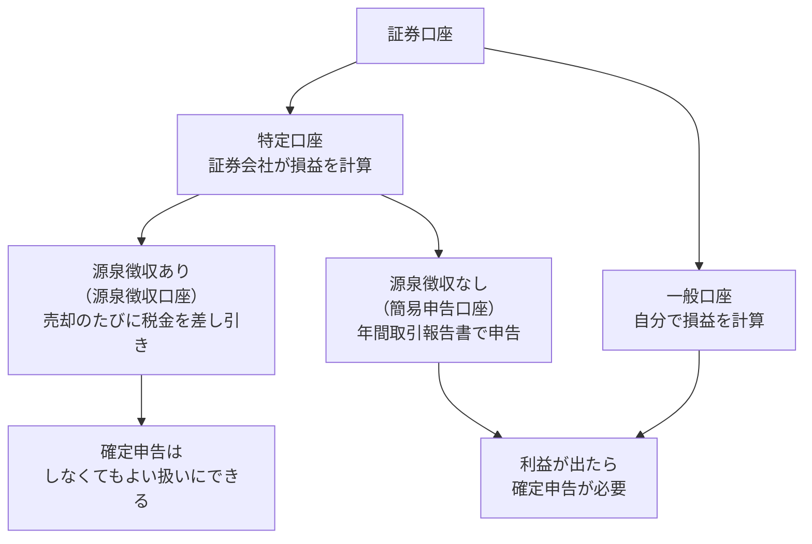

# 特定口座と一般口座

!!! abstract "3行でいうと"
    - 株式などを売って得た利益には税金がかかります。その**計算を証券会社が代わりに行う**口座が**特定口座**、自分で計算する口座が**一般口座**です。
    - 特定口座には「**源泉徴収あり**」と「**源泉徴収なし**」があり、「あり」を選ぶと税金の納付まで証券会社経由で済み、確定申告をしなくてもよい扱いにできます。
    - ただし、**損失を翌年以降に繰り越す**場合や、**複数の口座の損益を合算する**場合などは、確定申告が必要です。

!!! note "この記事について"
    この記事は制度の一般的な説明であり、個別の税務相談に代わるものではありません。例の金額は説明用の単純な数字です。実際の判断は国税庁の案内を確認するか、税務署・税理士にご相談ください。

## なぜ必要なの？

上場株式などを売って利益（譲渡益）が出ると、ほかの所得とは分けて税金を計算する「申告分離課税」の対象になります。[^nta-1463] 本来は、1年分の売買をすべて集計し、取得価額（買ったときの値段）や手数料を差し引いて利益を計算し、確定申告をする必要があります。

売買の回数が多い人にとって、この計算はとても手間がかかります。そこで、**証券会社が1年間の損益を計算して「特定口座年間取引報告書」を作る**仕組みとして、特定口座制度が設けられています。[^nta-1476]

## しくみ

### 口座の種類と違い

| | 特定口座（源泉徴収あり） | 特定口座（源泉徴収なし） | 一般口座 |
|---|---|---|---|
| 損益の計算 | 証券会社 | 証券会社 | 自分 |
| 年間取引報告書 | 交付される | 交付される | なし |
| 税金の納付 | 証券会社が源泉徴収して納付 | 確定申告で自分で納付 | 確定申告で自分で納付 |
| 確定申告 | 不要とすることができる | 原則必要（利益が出た場合） | 原則必要（利益が出た場合） |

- 特定口座は、**1つの証券会社（金融商品取引業者等）につき1口座**です（一定の未成年者向け口座を除く）。[^nta-1476]
- 源泉徴収ありにするには、その年の最初の売却までに「特定口座源泉徴収選択届出書」を証券会社に出します。選んだ方式は**その年の途中では変えられません**。[^nta-1476]

### 源泉徴収ありの場合の税率

源泉徴収口座では、売却して利益が出るたびに、2026年（令和8年）分は**所得税・復興特別所得税 15.315%** と**住民税 5%** が差し引かれます。[^nta-1476]

!!! info "2027年（令和9年）1月からの内訳の変更"
    2027年1月1日以後に生じる所得については、**復興特別所得税の税率が 1.1% に下がり**、新たに**防衛特別所得税（所得税額の 1% 相当）**が併せて源泉徴収されることになっています。[^nta-1476] 内訳と名称が変わる点に注意してください（詳しくは[譲渡益・配当の課税と損益通算](capital-gains.md)）。

**例（説明用の数字）**：源泉徴収ありの特定口座で、株を売って **10万円の利益**が出た場合（2026年分）

- 所得税・復興特別所得税：10万円 × 15.315% ＝ 15,315円
- 住民税：10万円 × 5% ＝ 5,000円
- 手取りの利益：10万円 − 20,315円 ＝ 79,685円

実際の源泉徴収税額は、売却のたびに法令で定められた一定の計算方法で算出されます（この例は考え方を示すための単純化です）。[^nta-1476]

### 配当も特定口座で受け取れる

源泉徴収ありの特定口座では、届出をすれば上場株式等の配当などを口座に受け入れることができます。こうすると、**同じ口座の売却損と配当を差し引きしたうえで**源泉徴収税額が計算されます。[^nta-1476] 配当の課税のしかたは[譲渡益・配当の課税と損益通算](capital-gains.md)で説明しています。

## 確定申告が必要なケース

源泉徴収ありの特定口座でも、次のような場合は確定申告が必要です。[^nta-1476][^nta-1474]

- **ほかの口座の損益と合算したい**（例：A社の口座は利益、B社の口座は損失）
- **損失を翌年以降に繰り越したい**（上場株式等の譲渡損失は、確定申告をすれば翌年以後3年間繰り越せます）

一方で、源泉徴収なしの特定口座や一般口座で利益が出た場合は、原則として確定申告で税金を納めます。

!!! tip "申告するかどうかは口座ごとに選ぶ"
    源泉徴収ありの特定口座を確定申告に含めるかどうかは、**口座ごとに**選びます。その口座の譲渡損失を申告する場合は、その口座で受け入れた配当なども併せて申告する必要があります。[^nta-1476]

[^nta-1463]: [国税庁 タックスアンサー No.1463「株式等を譲渡したときの課税（申告分離課税）」](https://www.nta.go.jp/taxes/shiraberu/taxanswer/shotoku/1463.htm)（令和8年4月1日現在法令等）
[^nta-1476]: [国税庁 タックスアンサー No.1476「特定口座制度」](https://www.nta.go.jp/taxes/shiraberu/taxanswer/shotoku/1476.htm)（令和8年4月1日現在法令等）
[^nta-1474]: [国税庁 タックスアンサー No.1474「上場株式等に係る譲渡損失の損益通算及び繰越控除」](https://www.nta.go.jp/taxes/shiraberu/taxanswer/shotoku/1474.htm)（令和8年4月1日現在法令等）

## よくある誤解

!!! warning "誤解：特定口座なら、どんな場合でも確定申告はいらない"
    確定申告が不要とできるのは「源泉徴収あり」の特定口座の場合です。「源泉徴収なし」では利益が出れば原則申告が必要です。また、源泉徴収ありでも、損失の繰越や他の口座との損益通算をしたいときは申告が必要です。

!!! warning "誤解：損失が出た年は何もしなくても翌年に繰り越せる"
    損失の繰越控除を使うには、損失が出た年に確定申告をし、その後も**連続して**確定申告をする必要があります。売却がなかった年も、繰り越すための申告が必要です。[^nta-1474]

!!! warning "誤解：特定口座は証券会社ごとに何口座でも作れる"
    特定口座は1つの証券会社につき1口座です。[^nta-1476]

## もっと知りたい人へ

- [国税庁 タックスアンサー No.1476「特定口座制度」](https://www.nta.go.jp/taxes/shiraberu/taxanswer/shotoku/1476.htm)：特定口座の種類、源泉徴収の選択、配当の受入れ、申告の要否
- [国税庁 タックスアンサー No.1463「株式等を譲渡したときの課税（申告分離課税）」](https://www.nta.go.jp/taxes/shiraberu/taxanswer/shotoku/1463.htm)：株式の譲渡益の課税の基本
- [国税庁 タックスアンサー No.1474「上場株式等に係る譲渡損失の損益通算及び繰越控除」](https://www.nta.go.jp/taxes/shiraberu/taxanswer/shotoku/1474.htm)：損失の通算と繰越の要件

## 関連記事・用語

- [譲渡益・配当の課税と損益通算](capital-gains.md)
- [NISAの仕組み](nisa.md)
- [口座開設：本人確認と適合性の原則](../flow/account-opening.md)
- [税金](index.md)
- [用語集](../glossary.md)（特定口座・源泉徴収・確定申告）
