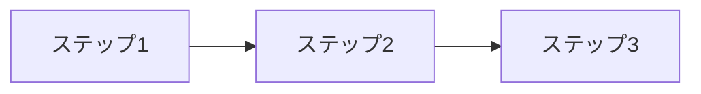

# 記事タイトル

!!! abstract "3行でいうと"
    - 結論1
    - 結論2
    - 結論3

## なぜ必要なの？

背景・目的を、業務経験のない人にも分かる言葉で書く。

## しくみ

図解を入れる（Mermaid が使えます）。

## よくある誤解

!!! warning "誤解：〇〇"
    正しくは××です。

## もっと知りたい人へ

- [出典名](https://example.com/)：何が書いてあるかを一言で

## 関連記事・用語

- [関連記事](../flow/index.md)
- [用語集](../glossary.md)

<!--
執筆チェックリスト
[ ] 個別銘柄・個別商品の推奨や、売買を勧める表現になっていない
[ ] 日証協規則・JPX資料・書籍の文章を転載していない（要約と出典リンクのみ）
[ ] 社内固有の情報（手順書・システム名・事例）を含んでいない
[ ] 数値・制度は一次情報で確認し、last_reviewed を更新した
-->
